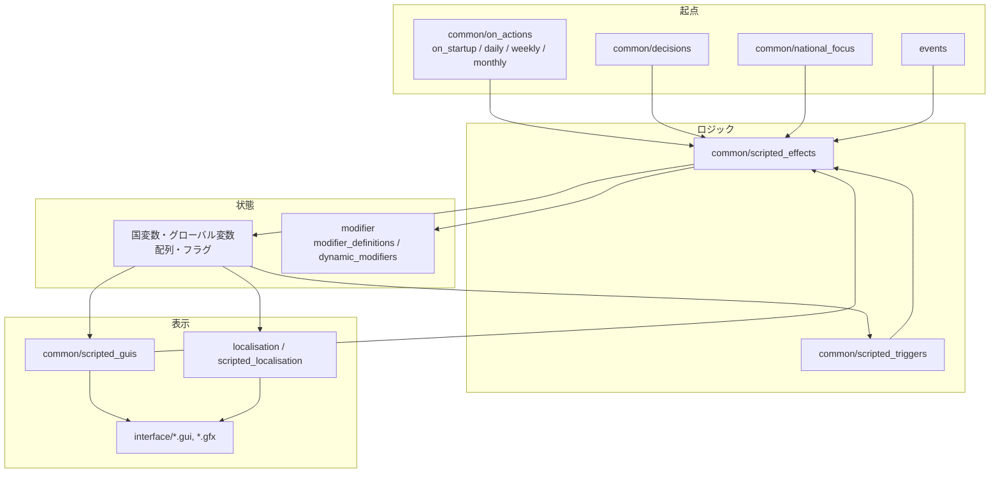

# 02 アーキテクチャ

BSMはバニラの主要フォルダを `replace_path` で丸ごと差し替えるトータルコンバージョンで、独自システムの大半は on_action を起点に scripted effect を呼び、scripted GUI と国変数で状態を表示する構成を取る。

## バニラとの関係

`descriptor.mod` には `replace_path` が56行ある。バニラのファイルを部分的に上書きするのではなく、次の領域はMOD側の内容だけが読み込まれる（[descriptor.mod:9](../../bakasekai/descriptor.mod#L9)）。

| 領域 | 代表的な置換先 |
|---|---|
| AI | `common/ai_focuses`, `ai_areas`, `ai_equipment`, `ai_strategy`, `ai_strategy_plans`, `ai_templates` |
| 国家 | `common/country_tags`, `countries`, `characters`, `ideas`, `national_focus`, `continuous_focus`, `bookmarks` |
| スクリプト基盤 | `common/on_actions`, `decisions`, `scripted_effects`, `scripted_triggers`, `scripted_localisation`, `events` |
| 歴史とマップ | `history/`, `map`, `map/strategicregions` |

置換の対象外である `interface/` は同名ファイルによる上書きになる。バニラ更新時に不足が生じやすいのはこの領域で、1.19系への追従作業は [HOI4_1_19_4_COMPATIBILITY_2026-10-29.md](../HOI4_1_19_4_COMPATIBILITY_2026-10-29.md) に記録がある。詳細な一覧は [13-map-assets-localisation](13-map-assets-localisation.md) を参照。

`replace_path` はフォルダ単位の完全置換なので、バニラの定義を使い続けたい場合はMOD側へ取り込む必要がある。`common/operations` は、BSMの国家方針やscripted effectと対応させるために置換している（[descriptor.mod:36](../../bakasekai/descriptor.mod#L36)）。`common/ai_focuses` は置換対象だがMOD側にフォルダがなく（[descriptor.mod:8](../../bakasekai/descriptor.mod#L8)）、バニラのAI方針定義は読み込まれない。

## 実行モデル

### on_action が駆動の中心

同じ on_action を複数ファイルで定義でき、BSMは役割ごとにファイルを分けている。

| ファイル | 定義している on_action |
|---|---|
| [00_on_actions.txt](../../bakasekai/common/on_actions/00_on_actions.txt#L2) | startup, monthly, declare_war, yearly, weekly, peaceconference_ended |
| [_bsm_system.txt](../../bakasekai/common/on_actions/_bsm_system.txt#L2) | startup, monthly, daily, weekly, bi_yearly, nuke_drop, state_control_changed, declare_war |
| [bsm_economic_alliance_on_actions.txt](../../bakasekai/common/on_actions/bsm_economic_alliance_on_actions.txt#L3) | startup, weekly, monthly |
| [_bsm_fallen_empire_on_actions.txt](../../bakasekai/common/on_actions/_bsm_fallen_empire_on_actions.txt#L3) | startup, monthly |
| [_bsm_quiz_on_actions.txt](../../bakasekai/common/on_actions/_bsm_quiz_on_actions.txt#L2) | yearly |
| [BSM_End_war.txt](../../bakasekai/common/on_actions/BSM_End_war.txt#L2) | puppet |

中心となる `_bsm_system.txt` の処理は次のとおり。

- `on_startup`: 月カウンタのグローバル変数を設定し（[_bsm_system.txt:6](../../bakasekai/common/on_actions/_bsm_system.txt#L6)）、各システムを初期化する。ステラリス要素、アノマリー探検隊、特殊研究は全国家ループで初期化し（[_bsm_system.txt:41](../../bakasekai/common/on_actions/_bsm_system.txt#L41)）、経済同盟は `random_country` で1回だけ初期化する（[_bsm_system.txt:47](../../bakasekai/common/on_actions/_bsm_system.txt#L47)）。
- `on_daily`: 統一通貨の補正計算と汎用modifier更新を行う（[_bsm_system.txt:441](../../bakasekai/common/on_actions/_bsm_system.txt#L441)）。
- `on_weekly`: 文明度を上げ、文明度を国家統合力へ加算し、特性スロットと伝統コストを更新する（[_bsm_system.txt:450](../../bakasekai/common/on_actions/_bsm_system.txt#L450)）。
- `on_monthly`: 通貨や鉱山の月次処理を呼ぶ（[_bsm_system.txt:379](../../bakasekai/common/on_actions/_bsm_system.txt#L379)）。

### 初期化は1回だけ実行する

グローバル配列を構築する初期化を全国家ループに入れると、処理が国家数倍に膨らむ。`AS_first_setting` は全国家ループ内で実行したために起動が数時間止まる不具合を起こした経緯があり、現在は `AS_initialized` フラグと `random_country` で1回だけ実行する（[_bsm_system.txt:21](../../bakasekai/common/on_actions/_bsm_system.txt#L21)）。新しいシステムの初期化も同じ形にする。

`on_startup` の effect はスコープが `None` である。グローバル配列を操作する処理は、単一の国スコープに入ってから実行する（[_bsm_system.txt:29](../../bakasekai/common/on_actions/_bsm_system.txt#L29)）。

## 命名規則

| 種類 | 規則 | 例 |
|---|---|---|
| システムファイル | `_bsm_` 接頭辞（[AGENTS.md:15](../../AGENTS.md#L15)） | `_bsm_mine.txt` |
| 国別ファイル | 既存の3文字タグ | `FRA_scenario_effects.txt`, `JAP_scripted_effects.txt` |
| イデオロギー | `*_ideology` を使う。バニラのキーへ戻さない（[AGENTS.md:16](../../AGENTS.md#L16)） | `democratic_ideology` |
| ブランチ | `type/scope_name`（[AGENTS.md:8](../../AGENTS.md#L8)） | `feature/_system_harvest` |

既存ファイルには `_bsm_`（191件）、`bsm_`（70件）、`BSM_`（41件）の表記揺れがある（`common/`, `events/`, `interface/` を集計）。規約上の推奨は `_bsm_` だが、既存ファイルの改名は参照を壊すため行わない。

## 主要ディレクトリの依存関係

| 変更するもの | 同時に確認するもの |
|---|---|
| 国タグ | `common/countries/`, `history/countries/`, `localisation/japanese/`, 国旗 |
| 国家方針 | `localisation/japanese/`, `gfx` のアイコンと `interface/*.gfx` |
| GUI | `common/scripted_guis/`, `interface/*.gfx`, 生成器が出力したファイルかどうか（[14-gui-tooling-ci](14-gui-tooling-ci.md)） |
| ステート | `history/states/`, `map/`, `common/state_category/` |

## 関連ページ

- [01-overview](01-overview.md)
- [03-development-guide](03-development-guide.md)
- [10-civilization-and-resources](10-civilization-and-resources.md)
- [11-gameplay-systems](11-gameplay-systems.md)
