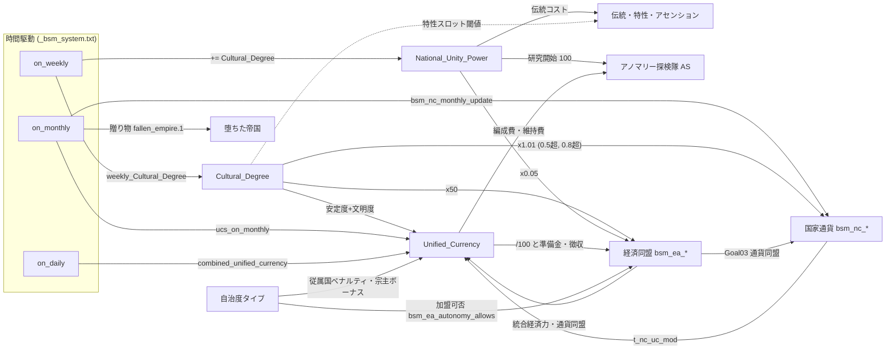
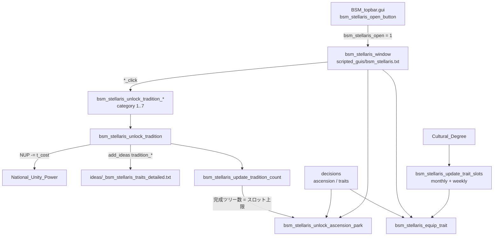
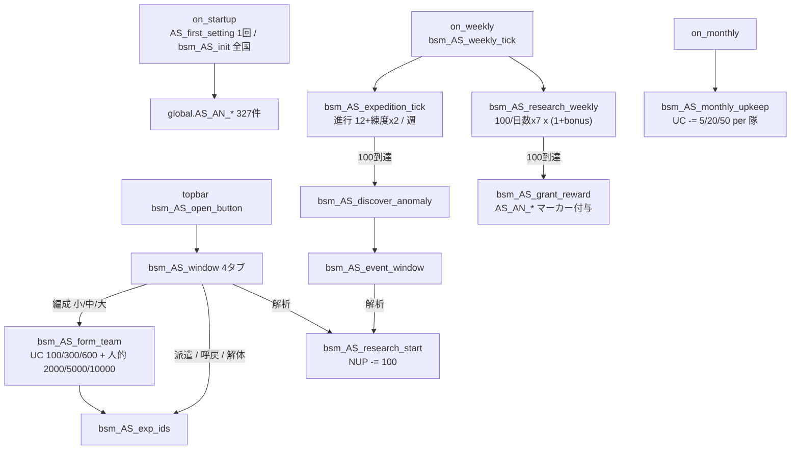
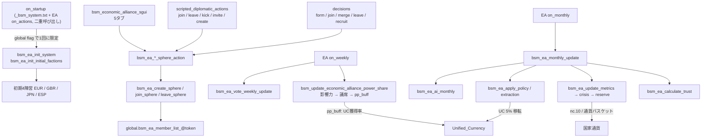

# 10 文明度・資源・経済同盟

文明度、国家統合力、統一通貨、国家通貨、ステラリス要素（伝統・特性・アセンション・アノマリー探検隊）、堕ちた帝国、経済同盟、自治度タイプの実装を扱う。記述は静的に読んだコードに基づき、ゲームは起動していない。既存ドキュメントと食い違う点は各節の「ドキュメント差異」と末尾の「未確認」に分けて記す。

## 0. 先に知っておくこと

- **`AS` はアノマリー探検隊システム（Anomaly System）の接頭辞で、自治州ではない。** `bsm_AS.gui` と `bsm_AS_*` は探検隊とアノマリー解析のウィンドウと処理（[bsm_AS.gui:13](../../bakasekai/interface/bsm_AS.gui#L13)）。自治度タイプは `common/autonomous_states/` にある（8節）。
- **`Cultural_Degree` は 0〜1 の小数で保持され、表示時に `|0%` で百分率になる**（[bsm_system_l_japanese.yml:8](../../bakasekai/localisation/japanese/bakasekai/bsm_system_l_japanese.yml#L8)）。初期値は `modifier@base_Cultural_Degree` の0.05前後（[00_on_actions.txt:82](../../bakasekai/common/on_actions/00_on_actions.txt#L82)）。ステラリス系の閾値（30/50/80/100）はこの尺度と一致しない（1節）。
- **発火頻度の前提が未確認。** リポジトリ内の設計文書は `on_daily/weekly/monthly` を「全体で1回」と前提する（[bsm_economic_alliance_v2_documentation.md:206](../00_coding_contexts/bsm_economic_alliance_v2_documentation.md#L206)）。一方バニラの `on_weekly` は国スコープの条件を直接書いており（Steamのバニラ `common/on_actions/05_lar_on_actions.txt` 1445行付近、`has_intelligence_agency = yes` を条件に持つ）、国ごとに発火する可能性がある。本ページは設計文書の前提で書く。

## システム間依存



実線は実装済みの参照、破線は尺度不整合で通常は成立しない参照を示す。

## 1. 文明度 (`Cultural_Degree`)

**目的**: 国の文化水準。統一通貨・GDP・国家通貨・経済同盟の信頼度に係数として入り、国家統合力の毎週の加算量でもある。

**主要変数**: `Cultural_Degree`, `Cultural_Degree_Last_Week_gain`。modifier は `weekly_Cultural_Degree`（週次増分）と `base_Cultural_Degree`（初期値）（[_bsm_core.txt:1](../../bakasekai/common/modifier_definitions/_bsm_core.txt#L1)）。

**データフロー**

1. 起動時: 非MYS国は `Cultural_Degree = modifier@base_Cultural_Degree`（[00_on_actions.txt:82](../../bakasekai/common/on_actions/00_on_actions.txt#L82)）。人間国のみ -1〜1 にクランプし、動的modifier `civ_research_buff` と `bsm_uc_factor` を付与する（[00_on_actions.txt:101](../../bakasekai/common/on_actions/00_on_actions.txt#L101)）。
2. 毎週: `Cultural_Degree += modifier@weekly_Cultural_Degree`、直後に `National_Unity_Power += Cultural_Degree`（[_bsm_system.txt:454](../../bakasekai/common/on_actions/_bsm_system.txt#L454)）。
3. `weekly_Cultural_Degree` を与える定義は、確認できた範囲でPOSの国民精神（+0.03）のみ（[POS.txt:140](../../bakasekai/common/ideas/POS.txt#L140)）。`base_Cultural_Degree` は起動時の初期化以外で読まれない。

**参照側（尺度に注意）**

| 参照先 | 条件・式 | 想定尺度 | 出典 |
|---|---|---|---|
| 統一通貨 | `(民需工場+1) x (安定度+文明度)` | 0〜1 | [_bsm_Unified_Currency.txt:30](../../bakasekai/common/scripted_effects/_bsm_Unified_Currency.txt#L30) |
| GDP | `(民需+1) x (安定度x0.6+0.4+文明度)` | 0〜1 | [_bsm_econ_gdp.txt:37](../../bakasekai/common/scripted_effects/_bsm_econ_gdp.txt#L37) |
| 国家通貨 | `>0.5` と `>0.8` でレート係数それぞれ x1.01 | 0〜1 | [_bsm_national_currency.txt:849](../../bakasekai/common/scripted_effects/_bsm_national_currency.txt#L849) |
| 経済同盟 | 信頼度に `文明度 x 50` | 0〜1 | [bsm_ea_goals_effects.txt:127](../../bakasekai/common/scripted_effects/bsm_ea_goals_effects.txt#L127) |
| `civ_research_buff` | 研究速度・政治力・安定度の各 factor に文明度を直接代入（人間国のみ） | 0〜1 | [bsm_dynamic_modifiers.txt:1](../../bakasekai/common/dynamic_modifiers/bsm_dynamic_modifiers.txt#L1) |
| 特性スロット | 30→1、50→3、80→5、100→6 | 0〜100 | [_bsm_stellaris_effects.txt:60](../../bakasekai/common/scripted_effects/_bsm_stellaris_effects.txt#L60) |
| アノマリー解禁 | 20/40/60/80（トリガー定義のみで呼び出しなし） | 0〜100 | [_bsm_stellaris_triggers.txt:9](../../bakasekai/common/scripted_triggers/_bsm_stellaris_triggers.txt#L9) |
| 特殊研究 | 50 または 70 以上 | 0〜100 | [_bsm_special_research_effects.txt:387](../../bakasekai/common/scripted_effects/_bsm_special_research_effects.txt#L387) |

**ドキュメント差異**

- [civilization_degree_system.md](../civilization_degree_system.md) は 0〜100% を前提に書かれているが、コアの式（統一通貨・国家通貨・経済同盟）は 0〜1 前提。ステラリス・特殊研究側だけ 0〜100 前提で、同一変数に2つの尺度が混在している。
- 小数尺度のままだと、特性スロット閾値（30以上）は通常到達しない。到達しうる経路は旧アノマリー報酬の `Cultural_Degree += 2/4/6/8`（[_bsm_stellaris_anomaly_integration.txt:18](../../bakasekai/common/scripted_effects/_bsm_stellaris_anomaly_integration.txt#L18)）だが、その経路自体が到達不能（5.2節）。
- 同文書の「伝統・特性・アセンションパークによる文明度加算」（文明伝統 +5% など）に対応する実装は見つからない。伝統・特性・パークのアイデアは `Cultural_Degree` を触らない（[_bsm_stellaris_traits_detailed.txt:14](../../bakasekai/common/ideas/_bsm_stellaris_traits_detailed.txt#L14)）。
- AI国には `civ_research_buff` が付かない（人間国のみ付与、前掲 00_on_actions.txt:101）。

## 2. 国家統合力 (`National_Unity_Power`)

**目的**: 伝統の取得とアノマリー研究の開始に消費する政治リソース。

**主要変数**: `National_Unity_Power`, `National_Unity_Power_Last_Week_gain`（表示用、[_bsm_system.txt:461](../../bakasekai/common/on_actions/_bsm_system.txt#L461)）。

| 区分 | 内容 | 出典 |
|---|---|---|
| 初期値 | 通常 10、MYS は 100 | [00_on_actions.txt:85](../../bakasekai/common/on_actions/00_on_actions.txt#L85), [:97](../../bakasekai/common/on_actions/00_on_actions.txt#L97) |
| 獲得（定常） | 毎週 `+= Cultural_Degree`（0〜1尺度なら週0.05程度） | [_bsm_system.txt:464](../../bakasekai/common/on_actions/_bsm_system.txt#L464) |
| 獲得（個別） | 特殊研究 +75、POS国家方針・決定 +10〜50 | [_bsm_special_research_effects.txt:701](../../bakasekai/common/scripted_effects/_bsm_special_research_effects.txt#L701), [POS.txt:352](../../bakasekai/common/national_focus/POS.txt#L352) |
| 消費 | 伝統 `100+25x取得数`（上限600、思想適性で x0.75） | [_bsm_stellaris_effects.txt:87](../../bakasekai/common/scripted_effects/_bsm_stellaris_effects.txt#L87) |
| 消費 | AS研究開始 100 | [_bsm_AS_expedition.txt:346](../../bakasekai/common/scripted_effects/_bsm_AS_expedition.txt#L346) |
| 参照 | 経済同盟の信頼度に `x0.05` | [bsm_ea_goals_effects.txt:129](../../bakasekai/common/scripted_effects/bsm_ea_goals_effects.txt#L129) |

**ドキュメント差異**

- [national_unity_power_system.md](../national_unity_power_system.md) と [README_systems.md](../README_systems.md) は「毎日のmodifierで獲得」とするが、`daily_National_Unity_Power_gain` と `National_Unity_Power_gain_factor` を読む effect は存在しない（定義・アイデア・ローカライズだけ。[_bsm_core.txt:13](../../bakasekai/common/modifier_definitions/_bsm_core.txt#L13)、[_bsm_system.txt:38](../../bakasekai/common/ideas/_bsm_system.txt#L38)）。modifierを足しても統合力は増えない。
- 伝統コストは文書の固定100/75ではなく、取得数に比例して上がる（5.1節）。
- 探検隊の統合力50消費は、旧経路の関数にだけ残っている（5.2節）。現行の探検隊は統一通貨で編成する。

## 3. 統一通貨 (`Unified_Currency`)

**目的**: 国の経済力を1つの数値で表す通貨。探検隊編成、経済同盟の結成・加盟・投資、準備金に使う。

**主要変数**: `Unified_Currency`（月次加算時に ±100000 でクランプ）, `Unified_Currency_Last_Month_gain`, `ucs_war_month_counter`, `ucs_required_ec`, `ucs_state_limit`, `unified_economic_power_bonus`。modifier は `Unified_Currency_gain_factor / war_factor / religion_factor`（[_bsm_core.txt:25](../../bakasekai/common/modifier_definitions/_bsm_core.txt#L25)）。

**データフロー**

- 起動: `ucs_first_setting` が 0 に初期化し、6か月分を加算（[_bsm_Unified_Currency.txt:8](../../bakasekai/common/scripted_effects/_bsm_Unified_Currency.txt#L8)）。呼び出しは [_bsm_system.txt:296](../../bakasekai/common/on_actions/_bsm_system.txt#L296)。
- **毎月**: `ucs_on_monthly`（[_bsm_system.txt:395](../../bakasekai/common/on_actions/_bsm_system.txt#L395)）が `ucs_add_Unified_Currency_month` を呼び、直後にペナルティ判定と同盟ボーナスを更新する（[_bsm_Unified_Currency.txt:372](../../bakasekai/common/scripted_effects/_bsm_Unified_Currency.txt#L372)）。
- 毎日: `combined_unified_currency` が `Unified_Currency_war_factor + religion_factor` を `combined_uc_factor` に集計するだけ（[_bsm_Unified_Currency.txt:519](../../bakasekai/common/scripted_effects/_bsm_Unified_Currency.txt#L519)）。これを動的modifier `bsm_uc_factor` が `Unified_Currency_gain_factor` に変換する（[bsm_dynamic_modifiers.txt:23](../../bakasekai/common/dynamic_modifiers/bsm_dynamic_modifiers.txt#L23)）。付与は人間国のみ。
- 領土失陥: `on_state_control_changed` で `ucs_on_dairy_effects` が `(war_factor+安定度+文明度+戦争支持率) x 0.05 x UC` を減算（[_bsm_system.txt:617](../../bakasekai/common/on_actions/_bsm_system.txt#L617), [_bsm_Unified_Currency.txt:491](../../bakasekai/common/scripted_effects/_bsm_Unified_Currency.txt#L491)）。

**月次加算の式**（[_bsm_Unified_Currency.txt:25](../../bakasekai/common/scripted_effects/_bsm_Unified_Currency.txt#L25) 以降）

```
基礎  = [(民需工場+1) x (安定度+文明度) x Σ{人口(m) x インフラ項} - 配備兵力(k)/1000 x ステート数] / 100
係数  = 1 + gain_factor + 生産効率x0.5 + 消費財x0.5 + 戦時 + 同盟 + 従属 + 宗主 + 為替
加算  = 基礎 x 係数    (月次は x1、起動時は x6)
```

- インフラ項は `インフラx1.25 + 飛行場x1.1 + 港湾x0.8` に `max = 1.0` が付く（[:57](../../bakasekai/common/scripted_effects/_bsm_Unified_Currency.txt#L57)）。`max` の解釈は「未確認」に記載。
- 戦時: `-0.015 x 戦時月数 x (1 - 戦争支持率x0.5)`（[:93](../../bakasekai/common/scripted_effects/_bsm_Unified_Currency.txt#L93)）。
- 従属国ペナルティ: 自治度タイプ別に -0.30 / -0.24 / -0.18 / -0.10 / -0.05 / -0.02、未分類は -0.15。宗主が `ucs_distribute_profit` を持てば +0.15（[:129](../../bakasekai/common/scripted_effects/_bsm_Unified_Currency.txt#L129)）。
- 宗主ボーナス: 従属国ごとに統合傀儡 +0.08、傀儡 +0.05、植民地 +0.03、自治領 +0.01、その他 +0.05。分配ON時は半減（[:291](../../bakasekai/common/scripted_effects/_bsm_Unified_Currency.txt#L291)）。
- 国家通貨の為替補正 `t_nc_uc_mod` を係数に加算し、係数は最低 0.1（従属補正後）と 0.05（為替補正後）で下限を取る（[:330](../../bakasekai/common/scripted_effects/_bsm_Unified_Currency.txt#L330), [:333](../../bakasekai/common/scripted_effects/_bsm_Unified_Currency.txt#L333)）。

**月次ペナルティ**: `ucs_required_ec = 工場数x50` を下回ると安定度 -10%（[:391](../../bakasekai/common/scripted_effects/_bsm_Unified_Currency.txt#L391)）。`ucs_state_limit = round(UC/1000 + 5)` をステート数が超えると政治力獲得 -20%・安定度 -5%（[:426](../../bakasekai/common/scripted_effects/_bsm_Unified_Currency.txt#L426), [bsm_dynamic_modifiers.txt:49](../../bakasekai/common/dynamic_modifiers/bsm_dynamic_modifiers.txt#L49)）。

**経済同盟連携**: 所属陣営（`bsm_ea_sphere` の1つ目のみ）の加盟国の工場合計 / 5000 を `unified_economic_power_bonus` とし、動的modifierで工場出力と研究速度に反映する（[:463](../../bakasekai/common/scripted_effects/_bsm_Unified_Currency.txt#L463), [bsm_dynamic_modifiers.txt:56](../../bakasekai/common/dynamic_modifiers/bsm_dynamic_modifiers.txt#L56)）。

| ファイル | 役割 |
|---|---|
| [_bsm_Unified_Currency.txt](../../bakasekai/common/scripted_effects/_bsm_Unified_Currency.txt) | 加算・ペナルティ・失陥・同盟ボーナス |
| [_bsm_system.txt](../../bakasekai/common/on_actions/_bsm_system.txt) | 呼び出し元（startup/monthly/daily/state_control_changed） |
| [bsm_dynamic_modifiers.txt](../../bakasekai/common/dynamic_modifiers/bsm_dynamic_modifiers.txt) | `bsm_uc_factor`, `ucs_*_penalty_modifier`, `ucs_economic_power_bonus_modifier` |
| [_religion.txt](../../bakasekai/common/ideas/_religion.txt) | `Unified_Currency_religion_factor` の供給（宗教国民精神） |

**ドキュメント差異**

- [unified_currency_system.md:14](../unified_currency_system.md#L14) と [README_systems.md](../README_systems.md) は更新頻度を「日次」とするが、獲得は月次。日次は係数の集計のみ。
- 「経済同盟ボーナス（同盟数x10%、上限30%）」は `economic_alliance_count` を読むが、この変数を代入する処理はコード全体に存在しない（[:112](../../bakasekai/common/scripted_effects/_bsm_Unified_Currency.txt#L112)）。実質的に常に0で、同盟ボーナスは上記の工場合計方式だけが効く。
- 同じく `Unified_Currency_additional_gain`（[:348](../../bakasekai/common/scripted_effects/_bsm_Unified_Currency.txt#L348)）にも代入側がない。
- `ucs_accumulate_generic_alliance_power` と `economic_alliance_members` は旧方式の残骸で、呼び出しがない（[:558](../../bakasekai/common/scripted_effects/_bsm_Unified_Currency.txt#L558)）。
- 決定 `ucs_add_Unified_Currency` のクランプは ±10000 で、月次加算の ±100000 と異なる（[:367](../../bakasekai/common/scripted_effects/_bsm_Unified_Currency.txt#L367), [:353](../../bakasekai/common/scripted_effects/_bsm_Unified_Currency.txt#L353)）。

## 4. 国家通貨 (National Currency)

**目的**: 各国が為替レートを持ち、UC獲得量と通貨危機に影響する。経済同盟のGoal03で通貨同盟を組める。

**主要変数**: `bsm_nc_id`, `bsm_nc_tok`, `bsm_nc_rate`, `bsm_nc_base_rate`, `bsm_nc_rate_prev`, `bsm_nc_rate_delta`, `bsm_nc_stability`（0〜100）, `bsm_nc_inflation`, `bsm_nc_strength_cat`（0強/1普通/2弱）, `bsm_nc_original_id`。通貨同盟用に `bsm_nc_union_convergence`, `bsm_nc_union_exit_pressure`。

**データフロー**

- 起動: `bsm_nc_init_currency` が変数を初期化して `bsm_nc_assign_currency` でタグから通貨を決め、続けて開始時の傀儡国に宗主国の通貨を継承（[_bsm_national_currency.txt:24](../../bakasekai/common/scripted_effects/_bsm_national_currency.txt#L24), [:45](../../bakasekai/common/scripted_effects/_bsm_national_currency.txt#L45), [_bsm_system.txt:297](../../bakasekai/common/on_actions/_bsm_system.txt#L297)）。
- 割り当て: ID 1〜28 の28通貨はタグ列挙、それ以外の全国は ID 30（固有通貨）で、`bsm_nc_tok = token:nc_<TAG>` を動的生成する（[:766](../../bakasekai/common/scripted_effects/_bsm_national_currency.txt#L766)）。
- **毎月**: `bsm_nc_monthly_update` → `bsm_nc_currency_union_monthly`（別パス）の順（[_bsm_system.txt:407](../../bakasekai/common/on_actions/_bsm_system.txt#L407), [:428](../../bakasekai/common/on_actions/_bsm_system.txt#L428)）。
- レート: `新レート = base / factor`、`base x0.3 〜 base x3.0` にクランプ。factor は `1+(安定度-0.5)x0.1` に、戦争 x0.95（戦時7か月超 x0.92、13か月超 x0.95）、UC余剰 x1.02、UC赤字 x0.93、Goal03 x1.05、文明度 x1.01 を2段、従属 x0.96、さらに ±0.01/0.02 の乱数を足す（[:800](../../bakasekai/common/scripted_effects/_bsm_national_currency.txt#L800)〜[:889](../../bakasekai/common/scripted_effects/_bsm_national_currency.txt#L889)）。
- UCへの返し: `(base/rate - 1) x 0.3` を `t_nc_uc_mod` として統一通貨の係数に加算（[:1060](../../bakasekai/common/scripted_effects/_bsm_national_currency.txt#L1060)）。
- 通貨同盟（`bsm_ea_goal_03_currency` 保有時）: 収斂度・離脱圧力を月次更新し、離脱圧力>79で `nc.5`（安定化/資本規制/離脱）を発火（[:171](../../bakasekai/common/scripted_effects/_bsm_national_currency.txt#L171), [:269](../../bakasekai/common/scripted_effects/_bsm_national_currency.txt#L269)）。経済同盟側の危機圧力>74で `nc.10`（[bsm_ea_metrics_effects.txt:313](../../bakasekai/common/scripted_effects/bsm_ea_metrics_effects.txt#L313)）。
- GUI: 経済同盟ウィンドウの第5タブ `bsm_ea_tab_currency`（[bsm_economic_alliance.gui:632](../../bakasekai/interface/bsm_economic_alliance.gui#L632)、一覧生成 [_bsm_national_currency.txt:1087](../../bakasekai/common/scripted_effects/_bsm_national_currency.txt#L1087)）。

| ファイル | 役割 |
|---|---|
| [_bsm_national_currency.txt](../../bakasekai/common/scripted_effects/_bsm_national_currency.txt) | 割り当て・月次レート・通貨同盟・GUI一覧 |
| [_bsm_national_currency_triggers.txt](../../bakasekai/common/scripted_triggers/_bsm_national_currency_triggers.txt) | 強弱判定・危機判定・表示対象 |
| [_bsm_national_currency_events.txt](../../bakasekai/events/_bsm_national_currency_events.txt) | `nc.4/5/6/10/11/12` |

**ドキュメント差異**（[national_currency_system.md](../national_currency_system.md)）

- 通貨は「30通貨、ID 29 が汎用」ではなく、ID 0〜28 と ID 30（固有）。ID 29 の割り当てはない。ID 0（UC直結）は初期化直後の値で、`assign` 後は全国が1〜28か30になる（[:25](../../bakasekai/common/scripted_effects/_bsm_national_currency.txt#L25)）。
- 通貨危機イベント `nc.1/2/3`（インフレ・UC赤字・高安定度）は実装されていない。`events/` にあるのは `nc.4/5/6/10/11/12` で、スクリプトから発火されるのは `nc.5` と `nc.10` だけ（`nc.4/11/12` は定義のみ）。

## 5. ステラリス要素

### 5.1 伝統・特性・アセンション

**目的**: 国家統合力を払って伝統ツリーを進め、アイデアで恒久効果を得る。文明度で特性を装備し、完成ツリー数でアセンションパークを取る。

**主要変数**: 伝統 `bsm_stellaris_tradition_{exploration,expansion,prosperity,armaments,diplomacy,governance,harmony}`（0=未採用、1=採用、2〜6=ノード1〜5、7=完成）、`bsm_stellaris_tradition_adopted_count`, `bsm_stellaris_tradition_cost`, `bsm_stellaris_ascension_slots(_max)`, `bsm_stellaris_ascension_perks_taken`, `bsm_stellaris_trait_slots`, `bsm_stellaris_traits_equipped`（[_bsm_stellaris_effects.txt:20](../../bakasekai/common/scripted_effects/_bsm_stellaris_effects.txt#L20)）。

**データフロー**



- 伝統コスト: `t_cost = clamp(100 + 25 x 取得済み伝統数, 100, 600)`、現在ツリーに思想適性があれば x0.75（[_bsm_stellaris_effects.txt:87](../../bakasekai/common/scripted_effects/_bsm_stellaris_effects.txt#L87)）。思想適性は `has_government` の列挙で、7カテゴリごとに異なる（[_bsm_stellaris_triggers.txt:33](../../bakasekai/common/scripted_triggers/_bsm_stellaris_triggers.txt#L33)）。
- 取得: 1クリックで1段。統合力が `t_cost` 以上のときだけ減算し、段に応じたアイデア `bsm_stellaris_tradition_<ツリー>_{adopt,1..5,finish}` を付与（[:104](../../bakasekai/common/scripted_effects/_bsm_stellaris_effects.txt#L104)）。
- アセンション: スロット上限 = 完成（=7）ツリー数、空き = 上限 - 取得済み（0〜8にクランプ）（[:249](../../bakasekai/common/scripted_effects/_bsm_stellaris_effects.txt#L249)）。パーク3と4は排他（[:518](../../bakasekai/common/scripted_effects/_bsm_stellaris_effects.txt#L518)）。8パークは `decisions/_bsm_stellaris_ascension_decisions.txt` が思想別に `available` を絞る（[:6](../../bakasekai/common/decisions/_bsm_stellaris_ascension_decisions.txt#L6)）。ただしGUIのクリック経路 `bsm_stellaris_asc_N_click` はスロット有無とパーク所持しか見ず、思想条件を検査しない（[bsm_stellaris.txt:238](../../bakasekai/common/scripted_guis/bsm_stellaris.txt#L238)）。
- 特性: 固定6種（好戦的、平和的、拡張主義、孤立主義、霊的、物質主義）＋追加10種のうち、装備の導線（wrapper、decision）があるのは追加の `technologically_advanced` のみ（[_bsm_stellaris_traits_decisions.txt:141](../../bakasekai/common/decisions/_bsm_stellaris_traits_decisions.txt#L141)）。他の9種は解禁マーカー（空のアイデア）と効果アイデアが定義されているだけ（[_bsm_stellaris_traits_detailed.txt:100](../../bakasekai/common/ideas/_bsm_stellaris_traits_detailed.txt#L100)）。
- 特性スロットは月次と週次の両方で更新（[_bsm_system.txt:414](../../bakasekai/common/on_actions/_bsm_system.txt#L414), [:468](../../bakasekai/common/on_actions/_bsm_system.txt#L468)）。GUIのトップバーボタンは `bsm_stellaris_open` を反転する（[BSM_topbar.txt:38](../../bakasekai/common/scripted_guis/BSM_topbar.txt#L38)）。

| ファイル | 役割 |
|---|---|
| [_bsm_stellaris_effects.txt](../../bakasekai/common/scripted_effects/_bsm_stellaris_effects.txt) | 初期化・伝統・アセンション・特性・（旧）探検隊 |
| [_bsm_stellaris_triggers.txt](../../bakasekai/common/scripted_triggers/_bsm_stellaris_triggers.txt) | 思想適性・アセンション適性・アノマリー解禁 |
| [bsm_stellaris.txt](../../bakasekai/common/scripted_guis/bsm_stellaris.txt) | クリックと有効判定（`*_click_enabled` は基本コストで判定） |
| [bsm_stellaris.gui](../../bakasekai/interface/bsm_stellaris.gui) | 1200x760の1画面、7ツリー |
| [_bsm_stellaris_traits_detailed.txt](../../bakasekai/common/ideas/_bsm_stellaris_traits_detailed.txt) | 伝統・パーク・特性のアイデア |

**ドキュメント差異**（[stellaris_elements_system.md](../stellaris_elements_system.md), [stellaris_earth_ideology_system.md](../stellaris_earth_ideology_system.md), [README_systems.md](../README_systems.md)）

- 伝統コスト: 文書は「100（適性なし）/ 75（適性あり）」の固定値。実装は取得数に応じて100〜600に増える。GUIの有効判定は割引前の基本コストで行う（[bsm_stellaris.txt:124](../../bakasekai/common/scripted_guis/bsm_stellaris.txt#L124)）ため、適性割引の分だけボタンが先に無効になりうる。
- アセンション枠: 文書は「伝統10個ごとに1」または「完成ごと＋全完成で追加1（最大8）」。実装は完成ツリー数そのもの（最大7）。
- 特性の追加10種を装備できる、という記述は `technologically_advanced` 以外で成り立たない。

### 5.2 アノマリー探検隊 (AS) と旧アノマリー

**目的**: 探検隊を編成して未解析アノマリーを発見し、統合力を払って解析する。解析済みはマーカーアイデアになる。

**主要変数**: `bsm_AS_unanalyzed / researching / completed`（アノマリー番号の配列）, `bsm_AS_prog_by_n^N`（進捗0〜100）, `bsm_AS_exp_ids`（探検隊ID配列）, `bsm_AS_exp_{size,level,status,prog,icon}_@ID`, `bsm_AS_exp_max = 3`, `bsm_AS_exp_upkeep`。DBはグローバル配列で総数327（[_bsm_AS_expedition.txt:36](../../bakasekai/common/scripted_effects/_bsm_AS_expedition.txt#L36)）。

**データフロー（現行のAS）**



- 編成は小/中/大で即時コストと月額維持費（5/20/50 UC）が異なり、上限3隊（上限を上げる処理はない）（[_bsm_AS_expedition.txt:70](../../bakasekai/common/scripted_effects/_bsm_AS_expedition.txt#L70), [:46](../../bakasekai/common/scripted_effects/_bsm_AS_expedition.txt#L46)）。
- 進行は週 `12+練度x2`、100到達で練度+1、未所持の次番号のアノマリーを発見（[:240](../../bakasekai/common/scripted_effects/_bsm_AS_expedition.txt#L240), [:273](../../bakasekai/common/scripted_effects/_bsm_AS_expedition.txt#L273)）。
- 解析の速度は `bsm_stellaris_anomaly_research_bonus`（5.1の伝統から計算）で加速する。週次の再計算は `文明度/100 + 探索x0.06 + 調和x0.04 + 統治x0.03 + 繁栄x0.03` を 0.01〜0.5 にクランプ（[_bsm_stellaris_anomaly_integration.txt:57](../../bakasekai/common/scripted_effects/_bsm_stellaris_anomaly_integration.txt#L57)）。月次にも別式（探索>0で+5、繁栄>0で+3、特性で+10）が同じ変数に書くが、毎週の再計算が先に上書きする（[_bsm_stellaris_effects.txt:686](../../bakasekai/common/scripted_effects/_bsm_stellaris_effects.txt#L686)）。
- 完了時の報酬はアイデア `AS_AN_<名前>` の付与のみ（[_bsm_AS_reward_grant.txt:8](../../bakasekai/common/scripted_effects/_bsm_AS_reward_grant.txt#L8)）。これらは効果を持たない隠しアイデアで（[_bsm_anomaly_system.txt:3](../../bakasekai/common/ideas/_bsm_anomaly_system.txt#L3)）、`common/` と `events/` に参照する側はない。

**旧アノマリー経路（実質到達不能）**

- 旧決定 `AN_research_decision_1/2` は統合力100・政治力100・`bsm_stellaris_anomaly_stock_count>0` を要求し、対象は番号1と2のみ（[_bsm_anomaly_decisions.txt:6](../../bakasekai/common/decisions/_bsm_anomaly_decisions.txt#L6)）。`stock_count` を増やすのは旧探検隊の成功判定（[_bsm_stellaris_effects.txt:397](../../bakasekai/common/scripted_effects/_bsm_stellaris_effects.txt#L397)〜）だけで、その入口 `bsm_stellaris_create_expedition_*` はGUI・決定・イベントのどこからも呼ばれない。
- 旧報酬 `bsm_stellaris_anomaly_tradition_bonus`（統合力+25〜100、文明度+2〜8を確率付与）は旧完了処理（[_bsm_anomaly_effects.txt:90](../../bakasekai/common/scripted_effects/_bsm_anomaly_effects.txt#L90)）からのみ呼ばれる。さらに `bsm_stellaris_anomaly_reward` の研究分野分岐は未設定の `t_anomaly_category` に依存する（[_bsm_stellaris_anomaly_mapping.txt:9](../../bakasekai/common/scripted_effects/_bsm_stellaris_anomaly_mapping.txt#L9)）。
- `AN_research_weekly` は毎週呼ばれるが、旧研究が始まらないため実質空回りする（[_bsm_system.txt:475](../../bakasekai/common/on_actions/_bsm_system.txt#L475)）。

| ファイル | 役割 |
|---|---|
| [_bsm_AS_expedition.txt](../../bakasekai/common/scripted_effects/_bsm_AS_expedition.txt) | 編成・進行・発見・研究 |
| [_bsm_AS_lookup_arrays.txt](../../bakasekai/common/scripted_effects/_bsm_AS_lookup_arrays.txt), [_bsm_AS_reward_grant.txt](../../bakasekai/common/scripted_effects/_bsm_AS_reward_grant.txt) | 日数・カテゴリ・難易度の参照配列、報酬付与（自動生成） |
| [_bsm_anomaly_system.txt](../../bakasekai/common/scripted_effects/_bsm_anomaly_system.txt) | アノマリーDB（5455行） |
| [bsm_AS_window.txt](../../bakasekai/common/scripted_guis/bsm_AS_window.txt), [bsm_AS_event.txt](../../bakasekai/common/scripted_guis/bsm_AS_event.txt) | ウィンドウ・編成ダイアログ・発見ポップアップ |
| [bsm_AS.gui](../../bakasekai/interface/bsm_AS.gui), [bsm_AS_event.gui](../../bakasekai/interface/bsm_AS_event.gui) | レイアウト（未解析/解析中/解析済み/探検隊） |

**ドキュメント差異**

- 解禁条件「文明度20/40/60/80で難易度を制限」は `bsm_stellaris_anomaly_can_research` に書かれているが、どこからも参照されない。現行の解析開始条件は統合力100のみ。
- 「探検隊は統合力50を消費、学術/軍事/商業/科学の4種」は旧経路。現行は統一通貨で小/中/大を編成する。旧経路でも完了処理は種別1〜3だけで、科学（種別4）は完了先がない（[_bsm_stellaris_effects.txt:347](../../bakasekai/common/scripted_effects/_bsm_stellaris_effects.txt#L347)）。
- 「バカ教育改革の資料で文明度+5%」など個別アノマリーの効果は実装されていない（隠しマーカーのみ）。

## 6. 堕ちた帝国 (Fallen Empire)

**目的**: 開戦できない休眠大国を配置し、定期的に近隣へ贈り物を送る。

**主要変数・定義**: アイデア `fallen_empire_{machine,xenophobe,isolationist,watchers}`（`can_not_declare_war`＋各種25%補正、`removal_cost = -1`）, `bsm_ancestor_databanks`（研究速度+25%）（[_bsm_fallen_empire.txt:3](../../bakasekai/common/ideas/_bsm_fallen_empire.txt#L3)）。トリガー `is_fallen_empire`（[_bsm_fallen_empire_triggers.txt:1](../../bakasekai/common/scripted_triggers/_bsm_fallen_empire_triggers.txt#L1)）。

**データフロー**

- 起動: NPL=isolationist、MON=xenophobe、SPL=watchers、XXX=machine にアイデアと `bsm_fallen_empire_setup`（マップ外の軍需50・民間50・造船所20）を付与（[_bsm_fallen_empire_on_actions.txt:3](../../bakasekai/common/on_actions/_bsm_fallen_empire_on_actions.txt#L3), [_bsm_fallen_empire_effects.txt:1](../../bakasekai/common/scripted_effects/_bsm_fallen_empire_effects.txt#L1)）。
- 贈り物は2系統が並存する。
  - **A**: 毎月、1936.12.1以降に各堕ちた帝国が `random_country`（AIのみ）へ `fallen_empire.1` を送る。受諾で資源・隠しアイデア・技術ボーナス・装備のランダム報酬、拒否で関係悪化（[_bsm_fallen_empire_on_actions.txt:24](../../bakasekai/common/on_actions/_bsm_fallen_empire_on_actions.txt#L24), [_bsm_fallen_empire_events.txt:1](../../bakasekai/events/_bsm_fallen_empire_events.txt#L1)）。
  - **B**: `bsm_fallen_empire.1` は `mean_time_to_happen = 180日` の自発イベントで、堕ちた帝国以外の無作為の国へ `bsm_fallen_empire.2` を送る（[bsm_fallen_empire_events.txt:3](../../bakasekai/events/bsm_fallen_empire_events.txt#L3)）。

| ファイル | 役割 |
|---|---|
| [_bsm_fallen_empire.txt](../../bakasekai/common/ideas/_bsm_fallen_empire.txt) | 4種のアイデア |
| [_bsm_fallen_empire_effects.txt](../../bakasekai/common/scripted_effects/_bsm_fallen_empire_effects.txt) | 初期設定と贈り物effect |
| [_bsm_fallen_empire_events.txt](../../bakasekai/events/_bsm_fallen_empire_events.txt), [bsm_fallen_empire_events.txt](../../bakasekai/events/bsm_fallen_empire_events.txt) | 系統A、系統B |

**ドキュメント差異**（[99_fallen_empire_jp.md](../99_fallen_empire_jp.md)）

- 「全ての通常技術を保有」は未実装。技術解放の effect は空で、研究速度ボーナスに置き換えたというコメントがある（[_bsm_fallen_empire_effects.txt:11](../../bakasekai/common/scripted_effects/_bsm_fallen_empire_effects.txt#L11)）。
- 系統Bの贈り物 effect は受領側イベントの `FROM = { ... }` 内で実行される（[bsm_fallen_empire_events.txt:44](../../bakasekai/events/bsm_fallen_empire_events.txt#L44)）。スコープ上、建物・装備・研究枠・隠しアイデアの付与先は堕ちた帝国自身に見える。受領側への付与は読み取れない（実機未検証）。
- 「覚醒戦争」「陣営に属さない」に対応する実装は確認できない。
- `XXX` は堕ちた帝国（machine）であると同時に、経済同盟の初期化と週次の自己修復を実行するシステム用スコープでもある（[bsm_economic_alliance_on_actions.txt:5](../../bakasekai/common/on_actions/bsm_economic_alliance_on_actions.txt#L5)）。

## 7. 経済同盟 (Economic Alliance, EA)

**目的**: 盟主と加盟国で構成する経済ブロック。影響力に応じた議席・政治力/UCバフ、全体方針（互恵/搾取）、同盟目標6種、通貨同盟、投資・援助、AI駆動を持つ。軍事の陣営とは独立。

**主要変数**

- グローバル: `global.bsm_ea_sphere_list`, `global.bsm_ea_member_list_@token`（**index 0 が盟主**）, `global.bsm_ea_goal_list_@token`, `global.bsm_ea_policy_@token`（0互恵/1搾取）。
- 国: `bsm_ea_joined_spheres`（複数所属可の配列）, `bsm_ea_sphere`（最初の所属）, `bsm_ea_is_leader`, `bsm_ea_influence`, `bsm_ea_member_seats`, `bsm_ea_trust`, `bsm_ea_maturity`, `bsm_ea_governance_mode`（1盟主主導/2投票）。盟主には `bsm_ea_integration_score`, `bsm_ea_crisis_pressure`, `bsm_ea_reserve_uc` も入る。

**データフロー**



- **作成・加盟・離脱**: 陣営は数値トークンで識別。盟主が離脱すると index 0 の国が新盟主になり、メンバーがゼロなら解散する（[bsm_ea_system_effects.txt:53](../../bakasekai/common/scripted_effects/bsm_ea_system_effects.txt#L53), [:247](../../bakasekai/common/scripted_effects/bsm_ea_system_effects.txt#L247)）。結成は政治力-100・UC-100（[:413](../../bakasekai/common/scripted_effects/bsm_ea_system_effects.txt#L413)）、決定の脱退は政治力50（[bsm_economic_alliance_decisions.txt:958](../../bakasekai/common/decisions/bsm_economic_alliance_decisions.txt#L958)）。
- **加盟条件**: 独立国か、自治度が高い従属国のみ（`bsm_ea_autonomy_allows`、[bsm_ea_system_triggers.txt:92](../../bakasekai/common/scripted_triggers/bsm_ea_system_triggers.txt#L92)）。結成/加盟は他に関係値>25、戦争中でない、等を要求（[:26](../../bakasekai/common/scripted_triggers/bsm_ea_system_triggers.txt#L26)）。
- **影響力と議席（週次）**: 影響力 = `(民需+軍需) x (1+modifier@ea_influence_factor)`、議席は影響力比 x「加盟国数x10」を四捨五入、政治力/UC獲得バフ `economic_alliance_pp_buff_value` は影響力比（上限0.05）を15日の動的modifierとして付与（[bsm_economic_alliance_calculations.txt:11](../../bakasekai/common/scripted_effects/bsm_economic_alliance_calculations.txt#L11), [:100](../../bakasekai/common/scripted_effects/bsm_economic_alliance_calculations.txt#L100)）。議長（盟主）は `ea_influence_factor +0.25`、外交担当は +0.10（[_bsm_ea_role_policy_ideas.txt:13](../../bakasekai/common/ideas/_bsm_ea_role_policy_ideas.txt#L13)）。
- **信頼度（月次）**: `bsm_ea_trust = clamp(文明度x50 + 統合力x0.05 + UC/100, 0, 100)`（[bsm_ea_goals_effects.txt:123](../../bakasekai/common/scripted_effects/bsm_ea_goals_effects.txt#L123)）。成熟度1〜5は加盟国数と信頼度30以上の国数から決まる（[:170](../../bakasekai/common/scripted_effects/bsm_ea_goals_effects.txt#L170)）。
- **目標と投票**: 盟主主導は即時追加、投票モードは30日間・毎週7日ずつ減算し、過半数で可決（[:347](../../bakasekai/common/scripted_effects/bsm_ea_goals_effects.txt#L347), [:390](../../bakasekai/common/scripted_effects/bsm_ea_goals_effects.txt#L390), [:469](../../bakasekai/common/scripted_effects/bsm_ea_goals_effects.txt#L469)）。
- **全体方針**: 互恵は全員 `Unified_Currency_gain_factor` +5%・安定度+2%。搾取は盟主が UC獲得+20%・政治力獲得+10%、加盟国が UC獲得-10%・安定度-5%を受け、さらに各加盟国のUCの5%を毎月盟主へ移転する（[_bsm_ea_role_policy_ideas.txt:41](../../bakasekai/common/ideas/_bsm_ea_role_policy_ideas.txt#L41), [bsm_ea_policy_effects.txt:98](../../bakasekai/common/scripted_effects/bsm_ea_policy_effects.txt#L98)）。
- **指標・危機・準備金**: 危機圧力 = `弱通貨数x8 + 高インフレ数x12 + UC赤字数x10 - 統合度x0.15 - 準備金/100`（0〜100）、統合度は信頼度・通貨安定度・加盟国数・目標数から算出。50/75/90で段階的なペナルティと `nc.10` を発火する（[bsm_ea_metrics_effects.txt:141](../../bakasekai/common/scripted_effects/bsm_ea_metrics_effects.txt#L141), [:189](../../bakasekai/common/scripted_effects/bsm_ea_metrics_effects.txt#L189), [:245](../../bakasekai/common/scripted_effects/bsm_ea_metrics_effects.txt#L245)）。UC黒字国は毎月 `(UC-100)x0.03x方針係数x信頼係数`（上限50）を準備金に拠出する（[:330](../../bakasekai/common/scripted_effects/bsm_ea_metrics_effects.txt#L330)）。
- **月次の実行順**: 信頼度・クールダウン・役職同期 → 陣営ごとに成熟度、指標、危機、準備金、バスケット、方針 → 盟主のAI駆動（[bsm_ea_goals_effects.txt:706](../../bakasekai/common/scripted_effects/bsm_ea_goals_effects.txt#L706)）。

| ファイル | 役割 |
|---|---|
| [bsm_economic_alliance_on_actions.txt](../../bakasekai/common/on_actions/bsm_economic_alliance_on_actions.txt) | startup / weekly / monthly の入口 |
| [bsm_ea_system_effects.txt](../../bakasekai/common/scripted_effects/bsm_ea_system_effects.txt), [bsm_ea_initialization.txt](../../bakasekai/common/scripted_effects/bsm_ea_initialization.txt) | 作成・加盟・離脱・初期4陣営 |
| [bsm_economic_alliance_calculations.txt](../../bakasekai/common/scripted_effects/bsm_economic_alliance_calculations.txt) | 影響力・議席・バフ |
| [bsm_ea_goals_effects.txt](../../bakasekai/common/scripted_effects/bsm_ea_goals_effects.txt), [bsm_ea_metrics_effects.txt](../../bakasekai/common/scripted_effects/bsm_ea_metrics_effects.txt), [bsm_ea_policy_effects.txt](../../bakasekai/common/scripted_effects/bsm_ea_policy_effects.txt) | 信頼・目標・投票・月次、指標・危機・準備金、方針 |
| [bsm_ea_action_effects.txt](../../bakasekai/common/scripted_effects/bsm_ea_action_effects.txt), [bsm_ea_officials_effects.txt](../../bakasekai/common/scripted_effects/bsm_ea_officials_effects.txt), [bsm_ea_ai_effects.txt](../../bakasekai/common/scripted_effects/bsm_ea_ai_effects.txt) | 投資/援助6種、役職、AI |
| [bsm_economic_alliance_decisions.txt](../../bakasekai/common/decisions/bsm_economic_alliance_decisions.txt), [BSM_economic_alliance_actions.txt](../../bakasekai/common/scripted_diplomatic_actions/BSM_economic_alliance_actions.txt) | 結成/加盟/合併/脱退/誘致妨害、外交アクション |
| [bsm_economic_alliance_sgui.txt](../../bakasekai/common/scripted_guis/bsm_economic_alliance_sgui.txt), [bsm_economic_alliance.gui](../../bakasekai/interface/bsm_economic_alliance.gui) | 5タブGUI（議会/経済/外交/ランキング/通貨） |

**ドキュメント差異**

- [economic_alliance_spec.md](../economic_alliance_spec.md) は旧方式（`economic_alliance_ids`、`global.economic_alliance_leader^ID`、政治力バフ=IC比で上限5%）を記述している。現行は v2（`bsm_ea_*`、[bsm_economic_alliance_v2_documentation.md](../00_coding_contexts/bsm_economic_alliance_v2_documentation.md)）で、旧変数を使うのは UC側の残骸（3節）と旧トリガー `is_in_economic_alliance` のみ（[_bsm_economic_alliance_triggers.txt:4](../../bakasekai/common/scripted_triggers/_bsm_economic_alliance_triggers.txt#L4)）。外交アクションは残っているが v2 のeffectを呼ぶ。加盟申請のコストは政治力10・UC25で、文書の25 PPと異なる（[BSM_economic_alliance_actions.txt:39](../../bakasekai/common/scripted_diplomatic_actions/BSM_economic_alliance_actions.txt#L39)）。
- v2文書の「議席=影響力比x100」は、実装は `加盟国数x10`（`max = 10` の解釈次第、未確認参照。[bsm_economic_alliance_calculations.txt:54](../../bakasekai/common/scripted_effects/bsm_economic_alliance_calculations.txt#L54)）。同文書の「4タブ」は5タブ（通貨タブ追加）。
- 同文書の月次処理一覧には、指標・危機伝播・準備金・通貨バスケット（`bsm_ea_metrics_effects.txt`）が載っていない。
- 初期化の二重呼び出し（[_bsm_system.txt:47](../../bakasekai/common/on_actions/_bsm_system.txt#L47) と [bsm_economic_alliance_on_actions.txt:10](../../bakasekai/common/on_actions/bsm_economic_alliance_on_actions.txt#L10)）は、グローバルフラグで2回目が無効になる（[bsm_ea_initialization.txt:22](../../bakasekai/common/scripted_effects/bsm_ea_initialization.txt#L22), [bsm_ea_system_effects.txt:9](../../bakasekai/common/scripted_effects/bsm_ea_system_effects.txt#L9)）。

## 8. 自治度タイプ（`common/autonomous_states`）

**目的**: 従属国の自由度・兵力共有・工場移転などを定義するデータ。UCの従属ペナルティと経済同盟の加盟可否が参照する。

**構成**: 82ファイル・166定義（バニラ系、DLC系、BSM汎用、国別、MD系、EU4系、日本系）。一覧は [autonomous_states_reference.md](../autonomous_states_reference.md)（自動生成、総計166種別）で、定義数はコードと一致する。1定義は `autonomy_state = { id, min_freedom_level, rule, modifier }` で、例は [Territorium.txt:1](../../bakasekai/common/autonomous_states/Territorium.txt#L1)。

**参照側**

| 参照元 | 使い方 | 出典 |
|---|---|---|
| 統一通貨 | `has_autonomy_state` を6段階に手動分類して係数に加算（-0.30〜-0.02、未分類は-0.15） | [_bsm_Unified_Currency.txt:129](../../bakasekai/common/scripted_effects/_bsm_Unified_Currency.txt#L129) |
| 統一通貨（宗主側） | 従属国ごとの搾取ボーナス | [:291](../../bakasekai/common/scripted_effects/_bsm_Unified_Currency.txt#L291) |
| 経済同盟 | 51種を列挙し、それ以外の従属国は加盟不可 | [bsm_ea_system_triggers.txt:92](../../bakasekai/common/scripted_triggers/bsm_ea_system_triggers.txt#L92) |
| 国家通貨 | 従属国は為替 x0.96、通貨安定度-10 | [_bsm_national_currency.txt:862](../../bakasekai/common/scripted_effects/_bsm_national_currency.txt#L862) |

**注意**: 2つの分類リスト（UCの6段階、EAの加盟可否）は `autonomous_states/` から手作業で転記された列挙で、新タイプを追加しても自動では反映されない。`bsm_eu4_*` や `bsm_jpn_*` の多くはUCの6段階に載っておらず、既定の-0.15になる。

## 未確認

- `on_daily/weekly/monthly` の発火回数。国ごとに発火する場合、`every_country` を内包する `_bsm_system.txt` の週次処理（文明度・統合力の加算）や、非冪等な経済同盟の月次処理が国数倍に膨らむ。バニラの用法は国スコープ（0節）だが、本MODでの実測はしていない。
- 数式内の `max = X` の意味。UCのインフラ項（[:62](../../bakasekai/common/scripted_effects/_bsm_Unified_Currency.txt#L62)）やGDP側のコメント（[_bsm_econ_gdp.txt:49](../../bakasekai/common/scripted_effects/_bsm_econ_gdp.txt#L49)、`max(1.0, ...)`）は下限として書かれ、統合度のコメント（[bsm_ea_metrics_effects.txt:184](../../bakasekai/common/scripted_effects/bsm_ea_metrics_effects.txt#L184)、`min(member_count*6, 30)`）は上限として書かれている。影響力係数（[bsm_economic_alliance_calculations.txt:28](../../bakasekai/common/scripted_effects/bsm_economic_alliance_calculations.txt#L28)）と議席総数（[:57](../../bakasekai/common/scripted_effects/bsm_economic_alliance_calculations.txt#L57)）の `max` が下限か上限かで、議長ボーナスや議席数が変わる。
- `Cultural_Degree` の実機での値域。尺度不整合の結論（特性スロット閾値の到達不能）は静的読解による。
- 堕ちた帝国の系統Bで贈り物が受領側に届くか（`FROM` スコープの読解のみで実行確認なし）、および「どの陣営にも属さない」の担保。
- 起動時の `Cultural_Degree` 初期値。`add_ideas = normal_country` と `modifier@base_Cultural_Degree` の読み取りが同じ on_startup 内にあり（[00_on_actions.txt:50](../../bakasekai/common/on_actions/00_on_actions.txt#L50)）、modifier が反映済みかは未確認。
- `interface/*.gui` のレイアウト内部（ボタン名と scripted_gui の対応の網羅）。ウィンドウ名と主要コンテナのみ確認した。

## 関連ページ

- [01-overview](01-overview.md)
- [02-architecture](02-architecture.md)
