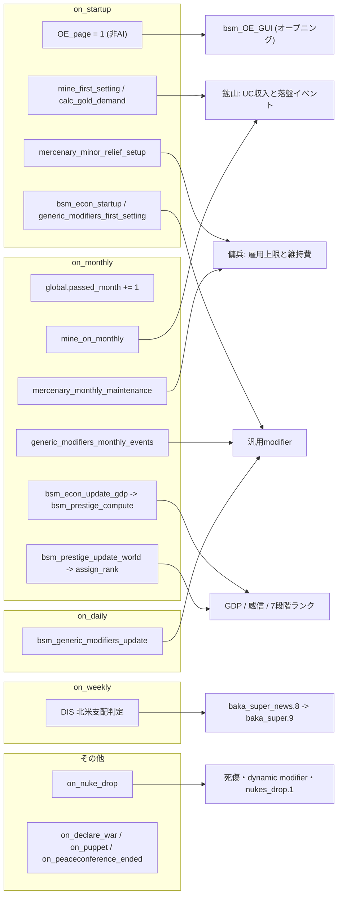
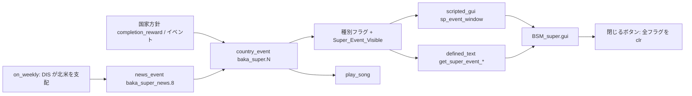
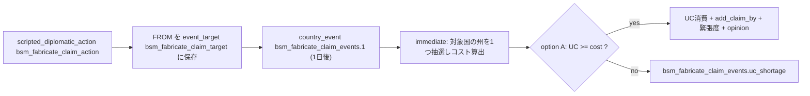

# 11 ゲームプレイ固有システム

元首ガチャ、スーパーイベント、鉱山開発、傭兵、請求権捏造、核関連、ATRMRW海軍設計など、文明度・通貨系以外の独自システムを実コードに基づいて整理する。`common/on_actions/` が各システムをどう駆動するかの全体像も扱う。文明度・統合力・統一通貨・国家通貨・ステラリス要素・堕ちた帝国・経済同盟・自治州は [10-civilization-and-resources](10-civilization-and-resources.md) を参照。

## 状態サマリ

| システム | 状態 | 主な根拠 |
|---|---|---|
| 元首ガチャ | 稼働（国家方針でフラグ解放） | [hre_army.txt:2374](../../bakasekai/common/national_focus/hre_army.txt#L2374) |
| スーパーイベント | 稼働（9種中、発火元が見つからないものあり） | [BAKA_SuperEvents.txt:7](../../bakasekai/events/BAKA_SuperEvents.txt#L7) |
| 収穫システム | 無効（ロジックは全てコメントアウト） | [_bsm_Harvest_System.txt:1](../../bakasekai/common/scripted_effects/_bsm_Harvest_System.txt#L1) |
| 鉱山開発 | 稼働（金鉱山のみ収入化） | [_bsm_mine.txt:94](../../bakasekai/common/scripted_effects/_bsm_mine.txt#L94) |
| 傭兵・金経済 | 稼働（非主要国に自動開放） | [_bsm_system.txt:331](../../bakasekai/common/on_actions/_bsm_system.txt#L331) |
| 酒保中隊 | 定義のみ（付与元が見つからない） | [bsm_sutler_company.txt:4](../../bakasekai/common/units/bsm_sutler_company.txt#L4) |
| 請求権捏造 | 稼働（外交アクション） | [BSM_custom_diplomatic_actions.txt:2](../../bakasekai/common/scripted_diplomatic_actions/BSM_custom_diplomatic_actions.txt#L2) |
| ATRMRW海軍設計 | 別ブランチのみ（現ブランチに実体なし） | 後述 |

## 1. on_action 全体像

BSMは `descriptor.mod` で vanilla の `common/on_actions` を丸ごと置換している（[descriptor.mod:35](../../bakasekai/descriptor.mod#L35)）。`common/decisions`（[L30](../../bakasekai/descriptor.mod#L30)）、`common/special_projects`（[L32](../../bakasekai/descriptor.mod#L32)）、`common/scripted_effects`（[L42](../../bakasekai/descriptor.mod#L42)）、`events`（[L47](../../bakasekai/descriptor.mod#L47)）も置換対象で、vanilla の発火元は一切残らない。基本の分担は [02-architecture](02-architecture.md) を参照。



### 1.1 on_action 一覧

ファイル全行は [_bsm_system.txt](../../bakasekai/common/on_actions/_bsm_system.txt) に集約され、残りは用途別ファイルに分かれる。

| on_action | 定義 | 駆動する処理 |
|---|---|---|
| on_startup | [_bsm_system.txt:2](../../bakasekai/common/on_actions/_bsm_system.txt#L2) | 月カウンタ（[L6](../../bakasekai/common/on_actions/_bsm_system.txt#L6)）、OE初期化（[L15](../../bakasekai/common/on_actions/_bsm_system.txt#L15)）、アノマリーDB（[L25](../../bakasekai/common/on_actions/_bsm_system.txt#L25)）、宗教フラグ（[L53](../../bakasekai/common/on_actions/_bsm_system.txt#L53)）、通貨初期化（[L295](../../bakasekai/common/on_actions/_bsm_system.txt#L295)）、鉱山（[L321](../../bakasekai/common/on_actions/_bsm_system.txt#L321)）、傭兵（[L331](../../bakasekai/common/on_actions/_bsm_system.txt#L331)）、GDP/威信（[L361](../../bakasekai/common/on_actions/_bsm_system.txt#L361)） |
| on_monthly | [_bsm_system.txt:379](../../bakasekai/common/on_actions/_bsm_system.txt#L379) | 月カウンタ、`ucs_on_monthly`、国別パス（GDP・威信・傭兵・汎用modifier、[L405-424](../../bakasekai/common/on_actions/_bsm_system.txt#L405)）、通貨同盟集計（[L426](../../bakasekai/common/on_actions/_bsm_system.txt#L426)）、威信ランク（[L432](../../bakasekai/common/on_actions/_bsm_system.txt#L432)）、`mine_on_monthly`（[L438](../../bakasekai/common/on_actions/_bsm_system.txt#L438)） |
| on_daily | [_bsm_system.txt:441](../../bakasekai/common/on_actions/_bsm_system.txt#L441) | `combined_unified_currency`、`bsm_generic_modifiers_update` |
| on_weekly | [_bsm_system.txt:450](../../bakasekai/common/on_actions/_bsm_system.txt#L450) | 文明度・統合力・ステラリス・アノマリー、DISのスーパーイベント判定（[L479](../../bakasekai/common/on_actions/_bsm_system.txt#L479)） |
| on_bi_yearly | [_bsm_system.txt:496](../../bakasekai/common/on_actions/_bsm_system.txt#L496) | POS（シーランド）の海峡圧力・称号イベント |
| on_nuke_drop | [_bsm_system.txt:543](../../bakasekai/common/on_actions/_bsm_system.txt#L543) | 核被害（3節） |
| on_state_control_changed | [_bsm_system.txt:614](../../bakasekai/common/on_actions/_bsm_system.txt#L614) | `ucs_on_dairy_effects`（通貨ページ担当） |
| on_declare_war | [_bsm_system.txt:620](../../bakasekai/common/on_actions/_bsm_system.txt#L620) | 開戦時に `war_effort_1` を付与 |
| on_startup/monthly/declare_war/yearly/weekly/peaceconference_ended | [00_on_actions.txt:2](../../bakasekai/common/on_actions/00_on_actions.txt#L2) | MYS方向選択・MYS/MON等の国民精神（[L2-30](../../bakasekai/common/on_actions/00_on_actions.txt#L2)）、AI国家方針ランダム化（`AI_NF_choice`）、MYSの欧州支配ニュース（[L275](../../bakasekai/common/on_actions/00_on_actions.txt#L275)）、CHN内戦（[L291](../../bakasekai/common/on_actions/00_on_actions.txt#L291)）、CHNストライキ（[L350](../../bakasekai/common/on_actions/00_on_actions.txt#L350)）、NORの帝国形成ニュース（[L372](../../bakasekai/common/on_actions/00_on_actions.txt#L372)）、聖地922の聖戦wargoal（[L406](../../bakasekai/common/on_actions/00_on_actions.txt#L406)） |
| on_puppet | [BSM_End_war.txt:2](../../bakasekai/common/on_actions/BSM_End_war.txt#L2) | SJK/SPL/USAの傀儡化時にcosmetic tagを設定 |
| on_yearly | [_bsm_quiz_on_actions.txt:2](../../bakasekai/common/on_actions/_bsm_quiz_on_actions.txt#L2) | 非AI国から1つ選び、`baka_quiz.1`〜`20` のいずれかをニュース表示 |
| on_startup / on_monthly | [_bsm_fallen_empire_on_actions.txt:3](../../bakasekai/common/on_actions/_bsm_fallen_empire_on_actions.txt#L3) | 堕ちた帝国（10ページ担当） |
| on_startup / on_weekly / on_monthly | [bsm_economic_alliance_on_actions.txt:3](../../bakasekai/common/on_actions/bsm_economic_alliance_on_actions.txt#L3) | 経済同盟（10ページ担当） |

### 1.2 発火スコープは未確認

on_monthly/on_weekly/on_daily が「全体で1回」か「国ごと」かは、リポジトリ内で前提が割れている。

- プロジェクト文書は「1回のみ発火（per-country ではない）」と書く（[bsm_economic_alliance_v2_documentation.md:206](../00_coding_contexts/bsm_economic_alliance_v2_documentation.md#L206)）。`global.passed_month` の加算（[_bsm_system.txt:381](../../bakasekai/common/on_actions/_bsm_system.txt#L381)）もこの前提に立つ。
- 一方、同じ on_monthly 直下で呼ぶ `ucs_on_monthly` は `has_country_flag` を直接使い（[_bsm_Unified_Currency.txt:372-374](../../bakasekai/common/scripted_effects/_bsm_Unified_Currency.txt#L372)）、`mine_on_monthly` も `Unified_Currency` を直接加算する（[_bsm_mine.txt:109](../../bakasekai/common/scripted_effects/_bsm_mine.txt#L109)）。どちらも国スコープで実行される前提の書き方になっている。
- インストール版 vanilla DLC の `on_monthly`/`on_weekly`（`08_bba_on_actions.txt`、`05_lar_on_actions.txt`。リポジトリ外）は ROOT を国として limit に直書きしており、国ごとの発火を前提とする。

実機ログで `global.passed_month` の1か月あたり増分を見れば判別できる。判別前は、月次・週次に非冪等処理を足す際は `limit` で冪等にしておく方が安全。

## 2. 元首ガチャ

**目的**: 政治力を払って、ランダムな新国家元首（`miraijin` 特性、期限 2050.1.1）を就任させる。

**主要変数・フラグ**

| 名前 | 役割 | 根拠 |
|---|---|---|
| `ALLOW_GATYA` | カテゴリ `lgatya` の可視条件 | [00_gachya.txt:6](../../bakasekai/common/decisions/categories/00_gachya.txt#L6) |
| `First_time` | 初回無料ガチャ券。使用時に `clr_country_flag` | [GACHYA_GATYA.txt:403](../../bakasekai/common/decisions/GACHYA_GATYA.txt#L403) |

**データフロー**: 共通政治ツリーの国家方針 `sf_political_effort`（[hre_army.txt:2360](../../bakasekai/common/national_focus/hre_army.txt#L2360)）を完了すると、`First_time` を立て、hidden で `ALLOW_GATYA` を立てる（[L2372-2374](../../bakasekai/common/national_focus/hre_army.txt#L2372)）。以後 `lgatya` カテゴリに3つのディシジョンが現れる。各ディシジョンは `hidden_effect` の `random_list` で、当選枠の政党支持率を +0.5 し、与党を切り替え、`create_country_leader` で元首を作る。

| ディシジョン | 条件 | コスト | 当選枠（重み） |
|---|---|---|---|
| `R_kakutei`（[L2](../../bakasekai/common/decisions/GACHYA_GATYA.txt#L2)） | 政治力 > 200 | 300 | 10枠。potta 50、Elon 5、jobs 5、saori 1、他6人 各15（合計151） |
| `SR_kakutei`（[L212](../../bakasekai/common/decisions/GACHYA_GATYA.txt#L212)） | 政治力 > 200 | 1500 | pottaを除く9枠（合計101） |
| `SR_kakutei_2`（[L402](../../bakasekai/common/decisions/GACHYA_GATYA.txt#L402)） | `First_time` | 0、1回限り（[L407](../../bakasekai/common/decisions/GACHYA_GATYA.txt#L407)） | 9枠。saori・Elon・jobs が各12、他6人 各15（合計126） |

当選枠の名前は `potta, Elon, jobs, saori, greta, marisa, reimu, utm, yo_ooizumi, todo`。イデオロギーは `transformationism`、`intellectualism`、`stupidism`、`futurism` の与党切替と、元首側の `accelerationism` 等の組み合わせ（[L9-211](../../bakasekai/common/decisions/GACHYA_GATYA.txt#L9)）。表示名は [bakasekai_l_japanese.yml:11-14](../../bakasekai/localisation/japanese/replace/bakasekai/bakasekai_l_japanese.yml#L11) にある。

**関連ファイル**

| ファイル | 役割 |
|---|---|
| `common/decisions/GACHYA_GATYA.txt` | 3ディシジョン |
| `common/decisions/categories/00_gachya.txt` | カテゴリ `lgatya` |
| `common/national_focus/hre_army.txt` | 解放フラグ |
| `gfx/leaders/OTHER/*.png` | 元首肖像（ディシジョン内で参照） |

## 3. スーパーイベント

**目的**: 大事件の発生時に、画像・タイトル・引用文・BGM付きの大型ポップアップをプレイヤーに表示する。

**主要変数・フラグ**: 表示全体のゲートは `Super_Event_Visible`（[super_events.txt:8](../../bakasekai/common/scripted_guis/super_events.txt#L8)）。種別フラグは次の9つ。

| イベント | 種別フラグ | 発火元（実コードで確認） |
|---|---|---|
| `baka_super.1` | `WES_SGC` | [battle3_.txt:615](../../bakasekai/common/national_focus/battle3_.txt#L615)、[wes-3.txt:4858](../../bakasekai/common/national_focus/wes-3.txt#L4858) |
| `baka_super.2` | `WES_SAND` | [wes-3.txt:4047](../../bakasekai/common/national_focus/wes-3.txt#L4047) |
| `baka_super.3` | `WES_Empire` | [WES.txt:1707](../../bakasekai/events/WES.txt#L1707) |
| `baka_super.4` | `Battle_War` | 発火元なし。フラグは [battle3_.txt:415](../../bakasekai/common/national_focus/battle3_.txt#L415) が直接設定 |
| `baka_super.5` | `Perfect_long` | [BKK_Long.txt:765](../../bakasekai/common/national_focus/BKK_Long.txt#L765) |
| `baka_super.6` | `MC_Donald` | [McDonald_s.txt:266](../../bakasekai/common/national_focus/McDonald_s.txt#L266) |
| `baka_super.7` | `NO_Economy` | [McDonald_s.txt:543](../../bakasekai/common/national_focus/McDonald_s.txt#L543) |
| `baka_super.8` | `spflag_YAAI` | 発火元が見つからない |
| `baka_super.9` | `DIS_North_America` | on_weekly 経由（下記） |

**データフロー**: 各 `baka_super.N` は `hidden`・`is_triggered_only`・`fire_only_once` の country_event で、optionが種別フラグと `Super_Event_Visible` を立て、`play_song` を呼ぶ（例: [BAKA_SuperEvents.txt:19-21](../../bakasekai/events/BAKA_SuperEvents.txt#L19)）。`baka_super.4` は追加で欧州・旧ソ連系タグ群に `bsm_nc_devalue_currency` を実行する（[L82-165](../../bakasekai/events/BAKA_SuperEvents.txt#L82)）。



- GUI: `sp_event_window` は背景・各種別画像・引用文・タイトル・閉じるボタンを持つ（[BSM_super.gui:3-121](../../bakasekai/interface/BSM_super.gui#L3)）。画像は `Super_Event_Image_<名前>` で、scripted GUI の `triggers` が `<名前>_visible` として種別フラグに結びつける（[super_events.txt:11-63](../../bakasekai/common/scripted_guis/super_events.txt#L11)）。閉じるボタンは `Super_Event_Visible` と種別フラグを全て解除する（[L69-136](../../bakasekai/common/scripted_guis/super_events.txt#L69)）。
- テキスト: `get_super_event_title`（[Super_Event_Scripted_Loc.txt:3](../../bakasekai/common/scripted_localisation/Super_Event_Scripted_Loc.txt#L3)）、`get_super_event_remark`（[L72](../../bakasekai/common/scripted_localisation/Super_Event_Scripted_Loc.txt#L72)）、`get_super_event_quote`（[L140](../../bakasekai/common/scripted_localisation/Super_Event_Scripted_Loc.txt#L140)）が種別フラグで分岐する。
- ニュース連鎖: `baka_super_news.1〜8` は hidden のニュースで、optionの `hidden_effect` が対応する `baka_super.N` を呼ぶ（[Baka_Super_News.txt:7-41](../../bakasekai/events/Baka_Super_News.txt#L7)）。実際に発火するのは `.8` のみで、DISが `dis_controls_north_america` を満たし未発火の場合に on_weekly が1回だけ呼ぶ（[_bsm_system.txt:479-493](../../bakasekai/common/on_actions/_bsm_system.txt#L479)、条件は [bsm_scripted_triggers.txt:82](../../bakasekai/common/scripted_triggers/bsm_scripted_triggers.txt#L82)）。他の `news_event` 呼び出しはコメントアウトされている（[McDonald_s.txt:268](../../bakasekai/common/national_focus/McDonald_s.txt#L268) 他）。

**実装上の不整合（確認済み）**

- `baka_super.7` と GUI は `NO_Economy` を使うが、scripted_loc は `MAC_NO_Economy` を判定している（[Super_Event_Scripted_Loc.txt:49](../../bakasekai/common/scripted_localisation/Super_Event_Scripted_Loc.txt#L49)、[L118](../../bakasekai/common/scripted_localisation/Super_Event_Scripted_Loc.txt#L118)、[L186](../../bakasekai/common/scripted_localisation/Super_Event_Scripted_Loc.txt#L186)）。`MAC_NO_Economy` を立てる箇所はなく、タイトル・備考・引用文が空になる可能性が高い。
- GUIの `Super_Event_Image_Second_World_War` には対応する `_visible` トリガーがない（[BSM_super.gui:18](../../bakasekai/interface/BSM_super.gui#L18)）。
- BGMは [baka_songs.txt](../../bakasekai/music/baka_songs.txt) と [baka_music.asset](../../bakasekai/music/baka_music.asset) に定義された曲名を `play_song` で指定する。

## 4. 収穫システム（無効）

**目的（コメントから読み取れる設計）**: 農地・漁獲から収量を計算し、肥料・新農法の施策で補正する。READMEは「収穫システム」を独自システムとして挙げるが、現行コードでは動かない。

**確認結果**

| 構成要素 | 状態 | 根拠 |
|---|---|---|
| イベント `bsm_HS.0〜5` | 全行コメントアウト | [_bsm_HarvestSystem.txt:1](../../bakasekai/events/_bsm_HarvestSystem.txt#L1) |
| scripted_effects（`HS_call`、収量計算、漁獲計算、ログ配列） | 全行コメントアウト | [_bsm_Harvest_System.txt:1](../../bakasekai/common/scripted_effects/_bsm_Harvest_System.txt#L1) |
| scripted_gui `bsm_Harvest_System_GUI` / `bsm_HS_food_reform_GUI` | 全行コメントアウト | [_bsm_Harvest_System.txt:1](../../bakasekai/common/scripted_guis/_bsm_Harvest_System.txt#L1) |
| ディシジョンとカテゴリ | ほぼ全行コメントアウト | [decisions/_bsm_Harvest_System.txt:1](../../bakasekai/common/decisions/_bsm_Harvest_System.txt#L1)、[categories:1](../../bakasekai/common/decisions/categories/_bsm_Harvest_System.txt#L1) |
| 起動用デバッグ決定 | コメントアウト | [_debug_decisions.txt:452](../../bakasekai/common/decisions/_debug_decisions.txt#L452) |
| 国民精神 `HS_DARC`、`HS_Fertilizers_1〜4`、`HS_New_farming_methods` | 定義は有効だが付与元なし | [ideas/_bsm_Harvest_System.txt:1](../../bakasekai/common/ideas/_bsm_Harvest_System.txt#L1) |
| modifier定義4件（`HS_Farming_efficiency` 等） | 有効 | [_bsm_HarvestSystem.txt:1](../../bakasekai/common/modifier_definitions/_bsm_HarvestSystem.txt#L1)、[tokens:2](../../bakasekai/common/synchronized_dynamic_tokens/_bsm_tokens.txt#L2) |
| `interface/_bsm_Harvest_System.gui`、`_bsm_HS_food_reform_GUI.gui` | ファイルは有効だが参照する scripted_gui がなく表示されない | [_bsm_HS_food_reform_GUI.gui:3](../../bakasekai/interface/_bsm_HS_food_reform_GUI.gui#L3) |

コメント内の設計では、入口 `HS_call` が `you_are_harvester` フラグを立てて初期化し（[L1-16](../../bakasekai/common/scripted_effects/_bsm_Harvest_System.txt#L1)）、収量を `HS_farm_dev` 配列の添字で保持していた（[L41-53](../../bakasekai/common/scripted_effects/_bsm_Harvest_System.txt#L41)）。復活させる場合は、イベント・effect・GUI・ディシジョンの全てを同時に戻す必要がある。

## 5. 鉱山開発

**目的**: 州ごとの金鉱山レベルに応じて、月次で統一通貨（UC）を得る。金需要は国際緊張度と経過月数で上がる。

**主要変数・フラグ**

| 名前 | スコープ | 役割 | 根拠 |
|---|---|---|---|
| `gold_mine` | 州 | 金鉱山レベル。`history/states` で設定（約169ファイル） | [382-Colorado.txt:23](../../bakasekai/history/states/382-Colorado.txt#L23) |
| `jewel_mine` | 州 | 設定はあるが参照は `mine_reopening` の対象判定のみ。収入計算には未使用 | [_bsm_mine_system.txt:188](../../bakasekai/common/decisions/_bsm_mine_system.txt#L188) |
| `MD_mine_size` | 国 | 領有・占領中の稼働鉱山レベル合計 | [_bsm_mine.txt:11-36](../../bakasekai/common/scripted_effects/_bsm_mine.txt#L11) |
| `global.MD_demand` | global | 金需要 | [_bsm_mine.txt:77-93](../../bakasekai/common/scripted_effects/_bsm_mine.txt#L77) |
| `global.gold_demand_additional` | global | 需要への加算項。初期値0.5 | [_bsm_mine.txt:7](../../bakasekai/common/scripted_effects/_bsm_mine.txt#L7) |
| `occupied_mine_state` | 国（配列） | 占領済みで稼働を許可した州 | [_bsm_mine.txt:28](../../bakasekai/common/scripted_effects/_bsm_mine.txt#L28) |
| `bsm_mine_closed` | 州フラグ | 一時閉鎖。180日で自然消滅 | [_bsm_mine.txt:138-142](../../bakasekai/events/_bsm_mine.txt#L138) |
| `MD_gain_factor` | modifier | 収入補正 | [_bsm_core.txt:106](../../bakasekai/common/modifier_definitions/_bsm_core.txt#L106) |

**計算式（実コード）**

```
MD_demand = (global.threat + 1) × global.passed_month / 24 + global.gold_demand_additional
MD_gain   = MD_mine_size × MD_demand × (1 + modifier@MD_gain_factor)
Unified_Currency += MD_gain
```

根拠: [_bsm_mine.txt:79-90](../../bakasekai/common/scripted_effects/_bsm_mine.txt#L79)、[L98-109](../../bakasekai/common/scripted_effects/_bsm_mine.txt#L98)。`global.threat` はコメント上「国際緊張度」。`bsm_mine_closed` の州と `gold_mine = 0` の州は合計に入らない（[L19-20](../../bakasekai/common/scripted_effects/_bsm_mine.txt#L19)）。

**データフロー**

1. `on_startup` が全国に `mine_first_setting`（配列初期化、需要加算項設定）と `mine_on_monthly` を実行する（[_bsm_system.txt:323-328](../../bakasekai/common/on_actions/_bsm_system.txt#L323)）。
2. `on_monthly` の末尾で `mine_on_monthly` を呼ぶ（[L438](../../bakasekai/common/on_actions/_bsm_system.txt#L438)）。上記式でUCを加算し、鉱山のある領有州を1つ選んで `random_list` を引く。重みは「何も起きない 15」と、`mine.1`（大規模落盤）、`.2`（中規模）、`.3`（小規模）、`.4`（ストライキ）、`.7`（鉱脈発見）、`.8`（鉱山事故）が各 10（[_bsm_mine.txt:117-127](../../bakasekai/common/scripted_effects/_bsm_mine.txt#L117)）。
3. イベントの効果（[_bsm_mine.txt](../../bakasekai/events/_bsm_mine.txt)）: `.1` はUC -250・レベル -2（[L13](../../bakasekai/events/_bsm_mine.txt#L13)）、`.2` はUC -100・レベル -1（[L32](../../bakasekai/events/_bsm_mine.txt#L32)）、`.3` はUC -20（[L51](../../bakasekai/events/_bsm_mine.txt#L51)）、`.7` はレベル +1（[L96](../../bakasekai/events/_bsm_mine.txt#L96)）、`.8` は「安定度 -0.05」または「180日閉鎖」の選択（[L113](../../bakasekai/events/_bsm_mine.txt#L113)）。`.4` は効果なし、`.5`/`.6` は発火元が見つからない。
4. 拡張ディシジョン `expansion_gold_mine_1〜5` は対象州の `gold_mine` が現レベルと一致し、研究 `excavation1〜5` を持つとき、UC > 49.999 で50UCを払い、100日後に +1 する（[_bsm_mine_system.txt:3-34](../../bakasekai/common/decisions/_bsm_mine_system.txt#L3)）。`mine_reopening` は占領州を稼働させる（[L169](../../bakasekai/common/decisions/_bsm_mine_system.txt#L169)）。
5. ログ表示: `add_gold_mine_level` / `change_gold_demand` が `bsm_mine_log_*` 配列の先頭に追記する（[_bsm_mine.txt:40-76](../../bakasekai/common/scripted_effects/_bsm_mine.txt#L40)）。カテゴリ `bsm_mine` の scripted_gui `bsm_mine_GUI` が動的リストで描画する（[_bsm_mine_dev_GUI.txt:13-22](../../bakasekai/common/scripted_guis/_bsm_mine_dev_GUI.txt#L13)）。カテゴリは `gold_mine` を持つ州を所有するときだけ表示される（[categories:5-12](../../bakasekai/common/decisions/categories/_bsm_mine_system.txt#L5)）。

**関連ファイル**

| ファイル | 役割 |
|---|---|
| `common/scripted_effects/_bsm_mine.txt` | 計算・イベント抽選 |
| `events/_bsm_mine.txt` | 落盤・鉱脈・事故（名前空間 `mine`） |
| `common/decisions/_bsm_mine_system.txt`、`categories/_bsm_mine_system.txt` | 拡張・再開、デバッグ決定（[L209](../../bakasekai/common/decisions/_bsm_mine_system.txt#L209)、[L259](../../bakasekai/common/decisions/_bsm_mine_system.txt#L259)） |
| `common/scripted_guis/_bsm_mine_dev_GUI.txt`、`interface/_bsm_mine_dev_GUI.gui` | ログ一覧GUI |
| `common/scripted_localisation/_bsm_mine.txt` | `MD_log_type`、`MD_log_event` |

**注意**: `calc_mine_total` は `owner = { ... }` で始まるため州スコープから呼ぶ設計に読める（[_bsm_mine.txt:12](../../bakasekai/common/scripted_effects/_bsm_mine.txt#L12)）。一方、`mine_on_monthly` とディシジョンの `remove_effect` は国スコープから呼ぶ。実機での整合は未確認。カテゴリ `bsm_ecpp`（変換）は定義のみでディシジョンが見つからない（[categories:14](../../bakasekai/common/decisions/categories/_bsm_mine_system.txt#L14)）。

## 6. 傭兵・金経済

**目的**: 非主要国向けの救済策。UCを「金」として扱い、傭兵師団の雇用・金から装備購入ができる。

**主要変数・フラグ**: `Mercenary_System_Allowed`（国フラグ。ディシジョンの可視条件）、`MS_sum_num`（傭兵大隊数）、`MS_max`（雇用上限）、`mercenary_maintenance`（月次維持費）。

**データフロー**

- 開放: `on_startup` で `exists = yes` かつ `is_major = no` の全国に `mercenary_minor_relief_setup` を実行する（[_bsm_system.txt:331-337](../../bakasekai/common/on_actions/_bsm_system.txt#L331)）。上限 `MS_max` は既定6、州数 < 8 で8、< 3 で10（[_bsm_mercenary.txt:52-67](../../bakasekai/common/scripted_effects/_bsm_mercenary.txt#L52)）。SWI=10、VAT=2、FRA=20 は個別設定（[_bsm_system.txt:339-356](../../bakasekai/common/on_actions/_bsm_system.txt#L339)）。
- 雇用: `mercenary_system_koyou_s`（UC 30、+2大隊、[L178](../../bakasekai/common/decisions/_bsm_mercenary_system.txt#L178)）、`_m`（UC 50、+4大隊、[L228](../../bakasekai/common/decisions/_bsm_mercenary_system.txt#L228)）、政治力版 `_s_pp`（150、[L280](../../bakasekai/common/decisions/_bsm_mercenary_system.txt#L280)）、`_m_pp`（250、[L329](../../bakasekai/common/decisions/_bsm_mercenary_system.txt#L329)）。`MS_sum_num < MS_max` を満たすと `mercenary` 連隊のロック済みテンプレート `MS_NAME`/`MS_NAME_2` を作り、ランダムな領有州に1師団を生成する。上限判定は雇用前の値で行うため、`MS_max` を超えうる。`mercenary_system_kaiko`（[L379](../../bakasekai/common/decisions/_bsm_mercenary_system.txt#L379)）で全員を解雇し `MS_sum_num = 0` に戻す。
- 維持費: 月次パスのうちフラグ保有国だけ `mercenary_monthly_maintenance` を実行する（[_bsm_system.txt:418-421](../../bakasekai/common/on_actions/_bsm_system.txt#L418)）。維持費は `MS_sum_num × 2.5` UC。UC不足なら安定度 -0.02、戦争支持率 -0.02（[_bsm_mercenary.txt:4-40](../../bakasekai/common/scripted_effects/_bsm_mercenary.txt#L4)）。
- 金→資源・装備（カテゴリ `bsm_gold_conversion`、[categories:1](../../bakasekai/common/decisions/categories/_bsm_mercenary.txt#L1)）: 消費財→UC 50（[L2](../../bakasekai/common/decisions/_bsm_mercenary_system.txt#L2)）、政治力100→UC 30（[L33](../../bakasekai/common/decisions/_bsm_mercenary_system.txt#L33)）、UC 50→歩兵装備1000（[L59](../../bakasekai/common/decisions/_bsm_mercenary_system.txt#L59)）、UC 30→支援装備500（[L98](../../bakasekai/common/decisions/_bsm_mercenary_system.txt#L98)）、UC 70→砲200（[L137](../../bakasekai/common/decisions/_bsm_mercenary_system.txt#L137)）。装備購入は `MS_sum_num = 0` かつ `recent_gold_income` なしが条件で、購入時に180日のフラグを立てる。
- GUI: カテゴリ `mercenary_system_koyou` が scripted_gui `bsm_mercenary_gui` を持ち（[categories:10](../../bakasekai/common/decisions/categories/_bsm_mercenary.txt#L10)）、`_bsm_yohei.gui` が数・コスト・最大数を表示する（[L3](../../bakasekai/interface/_bsm_yohei.gui#L3)）。

**不整合（確認済み）**

- `mercenary_system_init` は定義のみで呼び出し元がない（[_bsm_mercenary.txt:43](../../bakasekai/common/scripted_effects/_bsm_mercenary.txt#L43)）。
- GUIの `MS_cost` は `ROOT.mercenary_cost` を読むが（[bsm_system_l_japanese.yml:55](../../bakasekai/localisation/japanese/bakasekai/bsm_system_l_japanese.yml#L55)）、実コードで書き込まれる変数は `mercenary_maintenance`。`mercenary_cost` を使う dynamic modifier もコメントアウトされている（[bsm_dynamic_modifiers.txt:9](../../bakasekai/common/dynamic_modifiers/bsm_dynamic_modifiers.txt#L9)）。
- ローカライズは「上限を超えると反乱の恐れ」と書くが（[L58](../../bakasekai/localisation/japanese/bakasekai/bsm_system_l_japanese.yml#L58)）、反乱処理は実コードで見つからない。

## 7. 酒保中隊とビール瓶

**酒保中隊**: 支援中隊 `bsm_sutler_company`（略称 SAK）。`active = no`（[L10](../../bakasekai/common/units/bsm_sutler_company.txt#L10)）で、必要装備は支援装備20・ビール瓶10・自動車化装備10（[L58-62](../../bakasekai/common/units/bsm_sutler_company.txt#L58)）。解禁研究 `tech_bsm_sutler_company` は `allow = { always = no }` のため `add_tech` 等の付与専用（[_bsm_sutler_company_tech.txt:5-17](../../bakasekai/common/technologies/_bsm_sutler_company_tech.txt#L5)）。**この研究を付与する箇所は、リポジトリ内で見つからない**（未確認）。

**ビール瓶**: 装備 `bsm_broken_beer_bottle_equipment`（1940年、ソフトアタック7、[infantry_bsm_beer_bottle.txt:3](../../bakasekai/common/units/equipment/infantry_bsm_beer_bottle.txt#L3)）は研究 `bsm_broken_beer_bottle_tech` で解禁される（[_bsm_beer_bottle_tech.txt:2](../../bakasekai/common/technologies/_bsm_beer_bottle_tech.txt#L2)）。付与元はENG/GBR限定のディシジョン `bsm_eng_militia_recruitment`（FRAが降伏済み・FRAと同派閥・戦争中、政治力25、[L2-23](../../bakasekai/common/decisions/_bsm_eng_militia_decisions.txt#L2)）で、イベント `bsm_eng_militia.1` が研究付与とビール瓶1000本の備蓄を行う（[_bsm_eng_militia_events.txt:13-20](../../bakasekai/events/_bsm_eng_militia_events.txt#L13)）。

## 8. ミュージックステーション

**目的**: 音楽プレイヤーに「バカ世界地図」専用ステーションを追加する。

- ステーション定義: `music_station = "baka_music"`（[baka_songs.txt:1](../../bakasekai/music/baka_songs.txt#L1)）。17曲が [baka_music.asset](../../bakasekai/music/baka_music.asset) に定義され、`baka_songs.txt` にも17件の `song` がある。うち9件は `chance` の `factor = 0` で自動再生されず、そのうち8件（`music_WES_Sand`、`music_east` 等）はスーパーイベントの `play_song` が指定する曲。DIS用の `miniature_land` は通常の再生対象に入っている。
- GUI: `baka_music_faceplate`（曲名・経過時間・前後送り・音量・シャッフル、[BSM_music_station.gui:3](../../bakasekai/interface/BSM_music_station.gui#L3)）と、ステーション選択エントリ `baka_music_stations_entry`（[L113](../../bakasekai/interface/BSM_music_station.gui#L113)）。曲名等のテキストはプレースホルダで、vanilla の `music_station_classic.gui` も同名要素（`track_name` 等）を持つ。アルバムアートは [BSM_musicplayer.gfx:3](../../bakasekai/interface/BSM_musicplayer.gfx#L3)。
- vanilla 側のステーション名は `base_music`（[_songs.txt:2](../../bakasekai/music/_songs.txt#L2)）。`alliedradio`、`sabaton`、`mtg` は `music_station` 宣言がコメントアウトされている（[sabatonsoundtrack.txt:4](../../bakasekai/music/sabatonsoundtrack.txt#L4) 他）。

## 9. オープニング（OE）

**目的**: ゲーム開始時、プレイヤーにウェルカム・更新履歴・独自機能・クレジットの5ページをブラウザ風ウィンドウで見せる。

- 開始: `on_startup` で非AI国に `OE_page = 1` を設定する（[_bsm_system.txt:15-19](../../bakasekai/common/on_actions/_bsm_system.txt#L15)）。ウィンドウ `bsm_OE_GUI` の可視条件は `has_variable = OE_page`。
- 操作: ページ切替は `OE_page` の増減（`OE_page_1〜5_click`、前後ボタン）、閉じるは `clear_variable`（[_bsm_opening_event.txt:2-40](../../bakasekai/common/scripted_guis/_bsm_opening_event.txt#L2)）。各ページは別の scripted_gui `OE_page_1〜5` で、`parent_window_name = bsm_OE_GUI_main` を指す（[L41-82](../../bakasekai/common/scripted_guis/_bsm_opening_event.txt#L41)）。
- 再表示: トップバーの `bsm_OE_GUI_open_button_click` が `OE_page` をトグルする（[BSM_topbar.txt:27](../../bakasekai/common/scripted_guis/BSM_topbar.txt#L27)）。
- GUI: 枠（header/main/footer）とページ本体がトップレベルの `containerWindowType` として並ぶ（[_bsm_opening_event.gui:3-182](../../bakasekai/interface/_bsm_opening_event.gui#L3)）。ページ名は [bsm_OE_l_japanese.yml:13-17](../../bakasekai/localisation/japanese/bakasekai/bsm_OE_l_japanese.yml#L13)。1ページ目の国別説明は scripted_loc `OE_country_description`/`OE_country_prehistory`（[_bsm_opening_event.txt:2](../../bakasekai/common/scripted_localisation/_bsm_opening_event.txt#L2)）。更新履歴ページの本文はローカライズ文字列に直書きされており（`OE_main_page_2_title`）、[BSM_changelog.txt](../../bakasekai/BSM_changelog.txt) とは別管理。

## 10. 請求権捏造

**目的**: UCを払って、対象国の州に自国の請求権を付与する外交アクション。

**データフロー**



- 表示条件: 自分自身・交戦国を除き、`bsm_can_initiate_fabricate_claim_diplo_action_trigger` を満たすこと。UC > 200、かつ対象国に「未所有・未請求・非中核・隣接または沿岸」の州が1つ以上あること（[bsm_scripted_triggers.txt:38-60](../../bakasekai/common/scripted_triggers/bsm_scripted_triggers.txt#L38)）。アクション自体のコストは `cost = 25`（[BSM_custom_diplomatic_actions.txt:20](../../bakasekai/common/scripted_diplomatic_actions/BSM_custom_diplomatic_actions.txt#L20)）。
- 州抽選とコスト: 同じ条件の州を `random_owned_state` で1つ選び、コスト = 州人口(千人) + 100 UC（[_bsm_Fabricate_Claim_Events.txt:20-57](../../bakasekai/events/_bsm_Fabricate_Claim_Events.txt#L20)）。
- 実行: UC不足なら通知イベントへ（[L67-72](../../bakasekai/events/_bsm_Fabricate_Claim_Events.txt#L67)）。足りれば `ucs_add_Unified_Currency` で減算し、`add_claim_by`、国際緊張度 +0.003（`add_named_threat`）、対象国の好感度に `fabricated_claim_bsm_negative_opinion`（-50、減衰1）を付ける（[L73-97](../../bakasekai/events/_bsm_Fabricate_Claim_Events.txt#L73)、[99_opinion_modifiers.txt:2-6](../../bakasekai/common/opinion_modifiers/99_opinion_modifiers.txt#L2)）。
- 未使用: `bsm_can_fabricate_claim_on_this_state_in_event_trigger` は `event_target:bsm_fabricate_claim_target_country` を参照するが（[bsm_scripted_triggers.txt:66](../../bakasekai/common/scripted_triggers/bsm_scripted_triggers.txt#L66)）、保存される名前は `..._target` で、どこからも呼ばれていない。

## 11. 核関連

- `on_nuke_drop` は `FROM` を被弾州として扱う。州人口(千人)に、州区分ごとの係数（荒地・牧畜・田舎系 -10、都市系 -30、飛び地・小島系 -50）を掛けて `add_manpower` する。コメントでは死者率1%・3%・5%（[_bsm_system.txt:549-594](../../bakasekai/common/on_actions/_bsm_system.txt#L549)）。
- 被弾州に `bsm_dropped_nuke_modifier` を90日付与する（[L596-598](../../bakasekai/common/on_actions/_bsm_system.txt#L596)）。内容は資源・補給・工場・移動速度が全て -75%（[bsm_dynamic_modifiers.txt:14-20](../../bakasekai/common/dynamic_modifiers/bsm_dynamic_modifiers.txt#L14)）。
- 州922（聖地）が被弾するとニュース `nukes_drop.1` を出す（[L606-610](../../bakasekai/common/on_actions/_bsm_system.txt#L606)）。カトリック国民精神を持つ国は安定度 -0.3 の上、70%で `.3`（戦争支持率 +0.25）、30%で `.2` に進む（[_bsm_on_nukes.txt:14-30](../../bakasekai/events/_bsm_on_nukes.txt#L14)）。`.2` は `fire_only_once` なのに自分自身を再発火する枠があり（[L47](../../bakasekai/events/_bsm_on_nukes.txt#L47)、[L56-61](../../bakasekai/events/_bsm_on_nukes.txt#L56)）、2回目以降は発火しない。
- 同じ聖地の和平会議後は、カトリック国民精神を持つ国が所有国に `take_state` の wargoal を作る（[00_on_actions.txt:406-440](../../bakasekai/common/on_actions/00_on_actions.txt#L406)）。
- `events/NukeEvents.txt` の `nuke_dropped.*` は vanilla 由来で、on_actions が置換されているためリポジトリ内に発火元が見つからない（`nuke_dropped.0` の定義: [NukeEvents.txt:9](../../bakasekai/events/NukeEvents.txt#L9)）。

## 12. 汎用modifierとGDP・威信

### 12.1 汎用スケーリングmodifier

**目的**: 人口・安定度・戦争支持率・保有州数などに比例する効果を、モディファイア1行で書けるようにする。

- 国別 dynamic modifier `bsm_generic_scaled_modifier` が `var:bsm_scaled_*` を読む（[bsm_dynamic_modifiers.txt:68-76](../../bakasekai/common/dynamic_modifiers/bsm_dynamic_modifiers.txt#L68)）。
- `bsm_generic_modifiers_update` が係数 modifier（`bsm_consumer_goods_factories_per_million_population` 等、[_bsm_core.txt:50-98](../../bakasekai/common/modifier_definitions/_bsm_core.txt#L50)）に基準量を掛けて変数を更新し、`force_update_dynamic_modifier` で反映する（[_bsm_generic_modifiers.txt:26-64](../../bakasekai/common/scripted_effects/_bsm_generic_modifiers.txt#L26)）。起動時は `bsm_generic_modifiers_first_setting`（[_bsm_system.txt:327](../../bakasekai/common/on_actions/_bsm_system.txt#L327)）、日次は `bsm_generic_modifiers_update`（[L444-447](../../bakasekai/common/on_actions/_bsm_system.txt#L444)）。
- 月次は確率イベント: `bsm_domestic_strike_chance`（ストライキ）、`bsm_domestic_riot_chance`（暴動 `bsm_generic_modifier.1`）、`bsm_monthly_worker_death_chance`（労働者死亡 `.2`）。確率は modifier × 100 を 0〜100 にクランプして乱数と比較する（[_bsm_generic_modifiers.txt:66-125](../../bakasekai/common/scripted_effects/_bsm_generic_modifiers.txt#L66)）。
- 利用実績: 確認できた使用者は [NTS.txt:15](../../bakasekai/common/ideas/NTS.txt#L15) と [L96](../../bakasekai/common/ideas/NTS.txt#L96) のみ。`bsm_living_standard` を設定する箇所は見つからず、人口増加の項は常に0（[L57](../../bakasekai/common/scripted_effects/_bsm_generic_modifiers.txt#L57)）。

### 12.2 GDP（System A）と威信（System C）

- GDP: `output = (民需工場 + 1) × (0.4 + 0.6×安定度 + 文明度)`、`state_sum = Σ(人口k/1000 × max(1, インフラ×1.25 + 飛行場×1.1 + 港湾×0.8))`、`GDP = output × state_sum / 10 × (1 + modifier@bsm_gdp_factor)`（上限1e8）。成長率%も保持する（[_bsm_econ_gdp.txt:16-101](../../bakasekai/common/scripted_effects/_bsm_econ_gdp.txt#L16)）。ファイル冒頭は「decision起動のみ」と書くが古く、現在は月次パスから呼ばれる（[_bsm_system.txt:408](../../bakasekai/common/on_actions/_bsm_system.txt#L408)）。
- 威信: `(10 + tier(主要国+50) + GDP×0.2 + 大隊×0.5 + 艦船×3 + 従属国×20 + 研究済み技術×0.5 + bsm_prestige_flat) × (1 + bsm_prestige_factor)`（[_bsm_econ_prestige.txt:20-38](../../bakasekai/common/scripted_effects/_bsm_econ_prestige.txt#L20)）。世界平均との比で7段階（8倍以上=超大国、5倍=列強、2.5倍=大国、1倍=地域大国、0.5倍=中堅、0.2倍=小国）に分類し、ランクに連動する dynamic modifier を付ける（[L61-82](../../bakasekai/common/scripted_effects/_bsm_econ_prestige.txt#L61)）。世界順位 `bsm_prestige_position` はO(N^2)回避のため人間プレイヤーのみ計算する（[L88-100](../../bakasekai/common/scripted_effects/_bsm_econ_prestige.txt#L88)）。
- 実行順序は GDP → 威信計算 → 世界平均 → ランク判定（[_bsm_system.txt:408-436](../../bakasekai/common/on_actions/_bsm_system.txt#L408)）。設計は [bsm_economic_systems_design.md](../00_coding_contexts/bsm_economic_systems_design.md) が正本。

## 13. ATRMRW海軍設計

**状態**: 実装は現在のブランチ（`feature/london_three_sovereignties`）にも `develop` にも存在せず、ブランチ `feature/_system_ATRMRW_naval_design` の単一コミット `3fd89b0e1`（2026-08-12）にのみある。`tools/atrmrw/` は現ブランチでは `__pycache__` だけが残る。以下のリンクは当該コミットへの固定リンク。

基底URL: `https://github.com/BSM-HOI4/HOI4-Bakasekaitizu-MOD/blob/3fd89b0e15a1c40cb3ebf6cdfc5fed5850a4caef/`

**目的**: 旧ATRMの艦上配置型 Equipment Designer（スロット数・位置）と、SSW/NVRWの史実船体・計算・装備分類を統合した海軍設計コンセプト（[コンセプト文書:11-24](https://github.com/BSM-HOI4/HOI4-Bakasekaitizu-MOD/blob/3fd89b0e15a1c40cb3ebf6cdfc5fed5850a4caef/documents/00_coding_contexts/ATRMRW_NAVAL_DESIGN_CONCEPT.md#L11)）。4層（表示、スロット契約、意味装備、データ計算）に分離する（[L116-137](https://github.com/BSM-HOI4/HOI4-Bakasekaitizu-MOD/blob/3fd89b0e15a1c40cb3ebf6cdfc5fed5850a4caef/documents/00_coding_contexts/ATRMRW_NAVAL_DESIGN_CONCEPT.md#L116)）。

**構成と数値契約**

| 項目 | 内容 | 根拠 |
|---|---|---|
| スロット | 規模別に 36/30/24/18/15/12/9 枠（大型ほど多い）。最大36枠は custom 18 / fixed 18 | [コンセプト:190-196](https://github.com/BSM-HOI4/HOI4-Bakasekaitizu-MOD/blob/3fd89b0e15a1c40cb3ebf6cdfc5fed5850a4caef/documents/00_coding_contexts/ATRMRW_NAVAL_DESIGN_CONCEPT.md#L190)、[報告:10](https://github.com/BSM-HOI4/HOI4-Bakasekaitizu-MOD/blob/3fd89b0e15a1c40cb3ebf6cdfc5fed5850a4caef/documents/00_coding_contexts/atrmrw/ATRMRW_STATIC_IMPLEMENTATION_REPORT.md#L10) |
| 基礎HP | `(1100√(D/(D+45000)) + 300√(A/(A+15000)) + 50) × (0.85 + 0.1×艦種係数) × 年代係数`、下限20（D=満載排水量、A=全長×幅） | [calculations.py:103-121](https://github.com/BSM-HOI4/HOI4-Bakasekaitizu-MOD/blob/3fd89b0e15a1c40cb3ebf6cdfc5fed5850a4caef/tools/atrmrw/calculations.py#L103) |
| 基礎ORG | `(100 + 400×艦種係数 + 150√(D/(D+25000)) + 80√(A/(A+15000))) × 年代係数`、下限50 | [calculations.py:124-141](https://github.com/BSM-HOI4/HOI4-Bakasekaitizu-MOD/blob/3fd89b0e15a1c40cb3ebf6cdfc5fed5850a4caef/tools/atrmrw/calculations.py#L124) |
| 航続・速力 | 航続 = 航続海里×1.852/2、速力 = (最大+巡航)/2（巡航の既定は最大の0.8倍） | [calculations.py:144-156](https://github.com/BSM-HOI4/HOI4-Bakasekaitizu-MOD/blob/3fd89b0e15a1c40cb3ebf6cdfc5fed5850a4caef/tools/atrmrw/calculations.py#L144) |
| 合成式 | `final = (base + Σ加算) × (1 + Σ乗算)`。史実variantの目標から base を一度だけ逆算してdigestと共に固定 | [composition.py:42](https://github.com/BSM-HOI4/HOI4-Bakasekaitizu-MOD/blob/3fd89b0e15a1c40cb3ebf6cdfc5fed5850a4caef/tools/atrmrw/composition.py#L42)、[報告:22](https://github.com/BSM-HOI4/HOI4-Bakasekaitizu-MOD/blob/3fd89b0e15a1c40cb3ebf6cdfc5fed5850a4caef/documents/00_coding_contexts/atrmrw/ATRMRW_STATIC_IMPLEMENTATION_REPORT.md#L22) |
| 日本5艦級 | 大和・高雄・吹雪・赤城・伊十五の5船体、59論理module、5variant | [報告:13](https://github.com/BSM-HOI4/HOI4-Bakasekaitizu-MOD/blob/3fd89b0e15a1c40cb3ebf6cdfc5fed5850a4caef/documents/00_coding_contexts/atrmrw/ATRMRW_STATIC_IMPLEMENTATION_REPORT.md#L13)、[コンセプト:571-582](https://github.com/BSM-HOI4/HOI4-Bakasekaitizu-MOD/blob/3fd89b0e15a1c40cb3ebf6cdfc5fed5850a4caef/documents/00_coding_contexts/ATRMRW_NAVAL_DESIGN_CONCEPT.md#L571) |

**データフロー**: 台帳JSON（`documents/00_coding_contexts/atrmrw/`）を入力に、`generate_japan_game_files.py`（[L1](https://github.com/BSM-HOI4/HOI4-Bakasekaitizu-MOD/blob/3fd89b0e15a1c40cb3ebf6cdfc5fed5850a4caef/tools/atrmrw/generate_japan_game_files.py#L1)）が `_atrmrw_japan_hulls.txt`、`modules/_atrmrw_japan_modules.txt`、`_atrmrw_japan_naval.txt`（技術 `atrmrw_jap_prewar_prototypes`）、日英ローカライズを生成する。variant は scripted_effect `ATRMRW_JAP_prewar_ship_design`（[_atrmrw_japan_variants.txt:1](https://github.com/BSM-HOI4/HOI4-Bakasekaitizu-MOD/blob/3fd89b0e15a1c40cb3ebf6cdfc5fed5850a4caef/bakasekai/common/scripted_effects/_atrmrw_japan_variants.txt#L1)）で作り、JPN の国履歴から呼ぶ。`migrate_japan_oob.py`（[L1](https://github.com/BSM-HOI4/HOI4-Bakasekaitizu-MOD/blob/3fd89b0e15a1c40cb3ebf6cdfc5fed5850a4caef/tools/atrmrw/migrate_japan_oob.py#L1)）が JPN 1936 OOB の赤城1・高雄4・吹雪23を新船体IDへ移す。GUI は vanilla 1.19.2 の `equipmentdesignerview.gui` と艦種別5 GUI にanchorを追加して生成する。

**検証範囲**: 静的実装のみ。60テストと統合検証は通過したが、Designerの表示・建造・改装・OOBロード・海戦性能・`error.log` は「HOI4起動禁止」の指示により未確認で、加算・乗算順序の実機校正も pending（[報告:23](https://github.com/BSM-HOI4/HOI4-Bakasekaitizu-MOD/blob/3fd89b0e15a1c40cb3ebf6cdfc5fed5850a4caef/documents/00_coding_contexts/atrmrw/ATRMRW_STATIC_IMPLEMENTATION_REPORT.md#L23)、[L49-59](https://github.com/BSM-HOI4/HOI4-Bakasekaitizu-MOD/blob/3fd89b0e15a1c40cb3ebf6cdfc5fed5850a4caef/documents/00_coding_contexts/atrmrw/ATRMRW_STATIC_IMPLEMENTATION_REPORT.md#L49)）。全国家展開（A半固有・B汎用）は後続（[コンセプト:591-596](https://github.com/BSM-HOI4/HOI4-Bakasekaitizu-MOD/blob/3fd89b0e15a1c40cb3ebf6cdfc5fed5850a4caef/documents/00_coding_contexts/ATRMRW_NAVAL_DESIGN_CONCEPT.md#L591)）。

## 14. その他の棚卸し結果

| 領域 | 内容 | 根拠 |
|---|---|---|
| 初期tech設定ヘルパー | `*_tech_level_*`（陸・海・空・産業）、`doctrine_set_1`。国履歴の約188ファイルから呼ばれる | [_bsm_tech_level.txt:167](../../bakasekai/common/scripted_effects/_bsm_tech_level.txt#L167) |
| 師団生成 | `pop_infantry_random_owned_state_v3` 等。`ROOT.POP_Division_count` 分の師団を生成。`CHN_civil_war.txt` が使用 | [_bsm_custom_division_effects.txt:10](../../bakasekai/common/scripted_effects/_bsm_custom_division_effects.txt#L10) |
| 独自ユニット設計 | 1936年tech・軽戦車・哨戒機・艦艇バリアントの共通ヘルパー | [_bsm_unique_unit_designs.txt:1](../../bakasekai/common/scripted_effects/_bsm_unique_unit_designs.txt#L1) |
| 造船所貸与 | 同盟国（海軍工場20未満）へ、政治力50で30日貸与。再利用90日 | [00_shipyard_lending_decisions.txt:1](../../bakasekai/common/decisions/00_shipyard_lending_decisions.txt#L1) |
| 戦争エスカレーションUI | 10段階アイコン表示（decision_category型）。アイコン名が `lon_we_*` でLONシナリオ用と見られる | [war_escalation_scripted_gui.txt:3](../../bakasekai/common/scripted_guis/war_escalation_scripted_gui.txt#L3) |
| トップバー | UC/国家通貨表示の切替、OE・ステラリス・アノマリーの開閉ボタン | [BSM_topbar.txt:2](../../bakasekai/common/scripted_guis/BSM_topbar.txt#L2) |
| 政党名・政治設定 | `set_party_names_*`、`political_set_*`、地球市民社会の同盟加入 | [_bsm_party_name.txt:1](../../bakasekai/common/scripted_effects/_bsm_party_name.txt#L1)、[_bsm_set_politics.txt:1](../../bakasekai/common/scripted_effects/_bsm_set_politics.txt#L1) |
| 特殊研究 | 物理・社会・工学カードの更新（約1000行）。ステラリス要素と同系統のため10ページ担当の可能性が高い | [_bsm_special_research_effects.txt:1](../../bakasekai/common/scripted_effects/_bsm_special_research_effects.txt#L1) |
| デバッグ・テスト | `debug_*` ディシジョン（鉱山・UC・CHN内戦）、数式テスター | [_debug_decisions.txt:390-447](../../bakasekai/common/decisions/_debug_decisions.txt#L390)、[_bsm_mathtest_agg_probe.txt:12](../../bakasekai/common/scripted_effects/_bsm_mathtest_agg_probe.txt#L12) |
| special_projects | `bsm`/`baka` の語を含まず、BSM独自の識別子は見つからない（vanilla 由来コピー。独自システムは未確認） | [descriptor.mod:32](../../bakasekai/descriptor.mod#L32) |
| 国別システム | `common/scripted_guis` 内の SOV、USA、GRE、BUL、MAC、VAT 等は各国ページの担当 | [common/scripted_guis](../../bakasekai/common/scripted_guis) |

## 15. READMEと実装の差異・未確認

| 項目 | README | 実装 |
|---|---|---|
| 収穫システム | 記載なし（修正済み） | 無効。定義（国民精神・modifier）だけが残る |
| 対応バージョン | HoI4 `1.19.*`（[README.md:35](../../README.md#L35)） | `supported_version="1.19.*"`（[descriptor.mod:69](../../bakasekai/descriptor.mod#L69)）で一致 |
| 元首ガチャ・スーパーイベント・鉱山開発 | 記載あり | 稼働。ただし本ページの不整合を含む |

**未確認として残したもの**

- on_monthly/weekly/daily の発火回数と ROOT スコープ（1.2節）。
- `calc_mine_total` の呼び出しスコープ整合（5節）。
- 酒保中隊研究の付与元（7節）。
- `baka_super.4`/`.8`、`mine.5`/`.6` の発火元。
- `MAC_NO_Economy` による表示崩れの実機症状（3節）。
- ATRMRW の実機動作（13節）。

## 関連ページ

- [01-overview](01-overview.md)
- [02-architecture](02-architecture.md)
- [10-civilization-and-resources](10-civilization-and-resources.md)
