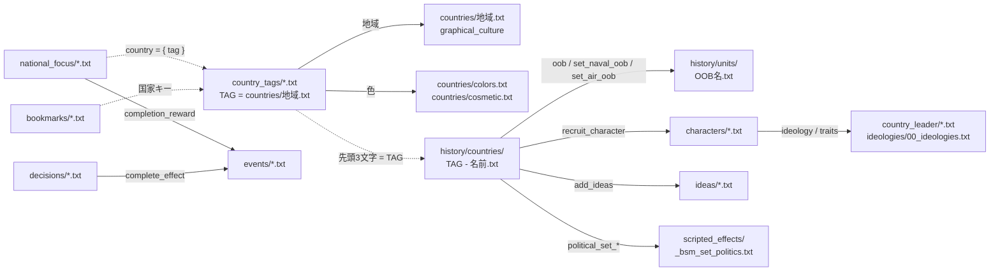
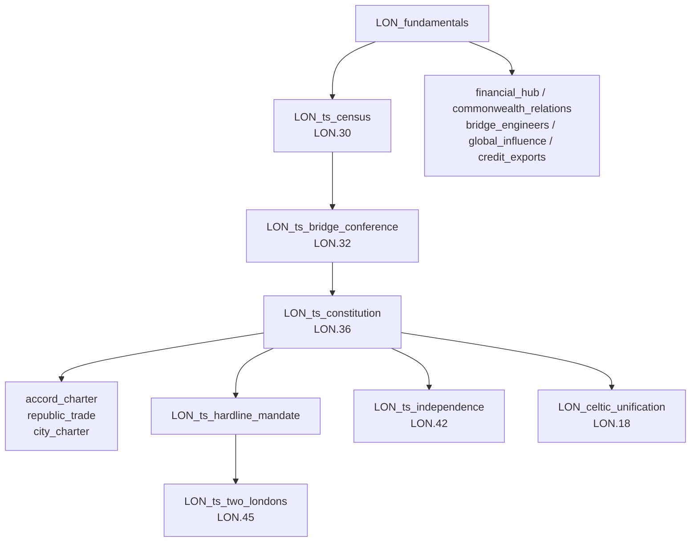

# 12 国家とシナリオ

国家タグ466件の登録から history・OOB・人物・国民精神までのデータモデルと、国家方針73ファイル・イベント142ファイルの棚卸し、主要シナリオの実装状況をまとめる。基準は現在のブランチ `feature/london_three_sovereignties` の作業ツリーで、ロンドン・フランス・スペイン・北センチネルの実装は未コミット変更として存在する。

判定語は次の意味で使う。実装済みは、計画に対応する focus・イベント・決定・国民精神が実在し、日本語キーが揃っていること（静的確認）。部分実装は計画の一部だけが実在すること。計画のみはゲーム用スクリプトが無いこと。実ゲームでの通しプレイは、特記しない限り確認していない。

## 1. 国家データモデル

### 1.1 タグ登録（common/country_tags）

`descriptor.mod` は `country_tags`・`countries`・`ideas`・`characters`・`bookmarks`・`national_focus`・`continuous_focus`・`events`・`history/countries`・`history/units` を `replace_path` で丸ごと差し替える（[descriptor.mod:18](../../bakasekai/descriptor.mod#L18)〜[:22](../../bakasekai/descriptor.mod#L22)、[:29](../../bakasekai/descriptor.mod#L29)、[:34](../../bakasekai/descriptor.mod#L34)、[:47](../../bakasekai/descriptor.mod#L47)〜[:50](../../bakasekai/descriptor.mod#L50)）。`country_leader`・`factions`・`focus_inlay_windows` は置換対象外で、バニラの同名ファイルを上書きする形になる。

| ファイル | 役割 | タグ数 | 参照する地域ファイル |
|---|---|---|---|
| [bsm_default_countries.txt](../../bakasekai/common/country_tags/bsm_default_countries.txt#L1) | MOD側の静的タグ（`LON`・`NSI`・`NTS`・`PAL`・`BTL`・`MYS`・`XXX` など） | 95 | 7種（Asia 38、Western Europe 36、Eastern Europe 11 ほか） |
| [zzz_default_countries.txt](../../bakasekai/common/country_tags/zzz_default_countries.txt#L1) | 基幹の静的タグ（`GBR`・`FRA`・`ESP`・`IRE`・`IND`・`JPN` など） | 246 | 8種（Asia 55、Eastern Europe 50、Africa 45 ほか） |
| [xxx_dependent_countries.txt](../../bakasekai/common/country_tags/xxx_dependent_countries.txt#L1) | 従属地域 `PML`・`GGY`・`JEY`・`GOC`・`CEU`・`GIB` | 6 | Western Europe 3、Commonwealth 3 |
| [zzz_dynamic_countries.txt](../../bakasekai/common/country_tags/zzz_dynamic_countries.txt#L1) | 内戦用の動的タグ `D01`〜`D69` | 69 | `D01.txt`〜`D15.txt` を循環参照 |
| [zzz_japnanese_prefecture.txt](../../bakasekai/common/country_tags/zzz_japnanese_prefecture.txt#L2) | 都道府県用タグ `J00`〜`J48`・`J0K` | 50 | Asia |

5ファイル計466件、重複なし。`history/countries` を持つのは347タグで、持たない119タグは `D*` 69件と `J*` 50件だけ。つまり静的347・動的119に分かれる。

- 動的化は `dynamic_tags = yes` の行より後ろに及ぶ（[zzz_dynamic_countries.txt:1](../../bakasekai/common/country_tags/zzz_dynamic_countries.txt#L1)）。ファイル名が後ろに並ぶ都道府県ファイルはこれを引き継ぐ。ゲーム開始時に領土を持たせるとクラッシュするため、`JSH` だけ静的側へ移された（[zzz_japnanese_prefecture.txt:52](../../bakasekai/common/country_tags/zzz_japnanese_prefecture.txt#L52)、[zzz_default_countries.txt:20](../../bakasekai/common/country_tags/zzz_default_countries.txt#L20)）。
- `D16` 以降は `D01.txt`〜`D15.txt` を再利用する（[zzz_dynamic_countries.txt:17](../../bakasekai/common/country_tags/zzz_dynamic_countries.txt#L17)）。`common/countries` は置換済みでMODに `D01.txt` は無い。ゲームが解決できるかは未確認。

### 1.2 ファイルの関係

北センチネル（`NSI`）を例にたどる。

1. タグは [bsm_default_countries.txt:20](../../bakasekai/common/country_tags/bsm_default_countries.txt#L20) で `countries/Asia.txt` に紐づく。地域ファイルは `graphical_culture` と `graphical_culture_2d` が中心（[Western Europe.txt:1](../../bakasekai/common/countries/Western%20Europe.txt#L1)）。色は [colors.txt:1314](../../bakasekai/common/countries/colors.txt#L1314)。
2. 開始状態は [NSI - North Sentinel Island.txt](../../bakasekai/history/countries/NSI%20-%20North%20Sentinel%20Island.txt#L1) が決める。`oob = "NSI_1936"`（[:2](../../bakasekai/history/countries/NSI%20-%20North%20Sentinel%20Island.txt#L2)）が `history/units/NSI_1936.txt` を、`add_ideas`（[:34](../../bakasekai/history/countries/NSI%20-%20North%20Sentinel%20Island.txt#L34)）が `common/ideas` を、`recruit_character`（[:42](../../bakasekai/history/countries/NSI%20-%20North%20Sentinel%20Island.txt#L42)）が `common/characters` を引く。
3. 政体は `political_set_0 = yes`（[:43](../../bakasekai/history/countries/NSI%20-%20North%20Sentinel%20Island.txt#L43)）で、実体は [_bsm_set_politics.txt:74](../../bakasekai/common/scripted_effects/_bsm_set_politics.txt#L74) の `set_politics`。このscripted effectは15種あり（`political_set_d` が先頭、[:1](../../bakasekai/common/scripted_effects/_bsm_set_politics.txt#L1)）、履歴ファイルの利用は `political_set_d` が最多（77ファイル）。
4. 人物は [characters/NSI.txt:2](../../bakasekai/common/characters/NSI.txt#L2) の `NSI_Zokutyo`。`country_leader` の `ideology = animism`（[:10](../../bakasekai/common/characters/NSI.txt#L10)）は [00_ideologies.txt:558](../../bakasekai/common/ideologies/00_ideologies.txt#L558) のサブイデオロギー、`traits` は `common/country_leader` の `leader_traits`（例 [00_traits.txt:144](../../bakasekai/common/country_leader/00_traits.txt#L144)）を参照する。

OOBはDLC条件で分岐する。`FRA` は No Step Back の有無で `FRA_1936` と `FRA_1936_nsb` を切り替え（[FRA - France.txt:11](../../bakasekai/history/countries/FRA%20-%20France.txt#L11)、[:18](../../bakasekai/history/countries/FRA%20-%20France.txt#L18)）、海軍・空軍は `set_naval_oob`／`set_air_oob` で別ファイルを足す（[:209](../../bakasekai/history/countries/FRA%20-%20France.txt#L209)、[:216](../../bakasekai/history/countries/FRA%20-%20France.txt#L216)）。

### 1.3 命名規則

| 対象 | 規則と実数 |
|---|---|
| `common/countries` | 地域ファイル（Asia、Africa など）と `GER.txt`・`Bohmen Mahren.txt`・`System.txt`、色の `colors.txt`（346ブロック）、化粧タグ色の `cosmetic.txt`。計12ファイル |
| `history/countries` | `TAG - 名前.txt`、先頭3文字がタグ。353ファイル・347タグ。ファイル名の国名は当てにならない（`LON` の履歴は [LON - Ireland.txt](../../bakasekai/history/countries/LON%20-%20Ireland.txt#L1)） |
| `history/units` | ファイル名がOOB名。229ファイルのうち `TAG_1936` 96、`_1936_naval` 65、`_1936_air` 34、`_1936_nsb` 6。シナリオ専用に `IRE_ts_guard`・`NSI_tide_riders` など |
| `common/characters` | `TAG.txt` が224ファイル中219。人物IDは `TAG_名前`（例 `FRA_pierre_laval`、[FRA.txt:2](../../bakasekai/common/characters/FRA.txt#L2)） |
| `common/ideas` | 259ファイルでほぼ自由命名（`TAG.txt` 型は16）。シナリオ分は `FRA_scenario.txt`・`ESP_scenario.txt`・`LON_scenario.txt` |
| `common/country_leader` | トレイト定義のみ15ファイル。国別（`CHL_traits.txt`・`SPL_traits.txt`）とテーマ別が混在 |
| `common/factions` | 国別ではなく条件付きテンプレート。`templates` 10ファイル65定義、`goals`・`rules`・`upgrades` などで構成 |

履歴ファイルの重複に注意。次の6タグは内容の異なる2ファイルを持つ。`KHM`・`IDN`・`NYY`・`BTW`・`MAN`・`PSE`。例えば [KHM - Cambodia.txt](../../bakasekai/history/countries/KHM%20-%20Cambodia.txt#L1)（`capital = 557`）と [KHM- Cambodia.txt](../../bakasekai/history/countries/KHM-%20Cambodia.txt#L1)（`capital = 461`）。ゲームがどちらを採るかは未確認。

## 2. 国家方針

### 2.1 73ファイルの内訳

| 区分 | ファイル数 | 内容 |
|---|---|---|
| 国別・汎用ツリー（`focus_tree`） | 36 | focus 計1986本 |
| 共有方針（`shared_focus` 定義） | 4 | `china_shared` 65、`hre_army` 61、`hre_industry` 40、`hre_resource` 20、計186 |
| スタイル定義 | 1 | `00_titlebar_styles.txt` |
| 全体がコメントアウト | 3 | `lithuania.txt`、`mexico.txt`、`old_japan.txt` |
| 空ファイル（0〜4バイト） | 29 | `uk.txt`・`usa.txt`・`germany.txt`・`generic.txt` など |

`uk.txt` が空であるため、`GBR` には専用ツリーが無い。

### 2.2 ツリーの選択

- タグ固定型。`country = { factor = 0 modifier = { add = 10 tag = X } }` で国に割り当てる（例 [france.txt:4](../../bakasekai/common/national_focus/france.txt#L4)）。`france.txt`・`spain.txt`・`nsi.txt` は `original_tag` も併記する。
- 呼出し型。`factor = 0` だけの6ツリーは `load_focus_tree` で切り替える。`BKK_Long`（[BKK.txt:22](../../bakasekai/events/BKK.txt#L22)）、`BKK_Long_SJK`（[BKK.txt:65](../../bakasekai/events/BKK.txt#L65)）、`McDonald_s`（[MCD.txt:240](../../bakasekai/events/MCD.txt#L240)）、`WES_generic`（[WES.txt:995](../../bakasekai/events/WES.txt#L995)）、`wes-sahara_anarchy`（[WES.txt:1050](../../bakasekai/events/WES.txt#L1050)）、`wes-pdx`（[WES_anarchy.txt:303](../../bakasekai/events/WES_anarchy.txt#L303)）。
- 既定型。[generic2.txt:2](../../bakasekai/common/national_focus/generic2.txt#L2) の `generic_focus` は `default = yes`、`management_system` フラグを持つ国だけ除外する（[:7](../../bakasekai/common/national_focus/generic2.txt#L7)）。専用ツリーの無い国はここに落ちる想定だが、実ゲームでの選択結果は未確認。

### 2.3 規模の大きいツリー

| ファイル | ツリーID | 対象 | focus数 |
|---|---|---|---|
| [generic2.txt](../../bakasekai/common/national_focus/generic2.txt#L2) | `generic_focus` | 既定（上記） | 274 |
| [japan.txt](../../bakasekai/common/national_focus/japan.txt#L2) | `japan` | `JPN` | 187 |
| [wes-3.txt](../../bakasekai/common/national_focus/wes-3.txt#L2) | `wes_3` | `WES` | 139 |
| [france.txt](../../bakasekai/common/national_focus/france.txt#L3) | `fra_focus` | `FRA` | 117 |
| [spain.txt](../../bakasekai/common/national_focus/spain.txt#L3) | `esp_focus` | `ESP` | 108 |
| [McDonald_s.txt](../../bakasekai/common/national_focus/McDonald_s.txt#L2) | `McDonald` | 呼出し型 | 97 |
| [nazo_kari.txt](../../bakasekai/common/national_focus/nazo_kari.txt#L2) | `nazo_kari` | `MYS` | 93 |
| [chile.txt](../../bakasekai/common/national_focus/chile.txt#L2) | `chile` | `CHL` | 83 |
| [nsi.txt](../../bakasekai/common/national_focus/nsi.txt#L3) | `nsi_focus` | `NSI` | 71 |
| [battle3_.txt](../../bakasekai/common/national_focus/battle3_.txt#L2) | `battle_sannkoku12_1` | `BTL`・`BTW`・`BTP`・`BTY`・`BTG` | 64 |
| [WES_generic.txt](../../bakasekai/common/national_focus/WES_generic.txt#L11) | `WES_generic_focus` | 呼出し型 | 60 |
| [NTS.txt](../../bakasekai/common/national_focus/NTS.txt#L2) | `NTS_focus` | `NTS` | 57 |
| [india.txt](../../bakasekai/common/national_focus/india.txt#L2) | `india_bsm_focus` | `IND` | 55 |
| [POS.txt](../../bakasekai/common/national_focus/POS.txt#L2) | `sealand_focus` | `POS` | 51 |
| [china_nationalist.txt](../../bakasekai/common/national_focus/china_nationalist.txt#L2) | `china_nationalist_focus` | `CHN`（Waking the Tiger 必須） | 50 |

残り21ツリーは50本未満（`china_communist` 43、`og` 41、`china_warlord` 38、`BKK_Long` 37、`london` 16、`AST_second_emu_war` 15 など）。共有方針は `shared_focus = ID` の行で取り込む。`generic2`・`nsi`・`POS` は `HRE_…`／`sf_…` の8行（[nsi.txt:21](../../bakasekai/common/national_focus/nsi.txt#L21)〜[:28](../../bakasekai/common/national_focus/nsi.txt#L28)）、`nazo_kari` は `HRE_…` の4行、中国2ツリーは `china_shared` の1行を使う。

### 2.4 inlay window と continuous focus

- [common/focus_inlay_windows](../../bakasekai/common/focus_inlay_windows/ast_right_vs_left_campaign_inlay_window.txt#L1) は5ファイル。バニラ同名ファイルの上書きで、`ger_inner_circle` と `jap_imperial_influence` は全行コメントアウト、`ast_*` 2件と `sia_khana_ratsadon` の3件だけ定義が生きている。どのツリーも `inlay_window` を使わず、対応するGUIウィンドウも無いため、実質は未使用。
- [continuous_focus/generic.txt](../../bakasekai/common/continuous_focus/generic.txt#L1) は1パレット `generic_focus`（`default = yes`）に14本。`DEN_`・`ETH_`・`SWI_` 由来の国別継続方針と `continuous_*` の汎用方針が混在する。

## 3. シナリオ

### 3.1 ブックマーク

[the_gathering_storm.txt](../../bakasekai/common/bookmarks/the_gathering_storm.txt#L1) の1本だけ。開始日は1936.1.1.12（[:5](../../bakasekai/common/bookmarks/the_gathering_storm.txt#L5)）、既定国は `BTL`（[:7](../../bakasekai/common/bookmarks/the_gathering_storm.txt#L7)）。収録は14か国で、主要国6（`BTL`・`MYS`・`WES`・`MAC`・`CHL`・`JPN`）と小国8（`MEX`・`TEX`・`LVE`・`CLF`・`HLW`・`NYY`・`NEV`・`DIS`）。ロンドン・フランス・スペイン・北センチネル・ナントカスタンはブックマークの注目国に載らない。名称・説明キー `GATHERING_STORM_NAME`・`GATHERING_STORM_DESC` はMOD側の日本語localisationに定義が無い（バニラのキーの流用かは未確認）。`bakasekai/tests/` のスモークテストはこのブックマークの国を対象にする（[bsm_featured_majors.txt:1](../../bakasekai/tests/bsm_featured_majors.txt#L1)）。

### 3.2 実装状況の一覧

| シナリオ | タグ | 計画文書 | 判定 | 実在を確認した数 | 版管理 |
|---|---|---|---|---|---|
| ロンドン三主権 | `LON`・`IRE`・`GBR`（受信側） | `LON_london_britain_ireland_scenario.md` | 実装済み | focus 16（既存5＋新規11）、イベント47（新規26）、決定13（新規7）、国民精神10 | 未コミット |
| 英国41国家方針 | `GBR` | `GBR_britain_three_sovereignties_focus_proposal.md` | 計画のみ | 専用focus・イベント・決定なし | 計画文書も未追跡 |
| フランス | `FRA` | `FRA_france_iberia_comonarchy_scenario.md` | 実装済み | focus 117、イベント10、国民精神17、人物60 | 未コミット |
| スペイン | `ESP` | `ESP_spain_caribbean_exile_scenario.md` | 実装済み | focus 108、イベント13、国民精神15、人物10 | 未コミット |
| 北センチネル | `NSI` | `NSI_north_sentinel_scenario.md` | 実装済み | 追加29本が29本とも実在（42→71）、イベント9→17 | 未コミット |
| ナントカスタン | `NTS` | `NTS_nantokastan_scenario.md` | 実装済み | focus 57、イベント5、決定4、人物26 | コミット済み |
| 第二次エミュー戦争 | `AST`・`HRH`・`AUS`・`GBR` | `CONTENT_PLAN_second_emu_war.md` | 実装済み（記載と差異あり） | focus 15、イベント10、国民精神16 | コミット済み |
| インド独立 | `IND` | なし | 実装済み | focus 55、イベント24、決定5 | コミット済み |
| イベリア経済圏 | `ESP`・`CEU`・`PML` | なし | 部分実装 | イベントは全行無効、決定1・AI戦略2が実在 | コミット済み |

計画文書の冒頭記述は実装と食い違う。`ESP` と `FRA` と `NTS` の文書は「未作成／まだない」と書くが、いずれも実装がある（[ESP:3](../ESP_spain_caribbean_exile_scenario.md#L3)、[FRA:3](../FRA_france_iberia_comonarchy_scenario.md#L3)、[NTS:3](../NTS_nantokastan_scenario.md#L3)）。第二次エミュー戦争の文書は focus を13本とするが実際は15本。計画の数字や冒頭ではなく、コードを基準に読むこと。

### 3.3 ロンドン三主権（`LON`・`IRE`・`GBR`）

ブランチ固有の可能性が高い。[london.txt](../../bakasekai/common/national_focus/london.txt#L3) はHEADで5本、作業ツリーで16本。既存5本は `LON_fundamentals`・`LON_financial_hub`・`LON_commonwealth_relations`・`LON_global_influence`・`LON_celtic_unification`、新規11本は `LON_ts_*`。三者協約・共和国・シティ自治・強硬路線の4結末はイベントの選択で決まり、結末の一回適用は実行時の再確認で担保される（[LON文書:42](../LON_london_britain_ireland_scenario.md#L42)）。`LON_ts_constitution` の下に並ぶ後続4本（`accord_charter`・`republic_trade`・`city_charter`・`hardline_mandate`）は結末ごとのフラグで開く（例 [london.txt:302](../../bakasekai/common/national_focus/london.txt#L302) の `LON_ts_accord`）。

- NF呼出し。`LON_ts_census` → `LON.30`（[london.txt:117](../../bakasekai/common/national_focus/london.txt#L117)）、`ts_bridge_conference` → `LON.32`（[:140](../../bakasekai/common/national_focus/london.txt#L140)）、`ts_constitution` → `LON.36`（[:174](../../bakasekai/common/national_focus/london.txt#L174)）、`ts_independence` → `LON.42`（[:407](../../bakasekai/common/national_focus/london.txt#L407)）、`ts_two_londons` → `LON.45`（[:436](../../bakasekai/common/national_focus/london.txt#L436)）。
- イベント。`LON.30`〜`LON.55` の26件は新規の [LON_scenario_events.txt](../../bakasekai/events/LON_scenario_events.txt#L4)。既存の `LON.1`〜`LON.21` は3ファイルに分かれ、4ファイルとも `add_namespace = LON` を共有する（[LON_events.txt:1](../../bakasekai/events/LON_events.txt#L1)、[LON_scenario_events.txt:2](../../bakasekai/events/LON_scenario_events.txt#L2)）。`GBR` は回答を受ける側として `GBR = {` 内で呼ばれる。
- 決定。新規7件は [LON_scenario.txt:1](../../bakasekai/common/decisions/LON_scenario.txt#L1)。内訳は憲法会議の再開・再招集・独立再申請が3件、IRE・LON・GBR間の停戦申し入れが3件、北部協議が1件。カテゴリは `LON`・`GBR`・`IRE` に表示され、`LON_ts_started` フラグで可視化される（[categories/LON_scenario.txt:1](../../bakasekai/common/decisions/categories/LON_scenario.txt#L1)）。
- IRE成立。`IRE` は既存タグだが開始時の所有州は0で、州113・119・134・135は `LON` 所有（[113-Ireland.txt:15](../../bakasekai/history/states/113-Ireland.txt#L15)、[134-Connaught.txt:14](../../bakasekai/history/states/134-Connaught.txt#L14)）。憲法会議で州134・135を `release = IRE`（[LON_scenario_effects.txt:31](../../bakasekai/common/scripted_effects/LON_scenario_effects.txt#L31)）して成立させ、`IRE_ts_guard` の守備隊を [LON_scenario_effects.txt:49](../../bakasekai/common/scripted_effects/LON_scenario_effects.txt#L49) の `load_oob` で配備する。
- 検証記録。構文木検査・モデル検証・隔離環境での起動はPASS。キャンペーン中のイベント選択、NF画面、IRE部隊、陣営戦争の停戦波及は未実施（[verification README:3](../verification/london-three-sovereignties-2026-11-01/README.md#L3)〜[:8](../verification/london-three-sovereignties-2026-11-01/README.md#L8)）。

### 3.4 英国41国家方針（`GBR`）

計画のみ。提案書自身が「ゲーム用スクリプトは未実装」と明記している（[GBR提案:3](../GBR_britain_three_sovereignties_focus_proposal.md#L3)、[:167](../GBR_britain_three_sovereignties_focus_proposal.md#L167)）。実コードでも `national_focus` に `GBR_`／`ENG_` のfocus IDは無く、`uk.txt` は空。英国側の挙動は上のロンドン用イベントの受信側だけが実在する。`documents/implementation/GBR_swe2/` には41個のID契約とGemini生成のdesc下書きがあるが、ゲーム側localisationへは未配置で、実装担当の実行先の確認待ちと記録されている（[GBR_swe2 README:11](../implementation/GBR_swe2/README.md#L11)）。作業ツリーは共有されているので、並行して着手される可能性がある。

### 3.5 フランスとスペイン（`FRA`・`ESP`）

両ツリーとも、HEADでは0行の空ファイルだったものが作業ツリーで実装されている。計画のfocus IDを抽出して照合すると、`fra_focus` は117本すべて、`esp_focus` は108本すべてが計画に載ったIDと一致した（計画の合計は [FRA:402](../FRA_france_iberia_comonarchy_scenario.md#L402)、[ESP:375](../ESP_spain_caribbean_exile_scenario.md#L375)）。

| 項目 | フランス | スペイン |
|---|---|---|
| ツリー | [france.txt:3](../../bakasekai/common/national_focus/france.txt#L3) 117本 | [spain.txt:3](../../bakasekai/common/national_focus/spain.txt#L3) 108本 |
| イベント | [France.txt](../../bakasekai/events/France.txt#L1) `fra_scenario.1`〜`.20` の10件 | [Spain.txt](../../bakasekai/events/Spain.txt#L1) `esp_scenario.1`〜`.20` の13件 |
| 固有変数 | `FRA_crown_seat`（-100〜+100にclamp、[FRA_scenario_effects.txt:5](../../bakasekai/common/scripted_effects/FRA_scenario_effects.txt#L5)） | `ESP_proof_fleet` など四つの証（[ESP_scenario_effects.txt:6](../../bakasekai/common/scripted_effects/ESP_scenario_effects.txt#L6)）と `ESP_FRA_rapport`（[:81](../../bakasekai/common/scripted_effects/ESP_scenario_effects.txt#L81)） |
| 開始時の国民精神 | `FRA_two_crowns` ほか3件（[FRA - France.txt:135](../../bakasekai/history/countries/FRA%20-%20France.txt#L135)） | `ESP_government_in_exile` ほか3件（[ESP - Spain.txt:30](../../bakasekai/history/countries/ESP%20-%20Spain.txt#L30)） |
| 人物 | [FRA.txt](../../bakasekai/common/characters/FRA.txt#L1) 60人（人物数は変わらず、指導者枠14行を追加） | [ESP.txt](../../bakasekai/common/characters/ESP.txt#L1) 10人（新規）、履歴で登用（[:38](../../bakasekai/history/countries/ESP%20-%20Spain.txt#L38)） |
| 決定 | なし（`FRA.txt` は0バイト、カテゴリはコメントアウト） | なし |

`ESP_FRA_rapport` の正本は `ESP` 側の国変数で、`FRA` からは `ESP = { ... }` 経由で動かす（[FRA_scenario_effects.txt:2](../../bakasekai/common/scripted_effects/FRA_scenario_effects.txt#L2)）。AI戦略・テンプレートも `FRA_scenario_*`・`ESP_*` として追加されている。両ツリーは「政治・外交の枝は共通の親を持ち、政治／産業／軍事の分野間は独立」という配置規則に揃えてある（[france.txt:2](../../bakasekai/common/national_focus/france.txt#L2)）。座標・前提の独立性は `tools/verify_scenario_focus_layout.py` で3か国PASSだが、実ゲームの画面確認は未実施（[layout README:24](../verification/scenario-focus-layout-2026-11-01/README.md#L24)、[:34](../verification/scenario-focus-layout-2026-11-01/README.md#L34)）。

### 3.6 北センチネル（`NSI`）

既存ツリー42本に、計画の追加29本（潮位の幹3、外界接触6、古層・超技術8、GMI・アンダマン5、海と船4、文明・統合3）がすべて追加されている。計画の合計は [NSI文書:218](../NSI_north_sentinel_scenario.md#L218)。追加の最初は [`NSI_strange_sails`](../../bakasekai/common/national_focus/nsi.txt#L1059)、最後は [`NSI_bengal_reach`](../../bakasekai/common/national_focus/nsi.txt#L1719)。イベントは `nsi_events.1`〜`.8`・`.100` にHEADの9件があり、`.9`〜`.16` の8件が追加された。追加分は方針の報酬から呼ばれる（例 [nsi.txt:1073](../../bakasekai/common/national_focus/nsi.txt#L1073)）。固有変数 `NSI_tide_gauge`（外界の圧力）と `NSI_depth`（古層の深度）は [NSI_scenario_effects.txt:2](../../bakasekai/common/scripted_effects/NSI_scenario_effects.txt#L2) で定義され、艇隊OOB `NSI_tide_riders` は方針から `load_oob` される（[nsi.txt:1627](../../bakasekai/common/national_focus/nsi.txt#L1627)）。開始時の国民精神 `NSI_tide_weight` は [履歴:39](../../bakasekai/history/countries/NSI%20-%20North%20Sentinel%20Island.txt#L39)。

### 3.7 ナントカスタン（`NTS`）

実装済みで、文書冒頭の「方針樹はまだない」は古い。[NTS.txt](../../bakasekai/common/national_focus/NTS.txt#L2) は57本で、計画の幹・政治・産業・軍事・海のfocus IDが実在し、計画に無い外交系12本（`NTS_foreign_desk`・`NTS_seek_recognition`・`NTS_break_with_moscow`・`NTS_kashmir_dossier` など）が末尾側に加わっている。国境紛争の実装記録（[NTS文書:364](../NTS_nantokastan_scenario.md#L364)）も、コードと合っている。カシミール（州441）は三択の決定3件が共通フラグ `NTS_kashmir_policy` で排他になり、戦争目標を選んだ場合に限り、占領・領有後に `NTS_integrate_kashmir` が `NTS` コアを足す（[NTS_decisions.txt:3](../../bakasekai/common/decisions/NTS_decisions.txt#L3)、[:16](../../bakasekai/common/decisions/NTS_decisions.txt#L16)、[:39](../../bakasekai/common/decisions/NTS_decisions.txt#L39)、[:57](../../bakasekai/common/decisions/NTS_decisions.txt#L57)）。カザフ9州から `KAZ` コアは外れ、`NTS` コアが付いている（例 [583-Kazakhstan.txt:9](../../bakasekai/history/states/583-Kazakhstan.txt#L9)）。イベントは名前空間 `nts` の5件（[NTS.txt:1](../../bakasekai/events/NTS.txt#L1)）。

### 3.8 第二次エミュー戦争（`AST`・`HRH`・`AUS`・`GBR`）

実装済み。[AST_second_emu_war.txt](../../bakasekai/common/national_focus/AST_second_emu_war.txt#L6) は15本（文書は13本、[CONTENT_PLAN:53](../../CONTENT_PLAN_second_emu_war.md#L53)）。イベントは [second_emu_war_ast_support_events.txt](../../bakasekai/events/second_emu_war_ast_support_events.txt#L5) の3名前空間 `sew_support`・`sew_aus`・`sew_gbr` に10件で文書どおり。国民精神16、AIテンプレート・戦略・プランの各ファイルとlocalisationも実在する。

文書との差が一点ある。文書は `HRH_recapture_states.2` から `sew_support.1` を送るとするが（[events:20](../../bakasekai/events/second_emu_war_ast_support_events.txt#L20)の注記）、実際の起点は `AST` の方針 `AST_sew_respond_to_hrh` が `HRH` へ送る形（[AST_second_emu_war.txt:44](../../bakasekai/common/national_focus/AST_second_emu_war.txt#L44)）。開放条件の `AST_sew_hrh_contacted`（[:33](../../bakasekai/common/national_focus/AST_second_emu_war.txt#L33)）は読む側だけで、立てる箇所が無い。文書が「将来の拡張候補」とする `HRH_second_emu_war.txt`・`GBR_emu_intervention.txt`・`second_emu_war_decisions.txt`（[CONTENT_PLAN:395](../../CONTENT_PLAN_second_emu_war.md#L395)〜[:397](../../CONTENT_PLAN_second_emu_war.md#L397)）はいずれも未作成。

### 3.9 インド独立（`IND`）

計画文書は無いが実装済み。[india.txt](../../bakasekai/common/national_focus/india.txt#L2) の55本が [bsm_ind_independence_events.txt](../../bakasekai/events/bsm_ind_independence_events.txt#L1) の24件（`bsm_ind.1`〜`.31`、`2b`・`4b` などの枝番付き）を呼び、`GBR`・`PAK`・`SIA` へも送る（[india.txt:1044](../../bakasekai/common/national_focus/india.txt#L1044)、[:1183](../../bakasekai/common/national_focus/india.txt#L1183)）。決定は [bsm_ind_decisions.txt](../../bakasekai/common/decisions/bsm_ind_decisions.txt#L1) に5件。日本語キー101件が `bsm_ind_events_l_japanese.yml` と `bakasekai/bsm_ind_l_japanese.yml` に重複定義されている（[前者:3](../../bakasekai/localisation/japanese/bsm_ind_events_l_japanese.yml#L3)）。

### 3.10 イベリア経済圏

イベントは無効。[bsm_iberian_events.txt](../../bakasekai/events/bsm_iberian_events.txt#L1) は全行コメントアウトで、localisation側のキー `bsm_iberian_sphere.10.t` だけが残る（[BSM_diplomacy_l_japanese.yml:28](../../bakasekai/localisation/japanese/BSM_diplomacy_l_japanese.yml#L28)）。実際に動くのは決定 `BSM_petition_to_join_iberian_sphere` で、`ESP` へ経済同盟のイベント `bsm_economic_alliance_actions.1` を送る（[bsm_iberian_expansion.txt:2](../../bakasekai/common/decisions/bsm_iberian_expansion.txt#L2)、[:80](../../bakasekai/common/decisions/bsm_iberian_expansion.txt#L80)）。AI戦略は `RED` だけが `ESP` と同盟・友好を狙う設定（[bsm_iberian_ai_strategy.txt:1](../../bakasekai/common/ai_strategy/bsm_iberian_ai_strategy.txt#L1)）。

### 3.11 シナリオ実装の構成

新規シナリオは、方針ツリーを核に、イベント・国民精神・scripted effect・AIを国別の接頭辞で並べる型に揃っている。固有メカニクスは国変数を `*_scenario_effects.txt` の scripted effect で更新し、`*_scenario_triggers.txt` で方針の `available` に使う。

| シナリオ | イベント | 国民精神 | scripted effect／trigger | AI（戦略／プラン／テンプレート） | OOB・その他 |
|---|---|---|---|---|---|
| `LON` | `LON_*` 4ファイル | `LON_scenario.txt` | effect のみ（`LON_scenario_effects.txt`） | なし | `IRE_ts_guard.txt`、決定3ファイル |
| `FRA` | `France.txt` | `FRA_scenario.txt` | 両方（`FRA_scenario_*`） | `FRA_scenario*` | 既存人物へ指導者枠を追加 |
| `ESP` | `Spain.txt` | `ESP_scenario.txt` | 両方（`ESP_scenario_*`） | `ESP*` | `ESP_marines_oob.txt`、人物の新設 |
| `NSI` | `nsi_events.txt` | `nsi.txt`（既存に追記） | 両方（`NSI_scenario_*`） | `NSI*` | `NSI_tide_riders*.txt`、`nsi_decisions.txt` |
| `NTS` | `NTS.txt` | `NTS.txt` | 両方（`NTS_scripted_*`） | `NTS*` | `NTS_decisions.txt`、人物26 |
| 第二次エミュー戦争 | `second_emu_war_ast_support_events.txt` | `second_emu_war_ideas.txt` | なし | `sew_*` 3ファイル | なし |

## 4. イベント

### 4.1 棚卸し

142ファイルのうちイベント定義を持つのは67ファイル、定義数は930件、名前空間は86種。残り75ファイルは定義ゼロで、71ファイルが0〜5バイトの空ファイル、4ファイル（`LaR_France.txt`・`USA.txt`・`_bsm_HarvestSystem.txt`・`bsm_iberian_events.txt`）が全行コメントアウト。`BBA_`・`BFTB_`・`DOD_`・`LAR_`・`MTG_`・`NSB_`・`TFV_`・`WTT_` はバニラのDLCイベントと同じ接頭辞で、このうち `LaR_agent_events.txt` と `LaR_espionage_operations.txt` 以外は定義ゼロ。

| 区分（本ページでの分類） | ファイル数 | イベント数 | 代表 |
|---|---|---|---|
| 汎用・ゲーム全体 | 11 | 430 | `NewsEvents.txt` 291（`news`）、`stability_events.txt` 32、`Generic.txt` 25 |
| 国別・シナリオ | 38 | 386 | `WES.txt` 47、`MCD.txt` 27、`LON_*` 4ファイル47、`bsm_ind_independence_events.txt` 24 |
| MODシステム（`_bsm_*`・`bsm_ea_*` ほか） | 14 | 73 | `bsm_economic_alliance_events.txt` 13、`bsm_ea_diplomatic_events.txt` 11、`_bsm_mine.txt` 9 |
| バカ企画系 | 4 | 41 | `Baka_QuizOlympics.txt` 20、`BAKA_SuperEvents.txt` 9 |
| 定義なし | 75 | 0 | 上記のとおり |

### 4.2 名前空間とIDの付け方

統一された規則は無く、次の4系統が混在する。

- 大文字3字のタグ。`LON`・`BKK`・`MCD`・`WES`・`MYS`・`HRH`（例 [WES.txt:1](../../bakasekai/events/WES.txt#L1)）。
- 小文字の略称。`nts`（[NTS.txt:1](../../bakasekai/events/NTS.txt#L1)）、`emu`、`kpo`、`low`。タグ名の大小が方針（`NTS_`）と揃っていない。
- `シナリオ名_scenario`／`機能名_events`。`fra_scenario`（[France.txt:1](../../bakasekai/events/France.txt#L1)）、`esp_scenario`（[Spain.txt:1](../../bakasekai/events/Spain.txt#L1)）、`nsi_events`（[nsi_events.txt:1](../../bakasekai/events/nsi_events.txt#L1)）。
- システムの `bsm_` 接頭辞。`bsm_ea_*`・`bsm_economic_alliance_*`・`bsm_fallen_empire`・`bsm_ind`（[bsm_ind_independence_events.txt:1](../../bakasekai/events/bsm_ind_independence_events.txt#L1)）。

名前空間とファイルは1対1ではない。`LON` は4ファイル、`POS_*` の5名前空間は1ファイル（[POS_events.txt:1](../../bakasekai/events/POS_events.txt#L1)、[:183](../../bakasekai/events/POS_events.txt#L183)）に入る。IDは `名前空間.番号` で、シナリオでは番号の帯を段階ごとに分ける。`LON.1`〜`.21` が既存、`LON.30`〜`.55` が三主権。`nsi_events` は `.1`〜`.16` に、方針から呼ばれるニュース用の `.100`。`bsm_ind` は番号を1・10・20・30台に分け、返信用に `2b`・`2c` のような枝番を使う。

## 5. 未確認と注意点

- 本ページの「実装済み」は静的確認。実プレイの通しは、ロンドンの隔離起動（メインメニューと初期履歴読込）を除き未確認。起動テストは今回実施していない。
- 作業ツリーは共有されており、`GBR` の実装が並行して始まる可能性がある。再確認は `common/national_focus/` に `GBR_` のfocus IDがあるかで行える。
- 計画文書と実装の食い違い（3.2節）、履歴ファイルの重複6タグ（1.3節）、`D01.txt` の解決（1.1節）は、いずれもゲーム側の挙動を確認していない。
- `HRH` の国名localisationキーは確認できなかった。イベント文では「ハットリバー公国」。

## 関連ページ

- [01-overview](01-overview.md)
- [02-architecture](02-architecture.md)
