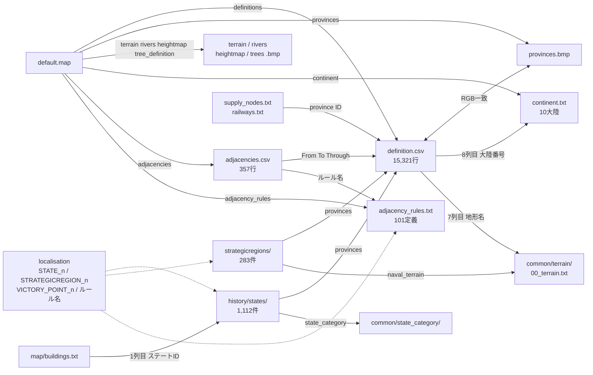
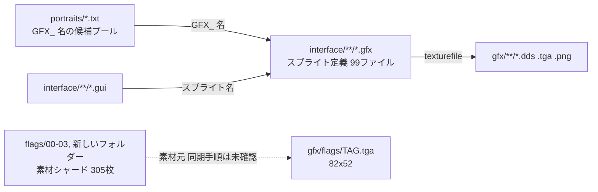

# 13 マップ・アセット・ローカライズ

BSMは `replace_path="map"` でバニラのマップを丸ごと差し替え、15,320プロヴィンス・1,112ステート・283ストラテジックリージョンの独自世界を持つ（[descriptor.mod:53](../../bakasekai/descriptor.mod#L53)）。これを `gfx/` 12,650ファイル（約1.47 GiB）と、日本語193・英語82のローカライズファイルが支える。英語のキーカバレッジは33.6%（[3.3](#33-loc_coveragepy-の実行結果)）。

## 集計方法と前提

- 件数・容量は作業ツリーで `find` とPython（`os.walk`、正規表現）により集計した。測定日は2026-11-02。作業ツリーには他作業の未コミット編集（ローカライズ・GUI画像など）があり、数値はその時点のスナップショットである。
- 容量はファイルサイズの合計（MiB = 2^20バイト）。[01-overview](01-overview.md) の `du` 値（gfx 1.5G）とは丸めが異なる。
- バイナリ（BMP・DDS・OGG・WAV）は中身を読んでいない。画像のピクセル寸法は未確認である。
- 読み取り専用で実行したもの: `tools/loc_coverage.py`（`GITHUB_STEP_SUMMARY` 未設定で実行し出力ファイルなし）、`.claude/skills/hoi4-map-editing/scripts/check_map.py`。ファイルを出力するスクリプトは実行していない。
- 「ローカルのバニラ」は `~/Library/Application Support/Steam/steamapps/common/Hearts of Iron IV` を指す。版は未確認で、参考比較に限る。

## 1. マップ（`bakasekai/map/`）

### 1.1 ファイル構成

`map/` は310ファイル・180.0 MiB。`default.map` が列挙するのは12ファイルだけで、残りは `default.map` に記載がなく固定の名前で置かれている。

| ファイル | 役割 | 実数・サイズ | 出典 |
|---|---|---|---|
| `default.map` | 各ファイルへの参照と `tree` パレット指定（`climate` は無効化） | 16行 | [default.map:1](../../bakasekai/map/default.map#L1)、[:11](../../bakasekai/map/default.map#L11)、[:16](../../bakasekai/map/default.map#L16) |
| `definition.csv` | プロヴィンス定義 `id;R;G;B;type;coastal;terrain;continent` | 15,321行・519 KiB | [definition.csv:1](../../bakasekai/map/definition.csv#L1) |
| `provinces.bmp` | プロヴィンス色ビットマップ | 37.5 MiB | [default.map:2](../../bakasekai/map/default.map#L2) |
| `terrain.bmp` `rivers.bmp` `heightmap.bmp` `trees.bmp` | 地形・河川・高さ・樹木 | 各12.5 MiB | [default.map:4-7](../../bakasekai/map/default.map#L4) |
| `positions.txt` | 0バイト（空） | 0 B | [default.map:3](../../bakasekai/map/default.map#L3) |
| `continent.txt` | 大陸名の並び（10件、`shikoku` を含む） | 12行 | [continent.txt:2](../../bakasekai/map/continent.txt#L2)、[:11](../../bakasekai/map/continent.txt#L11) |
| `adjacencies.csv` | 海峡・不可侵境界などの隣接 | 357行＋終端1行 | [adjacencies.csv:1](../../bakasekai/map/adjacencies.csv#L1)、[:359](../../bakasekai/map/adjacencies.csv#L359) |
| `adjacency_rules.txt` | 隣接の通行ルール（運河・海峡） | 101定義 | [adjacency_rules.txt:12](../../bakasekai/map/adjacency_rules.txt#L12)、[:14](../../bakasekai/map/adjacency_rules.txt#L14) |
| `supply_nodes.txt` | 補給ノード（`level province`） | 709行 | [supply_nodes.txt:1](../../bakasekai/map/supply_nodes.txt#L1) |
| `railways.txt` | 鉄道（`level 件数 province…`） | 720行 | [railways.txt:1](../../bakasekai/map/railways.txt#L1) |
| `buildings.txt` | 建物の配置座標（1列目がステートID） | 74,132行・3.5 MiB | [buildings.txt:1](../../bakasekai/map/buildings.txt#L1) |
| `cities.txt` / `cities.bmp` | 街の配置パラメータとその元画像 | 133行／12.5 MiB | [cities.txt:1](../../bakasekai/map/cities.txt#L1) |
| `seasons.txt` `ambient_object.txt` | 季節・環境オブジェクト | 149／190行 | [default.map:12-13](../../bakasekai/map/default.map#L12) |
| `unitstacks.txt` `weatherpositions.txt` `world_normal.bmp` `terrain/*.dds` | 表示位置・天候位置・法線マップ・都市発光マスク（`default.map` に記載なし） | 301,114行／562行／9.4 MiB／3.1 MiB | 実測のみ |
| `strategicregions/` | ストラテジックリージョン | 283ファイル | [1.3](#13-ストラテジックリージョン) |

`documents/03_map/` の資料は河川ビットマップの仕様1本（24行）だけで、`rivers.bmp` は8bitインデックス、1px幅、直交のみとされる（[01_River.md:3](../03_map/01_River.md#L3)）。GIMPで保存するとパレット不正のエラーが出るが無視できる、とも記されている（[01_River.md:24](../03_map/01_River.md#L24)）。

### 1.2 プロヴィンス（`definition.csv`）

行番号と ID が全行で一致する（`id == 行番号 - 1`、不一致0件）。`0;0;0;0;land;true;unknown;0` は予約行で、実プロヴィンスは1〜15320の15,320件（[definition.csv:1](../../bakasekai/map/definition.csv#L1)、[:15321](../../bakasekai/map/definition.csv#L15321)）。

| 区分 | 件数 | 割合（15,320件中） |
|---|---:|---:|
| `land`（id 0 を除く） | 11,458 | 74.8% |
| `sea` | 3,735 | 24.4% |
| `lake` | 127 | 0.8% |

海陸比はプロヴィンス数ベースで、陸 : 海＋湖 = 11,458 : 3,862（約2.97 : 1）。面積比はBMPを読んでいないため未確認。

陸の地形（7列目）は plains 3,136、forest 2,504、mountain 2,008、hills 1,793、desert 1,029、jungle 572、urban 276、marsh 140。大陸（8列目、`continent.txt` の並び順に1始まり）の陸プロヴィンス数は asia 3,767、europe 3,473、north_america 1,304、africa 874、south_america 677、middle_east 466、australia 381、shikoku 197、antarctica 185、north_pole 134。

`shikoku` はバニラにない独自大陸で、`australia` と別に197件を持つ（[continent.txt:11](../../bakasekai/map/continent.txt#L11)）。地形名と海軍用地形は `common/terrain/00_terrain.txt` の定義に対応する（`large_river`、`water_fjords`、`water_shallow_sea`、`water_deep_ocean` は [00_terrain.txt:22](../../bakasekai/common/terrain/00_terrain.txt#L22)、[:258](../../bakasekai/common/terrain/00_terrain.txt#L258)、[:303](../../bakasekai/common/terrain/00_terrain.txt#L303)、[:318](../../bakasekai/common/terrain/00_terrain.txt#L318)）。

### 1.3 ストラテジックリージョン

`strategicregions/` は283ファイル。`id` は1〜283で重複・欠番なし。全15,320プロヴィンスがちょうど1つのリージョンに属し、重複所属は0件（`check_map.py` の結果と集計の双方で確認）。

| 項目 | 値 |
|---|---|
| 1リージョンあたりのプロヴィンス数 | 最小1、最大299、平均54.1 |
| 構成 | 陸のみ109、海のみ73、陸＋海51、湖＋陸43、湖＋陸＋海5、湖＋海2 |
| `naval_terrain` | `water_deep_ocean` 37、`water_fjords` 23、`water_shallow_sea` 15、`large_river` 9、未指定199 |

ファイル書式は `id`、`name="STRATEGICREGION_<id>"`、`provinces`、`naval_terrain`、`weather` の並びである（[1-Southern England.txt:3-9](../../bakasekai/map/strategicregions/1-Southern%20England.txt#L3)）。ファイル名は `<id>-<名前>.txt` が基本だが、`281 - Alboran sea.txt`、`282 -amazon_r.txt` のように表記が揺れる。

`215-Namibia.txt` は `id=215` なのに `name="STRATEGICREGION_228"` で、日本語名は「スーダン」になる。`STRATEGICREGION_215`（イタリア南部）は参照されない（[215-Namibia.txt:3-4](../../bakasekai/map/strategicregions/215-Namibia.txt#L3)、[BSM_strategic_region_l_japanese.yml:216](../../bakasekai/localisation/japanese/replace/bakasekai/BSM_strategic_region_l_japanese.yml#L216)、[:229](../../bakasekai/localisation/japanese/replace/bakasekai/BSM_strategic_region_l_japanese.yml#L229)）。他の282件は名前とidが一致する。

### 1.4 ステート（`history/states/`）との関係

ステートは1,112ファイルで、`id` は1〜1112の連番。`provinces` に列挙された陸・湖プロヴィンスだけを持ち、海プロヴィンスはどのステートにも属さない（[1-France.txt:27-29](../../bakasekai/history/states/1-France.txt#L27)）。

| 項目 | 値 |
|---|---|
| ステートが参照するプロヴィンス | 11,556件（重複所属0） |
| うち陸 | 11,458件（陸プロヴィンスの全数） |
| うち湖 | 98件（湖127件のうち29件は無所属） |
| 1ステートあたり平均 | 10.4件 |

`buildings.txt` の1列目は1〜1112の全1,112ステートIDに一致する。ステート側の `victory_points` と `buildings` ブロックは、勝利点や海軍基地の位置をプロヴィンスIDで指す（[1-France.txt:14-21](../../bakasekai/history/states/1-France.txt#L14)）。州の `provinces` を動かす際は、移動元・先の両方、勝利点、建物位置を揃える（[SKILL.md:56-57](../../.claude/skills/hoi4-map-editing/SKILL.md#L56)）。

### 1.5 マップデータの依存関係

`definition.csv` のRGBと `provinces.bmp` の色が1対1で対応し、IDとRGBに重複がないことが整合性の前提になる（[SKILL.md:42-48](../../.claude/skills/hoi4-map-editing/SKILL.md#L42)）。

### 1.6 隣接・補給・鉄道

| 項目 | 集計 |
|---|---|
| `adjacencies.csv` の型 | `sea` 189、`impassable` 159、型が空欄9（計357） |
| `sea` の典型形 | 189件中176件が「陸 - 陸、Throughが海」の海峡 |
| ルール名つき隣接 | 34件（31種類）。ルール名はすべて `adjacency_rules.txt` に定義あり |
| `supply_nodes.txt` | 709件、すべて `level 1`、すべて陸プロヴィンス・重複なし |
| `railways.txt` | 720本。レベル1が434、2が255、3が27、4が4。件数列と実際のプロヴィンス数の不一致0。通る陸プロヴィンスは2,557件 |

隣接のルール名は `adjacency_rules.txt` の `name` と一致させる（[adjacency_rules.txt:12](../../bakasekai/map/adjacency_rules.txt#L12)）。表示名は `BSM_adjacency_rules_l_japanese.yml`（104行）で定義される。

### 1.7 `common/state_category/`

`state_category` は `replace_path` の対象外で、同名ファイルがバニラを上書きする形になっている。MOD側は14ファイルで、有効な定義は `BSM_state_category.txt` の25種と `large_island.txt` の1種、計26種類（[BSM_state_category.txt:1](../../bakasekai/common/state_category/BSM_state_category.txt#L1)、[large_island.txt:1](../../bakasekai/common/state_category/large_island.txt#L1)）。残る12ファイル（`city.txt` など）は全行コメントアウトされた空殻で（[city.txt:1](../../bakasekai/common/state_category/city.txt#L1)）、14ファイルのうち `BSM_state_category.txt` を除く13ファイルの名前は、ローカルのバニラの13ファイルと一致する。バニラ定義を無効化して `BSM_state_category.txt` に集約する形だが、その意図を記した文書は未確認である。

建物スロット数は `tiny_island` 0、`rural` 2、`town` 4、`city` 7、`metropolis` 14、`megalopolis` 18、`ecumenopolis` 40（[BSM_state_category.txt:104](../../bakasekai/common/state_category/BSM_state_category.txt#L104)、[:130](../../bakasekai/common/state_category/BSM_state_category.txt#L130)）。1,112ステートが使うのは18種類で、定義済み8種（`abandoned`、`atoll`、`great_reef`、`medium_city`、`medium_towm`、`reef`、`semi_ecumenopolis`、`sp_large_city`）は未使用。

使用数は `rural` 315、`town` 214、`city` 165、`pastoral` 99、`large_city` 68、`wasteland` 61、`small_island` 56、`large_town` 32、`tiny_island` 30、`metropolis` 23、`enclave` 20、`megalopolis` 17、`pastoral_town` 4、`large_island` 3、`medium_island` 2、`sp_metropolis` `sp_megalopolis` `ecumenopolis` が各1。

`state_category` の値が引用符つき（`"rural"` など）のファイルが11件ある。`medium_towm` は綴り違いの名前のまま定義されている（[BSM_state_category.txt:73](../../bakasekai/common/state_category/BSM_state_category.txt#L73)）。`ecumenopolis` の `color` は `62400 240 240` で通常の0〜255を超える（[BSM_state_category.txt:133](../../bakasekai/common/state_category/BSM_state_category.txt#L133)）。

### 1.8 整合性検査

`check_map.py` は、IDとRGBの重複、リージョン・ステートの重複所属、`definition.csv` にないプロヴィンスの参照を検査する（[check_map.py:1-14](../../.claude/skills/hoi4-map-editing/scripts/check_map.py#L1)）。2026-11-02の実行結果は7項目すべて `OK`、終了コード0だった。

マップ編集後は `naval_dist.cache` と `naval_dist_checksum.cache` を両方削除し、2回起動して確認する決まりがある。ファイルを直しても古いキャッシュが残ると2回目の起動で落ちるためである（[SKILL.md:11-17](../../.claude/skills/hoi4-map-editing/SKILL.md#L11)、[:19-32](../../.claude/skills/hoi4-map-editing/SKILL.md#L19)）。本ページの作業ではゲームを起動していない。

### 1.9 残存物と注意点

- ローカルのバニラの `map/` と比べると、MOD側にない項目は `colors.txt` と `supplyareas/`、MOD側にだけある項目は `provinces.mdp`（1.1 MiB）、`provinces2.bmp`（37.5 MiB）、`rivers.bmp.backup`（12.5 MiB）、`rivers_transparent_don't_delete.png`（165 KiB）の4つである。
- この4つは `default.map` から参照されない。リポジトリ内で名前が出るのは `rivers.bmp.backup` だけで、バックアップの「前例」としての言及（[SKILL.md:52](../../.claude/skills/hoi4-map-editing/SKILL.md#L52)）とクラッシュ調査メモ内のgit status記録（[hoi4_crash_debug_20260604.md:298](../hoi4_crash_debug_20260604.md#L298)）のみ。4つともGit管理下にある。
- `provinces.bmp` と `provinces2.bmp` は同サイズ（39,321,654バイト）でGitのblobは別物。どちらが最新かは未確認。
- 不整合に見える行: プロヴィンス5257は `sea` なのに大陸が `north_america`（[definition.csv:5258](../../bakasekai/map/definition.csv#L5258)）、8913は `sea` で地形が `plains`（[:8914](../../bakasekai/map/definition.csv#L8914)）、`13154` 以降の8件は `sea` で地形が `lakes`（[:13155](../../bakasekai/map/definition.csv#L13155)）。

## 2. アセット

### 2.1 `gfx/` の内訳

12,650ファイル・1,508.7 MiB（`.DS_Store` 3件を含む）。容量の63%（946.2 MiB）をフォントが占める。

| サブフォルダ | ファイル数 | 容量（MiB） | 内容 |
|---|---:|---:|---|
| `fonts/` | 184 | 946.2 | 日本語ビットマップフォント（`.dds`＋`.fnt`）。`japanese/` に44件・240.3 MiB。最大は `18mbs.dds` の46.9 MiB |
| `interface/` | 7,894 | 222.7 | 方針アイコン `goals/` 4,515、アイデア `ideas/` 2,208、`win95/` 427、`techtree/` 108 ほか |
| `loadingscreens/` | 75 | 187.4 | ロード画面（`replace_path` 対象） |
| `leaders/` | 819 | 83.8 | 人物ポートレート。97の国別サブフォルダ＋直下4 |
| `flags/` | 3,534 | 40.7 | 国旗（2.3） |
| `event_pictures/` `sp_events/` | 22／11 | 15.3／8.6 | イベント画像、特殊イベント画像 |
| `models/` `entities/` | 20／8 | 3.2／0.0 | 3Dモデル、エンティティ定義（`.gfx` 4件） |
| `parties/` `religion/` `currency/` `companies/` | 19／20／27／8 | 各0.2以下 | 政党・宗教・通貨・企業アイコン |
| その他 | 計9 | 0.2 | `train_gfx_database` 2、`army_icons` 1、`gfx` 直下6 |

拡張子別では `.dds` 7,247件（1,301.6 MiB）、`.tga` 3,911件（62.7 MiB）、`.png` 1,343件（35.0 MiB）、`.fnt` 91件（101.8 MiB）。画像以外の残存物として、`gfx/interface/goals/goal_shinemaker.exe`（4.6 MiB、Git管理下）、`goals/zzz_focus_clan_TEMPLATE.psd`、`fonts/jis16.pdn`、`gfx/HOI4_icon.bmp` がある。

### 2.2 `interface/*.gfx` のスプライト定義

`interface/` は280ファイル（`.gui` 180、`.gfx` 99、`.txt` 1）。`.gfx` の内訳は直下53、`thirdparty mods/` 28、`replace/` 15、`external/` 3。各 `.gfx` が `GFX_*` 名とテクスチャのパスを結ぶ（[BSM_goals.gfx:5-8](../../bakasekai/interface/BSM_goals.gfx#L5)）。

| 項目 | 集計 |
|---|---|
| スプライト系ブロック | 11,519（`spriteType` 11,329、`corneredTileSpriteType` 92、`textSpriteType` 59、`frameAnimatedSpriteType` 39）。キーワードは大文字小文字を区別せず数えた |
| `GFX_` 名の定義 | 11,501回の出現・9,811種類。1,262種類が複数回定義されている |
| 一意な `texturefile` パス | 7,099 |
| 　MOD内に実体あり | 4,486 |
| 　MOD内になくローカルのバニラにある | 1,862 |
| 　どちらにもない | 751（`external/ex_portraits.gfx` 282、`ex_ideas_characters.gfx` 263 が中心） |

どちらにもない751件は、未使用のスプライトか他MOD由来の参照とみられるが、内訳は未確認である。`gfx/interface/` 以外の画像は、国旗のように規定のパスで直接読まれるもの（2.3）と、`.gfx` を経由して読まれるものに分かれる。ポートレートは `portraits/*.txt` が `GFX_*` 名を挙げ、その実体を `.gfx` が `gfx/leaders/` の画像に結ぶ（[00_portraits.txt:25-30](../../bakasekai/portraits/00_portraits.txt#L25)、[ex_portraits.gfx:5-8](../../bakasekai/interface/external/ex_portraits.gfx#L5)）。

### 2.3 国旗: ルート `flags/` と `gfx/flags/`

| 場所 | ファイル数 | 内容 |
|---|---:|---|
| `bakasekai/gfx/flags/` 直下 | 607 | 標準サイズ（82x52）の `TAG.tga` |
| `gfx/flags/medium/` `small/` | 607／603 | 41x26、10x7 |
| `gfx/flags/移行前/` | 1,717 | 名前から旧版の置き場とみられる。用途は未確認 |
| ルート `flags/00` `01` `02` `03` と `新しいフォルダー` | 28／63／10／196／8（計305、5.1 MiB） | 素材のシャード保管 |

ルート `flags/` は、サイズ別のTGAをゲームに読ませる `gfx/flags/` とは別に、素材を番号付きフォルダへ分割保管する場所と位置づけられている（[CONTRIBUTING.md:67](../../.github/CONTRIBUTING.md#L67)、[onboarding_guide.md:10](../onboarding_guide.md#L10)、[SKILL.md:92-94](../../.claude/skills/hoi4-country-setup/SKILL.md#L92)）。ルートの305ファイルは名前の重複がなく、うち297が `gfx/flags/` 直下にも同名で存在し、8件（`CAM` `GDL` `ICE` `INS` `MLD` `MOL` `MOR` `VIN`）は存在しない。`flags/01/` の下には `存在しない`（10枚）と `国旗要修正`（5枚）がある。画像の同一性（内容比較）は未確認である。

### 2.4 音楽・効果音・ポートレート

| 場所 | 集計 | 備考 |
|---|---|---|
| `music/` | 95ファイル・398.1 MiB（`.ogg` 79、`.txt` 12、`.asset` 4） | `replace_path` 対象。直下に `.ogg` 44、`hoi2/` `hoi3/` の下にも楽曲がある |
| `sound/` | 31ファイル・19.7 MiB（`.wav` 28） | `menu/` にUI効果音・開始音、`menu/windows/` にWindows系の起動・終了音18件 |
| `portraits/` | 3ファイル（1,140／642／25行） | ポートレートの候補プール定義 |

楽曲は `*.asset` で名前とファイルを結び、`*_songs.txt` で出現条件を与える（[baka_music.asset:3-6](../../bakasekai/music/baka_music.asset#L3)、[baka_songs.txt:2](../../bakasekai/music/baka_songs.txt#L2)）。`.wav` と `.ogg` は変更禁止（[AGENTS.md:9](../../AGENTS.md#L9)、[CONTRIBUTING.md:66](../../.github/CONTRIBUTING.md#L66)）。`portraits/00_portraits.txt` と `998_scientist_portraits.txt` はローカルのバニラと同名のファイルで、同名上書きの形になる。

### 2.5 `.gitattributes` と `.gitignore`

- `.gitattributes` は `* text=auto` の1行のみ（[.gitattributes:2](../../.gitattributes#L2)）。Git LFSの設定はなく、37.5 MiBの `provinces.bmp` や46.9 MiBの `18mbs.dds` を含む大容量バイナリを直接コミットしている。`.git` の pack は1.20 GiB。
- ルート `.gitignore`（165行）は VSCode、JetBrains、Linux、Windows、macOS、Python の汎用テンプレートに、`/.env`、`.env`、`.key` を足したもの（[.gitignore:158-165](../../.gitignore#L158)）。マップや画像を除外する規則はない。
- `bakasekai/.gitignore`（154行）も同系統のテンプレートで、`.DS_Store` を除外する（[bakasekai/.gitignore:128](../../bakasekai/.gitignore#L128)）。

## 3. ローカライズ

### 3.1 構造

日本語193、英語82の計275ファイルで、すべてUTF-8 BOMつき。英語は全82ファイルが `l_english:`、日本語は `l_japanese:` を宣言する（BOMのみの1ファイルを除く。先頭に空白がある1ファイル、末尾に空白がある5ファイルを含む）。BOMとヘッダは [AGENTS.md:17](../../AGENTS.md#L17) の必須規則で、`validate_mod.py` が検査する（[tools/README.md:28](../../tools/README.md#L28)）。

| フォルダ | 日本語 | 英語 | 内容 |
|---|---:|---:|---|
| 直下 | 81 | 12 | 国別・システム別の通常定義 |
| `bakasekai/` | 65 | 51 | MOD独自システム・方針ツリー |
| `bakasekai/external/` | 3 | 3 | 外部MOD由来の `herunia_*` |
| `replace/` | 12 | 3 | バニラのキーを上書きする定義（`focus`、`state` ほか） |
| `replace/bakasekai/` | 26 | 9 | 同上のMOD独自分。ステート名・戦略地域名・隣接ルール名・勝利点名など |
| `map/` | 6 | 4 | 国名（`bsm_countries*`）・自治度・傀儡 |

英語ツリーは日本語ツリーと同じ相対パスの構造を取り、82ファイルのうち80が日本語側に同名の対応ファイルを持つ（`_l_japanese.yml` を `_l_english.yml` に読み替え）。日本語にだけ存在するファイルは113。ファイル名の規則（`_l_<言語>.yml`）から外れるのは `lon_I_japanese.yml` と `lon_I_english.yml` の2件。

マップ由来のキー（日本語）は次のとおり。

| キー | 件数 | 定義ファイル |
|---|---:|---|
| `STATE_<id>` | 172（全1,112ステートのうち） | [BSM_state_l_japanese.yml:2](../../bakasekai/localisation/japanese/replace/bakasekai/BSM_state_l_japanese.yml#L2) ほか |
| `STRATEGICREGION_<id>` | 298（リージョンは283件） | [BSM_strategic_region_l_japanese.yml:2](../../bakasekai/localisation/japanese/replace/bakasekai/BSM_strategic_region_l_japanese.yml#L2) |
| `VICTORY_POINT_<id>` | 24（勝利点は1,034件） | [BSM_VP_l_japanese.yml:2](../../bakasekai/localisation/japanese/replace/bakasekai/BSM_VP_l_japanese.yml#L2) |

残りのステート名・勝利点名をバニラのローカライズが供給しているかは未確認である。`replace/strategic_region_l_japanese.yml` はBOMのみの3バイトのファイル。

### 3.2 Paratranz連携

READMEは英語版が「機械翻訳（DeepL）ベース」であること、翻訳協力にはParatranzプロジェクト（`paratranz.cn/projects/9454`）へ参加することを案内する（[README.md:70](../../README.md#L70)、[:86-88](../../README.md#L86)）。CONTRIBUTINGにも同じリンクがある（[CONTRIBUTING.md:90](../../.github/CONTRIBUTING.md#L90)）。リポジトリ内にParatranzの設定ファイルや同期スクリプトはなく（`paratranz` を全文検索して該当は文書のみ）、エクスポート・インポートの手順は未確認である。

### 3.3 `loc_coverage.py` の実行結果

`python3 tools/loc_coverage.py`（引数なし、既定ルート `bakasekai`、[loc_coverage.py:78](../../tools/loc_coverage.py#L78)）の出力。

| 指標 | 値 |
|---|---:|
| Japanese keys | 17,839 |
| English keys | 6,061 |
| Translated | 5,985 |
| Untranslated | 11,854 |
| Orphaned (EN) | 76 |
| Coverage | 33.6% |

集計の定義は、日本語キー集合のうち英語キー集合にも存在するものを「翻訳済み」とする（[loc_coverage.py:88-91](../../tools/loc_coverage.py#L88)）。値の中身は見ないため、日本語文を貼っただけでも翻訳済みに数えられる。同じキーが複数ファイルにある場合は最初のファイルだけが数えられる（[loc_coverage.py:65-66](../../tools/loc_coverage.py#L65)）。キー行の実数は日本語21,255、英語6,242で、日本語には2ファイル以上に定義されたキーが3,100ある（[AGENTS.md:18](../../AGENTS.md#L18) は重複定義を禁じる）。

日本語キーの先頭定義ファイルの置き場所で分けたカバレッジは次のとおり。

| 場所 | 日本語キー | 英語に存在 | 率 |
|---|---:|---:|---:|
| `map/` | 1,895 | 1,659 | 87.5% |
| `bakasekai/` | 4,621 | 2,202 | 47.7% |
| 直下 | 6,717 | 1,296 | 19.3% |
| `replace/` | 4,606 | 828 | 18.0% |

未翻訳が最も多いのは `replace/focus_l_japanese.yml`（2,268キー）、`WES_l_japanese.yml`（1,102）、`bakasekai/_bsm_anomaly_system_l_japanese.yml`（654）。CIでは `validate-mod.yml` が `if: always()` で実行し、ジョブサマリーに表を出す。ゲート化の例として `--strict 0.40` がコメントにあるが、現状33.6%では閾値に届かない（[validate-mod.yml:35-39](../../.github/workflows/validate-mod.yml#L35)、[tools/README.md:36-49](../../tools/README.md#L36)）。

### 3.4 `hoi4_loc_keys.tsv` と `hoi4_index.tsv`

どちらも `bakasekai/` 直下にあり、列は `type`・`name`・`path`・`line` の4列。2026-10-31のコミット `c187c6bbb` で追加された。

| ファイル | 行数 | 内容 |
|---|---:|---|
| [hoi4_loc_keys.tsv](../../bakasekai/hoi4_loc_keys.tsv#L1) | 21,437 | `loc_key` のみ。日本語16,508・英語4,929行、163ファイル分 |
| [hoi4_index.tsv](../../bakasekai/hoi4_index.tsv#L1) | 13,182 | `idea` 5,384、`scripted_effect` 1,953、`focus` 1,932、`event` 930、`oob_variant` 866、`decision` 774、`equipment` 713、`scripted_trigger` 519、`decision_cat` 111 |

役割は「定義位置（ファイルと行）の索引」。リポジトリ内にこの2ファイルを読むスクリプトや文書はなく（全文検索で該当なし）、外部ツールの入力かどうかは未確認である。生成後に更新されておらず、現在のツリーにあって `loc_keys` にない（言語, キー）の組が5,154、逆が1ある。`hoi4_index.tsv` は13,182件中13,179件のパスが現存する。

### 3.5 補助スクリプト（`scripts/`）

どちらも実行していない。標準の `loc_coverage.py` と違い、行の書式が狭い点に注意する。

| スクリプト | 役割 | 注意 |
|---|---|---|
| [generate_localisation_csv.py](../../scripts/generate_localisation_csv.py#L87) | 言語別にファイル名・パス・キー数をCSV（`localisation_report_*.csv`）へ出力。既定の出力先は `reports/` | ファイル冒頭のshebang・docstring・importが2回重複する（[L1-L14](../../scripts/generate_localisation_csv.py#L1)） |
| [fill_missing_translations.py](../../scripts/fill_missing_translations.py#L74) | 指定言語（既定 `english`）にあって他言語にないキーを、`# TODO: translate` 付きで追記 | 既定はdry-runだがCSVは書き出す（[L134-L140](../../scripts/fill_missing_translations.py#L134)）。`--apply` で新規作成するファイルはBOMなしで書く（[L122-L125](../../scripts/fill_missing_translations.py#L122)） |

両スクリプトの正規表現は `キー: "文"`（バージョン番号なし）の行にしか一致しない（[generate_localisation_csv.py:35](../../scripts/generate_localisation_csv.py#L35)、[fill_missing_translations.py:19](../../scripts/fill_missing_translations.py#L19)）。`キー:0 "文"` の形式は拾えず、同じ正規表現をツリー全体に当てると、一致するのは日本語で約9,920行（キー行21,255の47%）、英語で約1,710行（6,242の27%）にとどまる（正規表現を再現して集計。スクリプト自体は未実行）。`loc_coverage.py` は両形式を扱う（[loc_coverage.py:51](../../tools/loc_coverage.py#L51)）。

## 4. `replace_path`（バニラの完全置換）

`descriptor.mod` の `replace_path` は56行・54種類。指定したバニラのフォルダは読み込まれず、MOD側のファイルだけが有効になる（意味は [02-architecture](02-architecture.md) も参照）。

| 領域 | 行 | 対象 |
|---|---|---|
| AI | [8-10](../../bakasekai/descriptor.mod#L8)、[13-15](../../bakasekai/descriptor.mod#L13) | `ai_focuses`（MOD側にフォルダなし）、`ai_areas`、`ai_equipment`、`ai_strategy_plans`、`ai_strategy`、`ai_templates` |
| 国家・人物 | [17-23](../../bakasekai/descriptor.mod#L17)、[26](../../bakasekai/descriptor.mod#L26)、[33-34](../../bakasekai/descriptor.mod#L33) | `autonomous_states`、`bookmarks`、`country_tags`、`countries`、`ideas`、`characters`、`intelligence_agencies`、`dynamic_modifiers`、`names`、`national_focus` |
| 技術・軍事・その他common | [12](../../bakasekai/descriptor.mod#L12)、[16](../../bakasekai/descriptor.mod#L16)、[24-25](../../bakasekai/descriptor.mod#L24)、[28-29](../../bakasekai/descriptor.mod#L28)、[32](../../bakasekai/descriptor.mod#L32)、[37-40](../../bakasekai/descriptor.mod#L37)、[63](../../bakasekai/descriptor.mod#L63) | `technology_sharing`、`bop`、`military_industrial_organization`（親・`organizations`）、`technologies`、`continuous_focus`、`special_projects`、`operations`、`units/names*`、`units/codenames_operatives` |
| 和平会議 | [11](../../bakasekai/descriptor.mod#L11)、[27](../../bakasekai/descriptor.mod#L27)、[45-46](../../bakasekai/descriptor.mod#L45)、[64](../../bakasekai/descriptor.mod#L64) | `peace_conference`（11・45・64行で3回重複）、`cost_modifiers`、`ai_peace` |
| スクリプト基盤 | [30-31](../../bakasekai/descriptor.mod#L30)、[35](../../bakasekai/descriptor.mod#L35)、[41-44](../../bakasekai/descriptor.mod#L41) | `decisions`（親・`categories`）、`on_actions`、`scripted_localisation`、`scripted_effects`、`scripted_triggers`、`script_constants/special_project_constants.txt`（ファイル） |
| イベント・履歴 | [47-51](../../bakasekai/descriptor.mod#L47) | `events`、`history/countries`、`history/states`、`history/units`、`history` |
| マップ・アセット・テスト | [52-55](../../bakasekai/descriptor.mod#L52)、[62](../../bakasekai/descriptor.mod#L62) | `gfx/loadingscreens`、`map`、`music`、`map/strategicregions`、`tests` |
| ローカライズ（ファイル単位） | [56-61](../../bakasekai/descriptor.mod#L56) | `countries_l_japanese.yml`、`autonomy_l_japanese.yml`、`toa_characters_l_japanese.yml`、`DRS_focus_l_japanese.yml`、`MYS_direction_l_japanese.yml`、`MYS_focus_l_japanese.yml` |

- 実体がMOD側にないのは [8行](../../bakasekai/descriptor.mod#L8) の `common/ai_focuses` と [58行](../../bakasekai/descriptor.mod#L58) の `toa_characters_l_japanese.yml`。後者はローカルのバニラに存在するため、バニラ側のファイルを無効化するだけの指定になっている。
- `countries_l_japanese.yml` はMOD側が15バイト（BOMとヘッダのみ）の空殻で、バニラ側の同名ファイルを無効化している。`autonomy_l_japanese.yml` もローカルのバニラに存在する。`DRS_focus`・`MYS_*` はローカルのバニラになく、依存する Japanese Language mod が提供するファイルを指すと推測されるが、未確認（[descriptor.mod:66-68](../../bakasekai/descriptor.mod#L66)）。
- 親パスが子パスを包含するかは未確認。作者は `history` と `history/states`、`map` と `map/strategicregions`、`common/decisions` と `categories` のように親子を個別に列挙している。
- 置換の対象外で、同名ファイルがあれば上書き、なければバニラと併存するのは `interface/`、`common/state_category`、`common/terrain`、`portraits/`、および `gfx/` のうち `loadingscreens` 以外。`common/terrain/00_terrain.txt`、`portraits/00_portraits.txt`、`portraits/998_scientist_portraits.txt` はローカルのバニラと同名である。

## 5. 未確認事項

- 画像のピクセル寸法（ヘッダ未読）。ファイルサイズからは `provinces.bmp` が24bit・13,107,200ピクセル、8bit画像が1,024バイトのパレット＋同ピクセル数と算術的に読めるにとどまる。面積ベースの海陸比も同様。
- `provinces2.bmp`、`provinces.mdp`、`rivers.bmp.backup`、`rivers_transparent_don't_delete.png` の現役度。ルート `flags/` と `gfx/flags/` の画像内容の一致、`gfx/flags/移行前/` の用途。
- Paratranzとのエクスポート・インポート手順、`hoi4_loc_keys.tsv` / `hoi4_index.tsv` の生成元と利用先。
- 「どちらにもない」テクスチャ参照751件の内訳、`replace_path` の親子包含の挙動、バニラが供給するステート名・勝利点名の範囲。
- ローカルのバニラとの比較は版未確認。ゲームの起動確認は行っていない。

## 関連ページ

- [01-overview](01-overview.md)
- [02-architecture](02-architecture.md)
