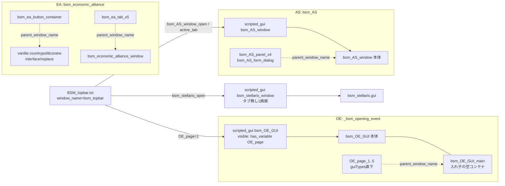
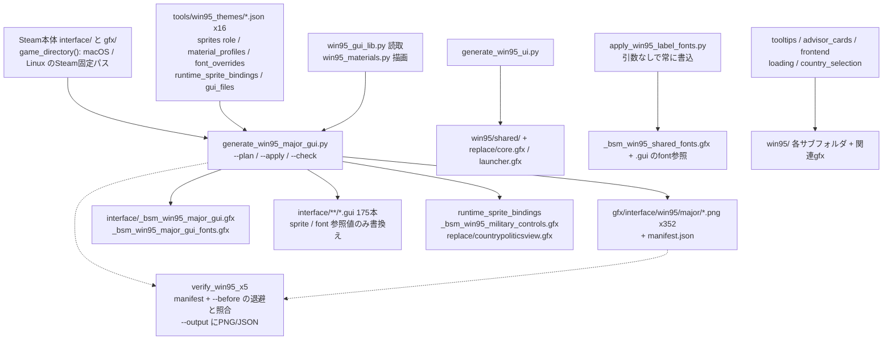

# 14 GUI・Win95テーマ・検証ツール・CI

> `bakasekai/interface/`（280ファイル）と `common/scripted_guis/`（24ファイル）の対応、Win95テーマの生成パイプライン、静的検証ツールとCIをまとめる。
> 数値は 2026-11-02 の作業ツリー（branch `feature/london_three_sovereignties`、HEAD `c187c6bbb`、未コミット変更あり）での実測。ドキュメント記載のみの事項は「記載」、再現できなかった事項は「未確認」と明記する。

## 1. インターフェース層

### 1.1 `interface/` の分類（実測）

| 区分 | 数 | 内容 |
|---|---:|---|
| `interface/` 直下 `.gui` | 24 | MOD独自窓（OE・AS・EA・Stellaris・Topbar・Mine・Mercenary等）と、vanilla窓の拡張（`BSM_countryinfoview`・`countryconstructionsview`・`load_screen`） |
| `interface/` 直下 `.gfx` | 53 | 独自窓のsprite、イベント画像・アイコン・国家方針アイコン（`BSM_goals`・`focus-*_customicons`）、Win95生成物6本、起動時bootstrap（`load_screen*.gfx`） |
| [`interface/replace/`](../../bakasekai/interface/replace/) | 172 | `.gui` 156・`.gfx` 15・`.txt` 1。vanilla `interface/` の同名ファイルのMOD側版（1.3） |
| [`interface/external/`](../../bakasekai/interface/external/) | 3 | `ex_ideas.gfx`・`ex_ideas_characters.gfx`・`ex_portraits.gfx` |
| [`interface/thirdparty mods/`](../../bakasekai/interface/thirdparty%20mods/) | 28 | 国家方針・アイデア用アイコン定義（`goals_new.gfx` 等）。ディレクトリ名から他MOD由来と推定（出典コメントは未確認） |

合計280（`.gui` 180・`.gfx` 99・`.txt` 1）。`replace/` 配下のサブフォルダ（`special_projects`・`international_market`・`career_profile`・`factions`・`military_industrial_organization` 等）は、インストール済みの vanilla `interface/` にある同名フォルダと対応する。

### 1.2 GUI と scripted GUI の対応

`.gui` は見た目、`common/scripted_guis/*.txt` は表示条件（`visible`）・ボタン動作（`effects`）・要素の出し分け（`triggers`）を持ち、`window_name` が `.gui` のトップレベル `containerWindowType` 名と一致して結びつく。Topbar のボタンが変数を立て、各窓の `visible` がそれを読む。

主な対応（`window_name` → 定義ファイルは全件を機械照合した）。

| scripted_guis | context | 窓（`.gui`） | 状態 |
|---|---|---|---|
| [`_bsm_opening_event.txt`](../../bakasekai/common/scripted_guis/_bsm_opening_event.txt) | player | `bsm_OE_GUI`・`OE_page_1..5`（`_bsm_opening_event.gui`） | 稼働 |
| [`bsm_AS_window.txt`](../../bakasekai/common/scripted_guis/bsm_AS_window.txt) | player | `bsm_AS_window`・パネル4・`bsm_AS_form_dialog`（`bsm_AS.gui`） | 稼働 |
| [`bsm_economic_alliance_sgui.txt`](../../bakasekai/common/scripted_guis/bsm_economic_alliance_sgui.txt) | player | ボタン容器・本体・タブ5（`bsm_economic_alliance.gui`） | 稼働 |
| [`bsm_stellaris.txt`](../../bakasekai/common/scripted_guis/bsm_stellaris.txt) | player | `bsm_stellaris_window` | 稼働（[タブ無し](../../bakasekai/common/scripted_guis/bsm_stellaris.txt#L4)） |
| [`BSM_topbar.txt`](../../bakasekai/common/scripted_guis/BSM_topbar.txt) | player | `bsm_topbar`。OE・Stellaris・AS を開くボタン（[L27-58](../../bakasekai/common/scripted_guis/BSM_topbar.txt#L27-L58)） | 稼働 |
| `bsm_AS_event.txt`・`super_events.txt`・`_bsm_mine_dev_GUI.txt`・`MAC_congress_scripted_gui.txt` | player / decision_category | `bsm_AS_event_window`・`sp_event_window`・`bsm_mine_GUI`・`mac_congress_decision_ui_window` | 稼働 |
| `_bsm_mathtest_GUI.txt` | player | `bsm_mathtest_window` | 開発用テスター（[L1-6](../../bakasekai/common/scripted_guis/_bsm_mathtest_GUI.txt#L1-L6)） |
| [`bsm_custom_country_info_GUI.txt`](../../bakasekai/common/scripted_guis/bsm_custom_country_info_GUI.txt) | player | `bsm_custom_country_info_GUI`（`BSM_pibt.gui`）、`bsm_country_info_view` | 前者は [`always = no`](../../bakasekai/common/scripted_guis/bsm_custom_country_info_GUI.txt#L6-L9) で無効 |
| `BSM_state_view.txt`・`_bsm_mercenary.txt` | selected_state / decision_category | `bsm_state_view`・`bsm_mercenary_gui`（`_bsm_yohei.gui`） | 中身は空の枠 |
| `BUL_`・`GRE_`・`USA_`・`SOV_propaganda_`・`war_escalation_` 各 `*_scripted_gui.txt`、`SOV_paranoia_*` | decision_category | vanilla の窓（`SOV_propaganda` の窓のみ `replace/` にMOD複製あり） | 5本は同梱 vanilla 1.19.4.1 とバイト同一、`SOV_paranoia` のみ `triggers` を削除した差分 |

`.gui` を持つが scripted GUI が結びつかないもの: `VAT_nuke_gui`・`BSM_music_station`・`BSM_countryinfoview`・`BSM_countrydoctrinetreeview`・`countryconstructionsview`・`load_screen`（vanilla窓の拡張・エンジン直結）。

### 1.3 `interface/replace/` の役割

- 172ファイル中164が、インストール済みゲーム（1.19.4.1）の `interface/` に同じ相対パスを持つ（12は vanilla とバイト同一）。残り8は独自追加: `PRC_random_portraits.gfx`・`add_common_portraits.gfx`・`_bsm_load_screen_font.gfx`・`_bsm_win95_country_selection.gfx`・`countrytechnologyview_win95.gfx`・`launcher.gfx`・`countryinternationalmarketview.gui`・`01_bba_plane_icons.txt`。
- descriptor に `interface` の `replace_path` は無い。反映の仕組みは「`replace/` の独自定義は後半の通常GUI探索で反映される」という記載（[WIN95_UI:81](../WIN95_UI_2026-10-29.md#L81)）に依存し、エンジン側の挙動は本調査では未確認。
- 生成器 `active_guis()` は、対象GUIがMODに無ければ vanilla から `interface/replace/` へ複製する（[generate_win95_major_gui.py:89-101](../../tools/generate_win95_major_gui.py#L89-L101)）。`replace/` の `.gui` 156本は全てWin95 manifest の対象で、ここの `sprite`/`font` 参照は再生成で上書きされる（2.2）。
- 例外: 起動直後に読まれる `load_screen.gui`・`load_screen.gfx`・`load_screen_font.gfx` は `replace/` ではなく直下の正規パスに置く（[WIN95_UI:81-87](../WIN95_UI_2026-10-29.md#L81-L87)）。

### 1.4 OE／EA／AS 型タブパネルの構造（`AGENTS.md` と実装の照合）

規約: タブパネルとentry templateは `guiTypes` 直下に置き、タブの独立 scripted GUI が `parent_window_name` で親を指す（[AGENTS.md:20](../../AGENTS.md#L20)、詳細は旧ガイド [L139-229](../../.agent-context/legacy/AGENTS-before-2026-09-05.md#L139-L229)）。実装は3系統とも規約どおりで、タブ別 scripted GUI の `visible` で出し分ける。

| | OE | AS | EA |
|---|---|---|---|
| 本体 | `bsm_OE_GUI` [gui:3](../../bakasekai/interface/_bsm_opening_event.gui#L3) | `bsm_AS_window` [gui:13](../../bakasekai/interface/bsm_AS.gui#L13) | `bsm_economic_alliance_window` [gui:26](../../bakasekai/interface/bsm_economic_alliance.gui#L26) |
| タブパネル（直下） | `OE_page_1..5` [L181](../../bakasekai/interface/_bsm_opening_event.gui#L181)・[L288](../../bakasekai/interface/_bsm_opening_event.gui#L288)・[L321](../../bakasekai/interface/_bsm_opening_event.gui#L321)・[L354](../../bakasekai/interface/_bsm_opening_event.gui#L354)・[L387](../../bakasekai/interface/_bsm_opening_event.gui#L387) | パネル4 [L99](../../bakasekai/interface/bsm_AS.gui#L99)・[L122](../../bakasekai/interface/bsm_AS.gui#L122)・[L145](../../bakasekai/interface/bsm_AS.gui#L145)・[L168](../../bakasekai/interface/bsm_AS.gui#L168)、`bsm_AS_form_dialog` [L244](../../bakasekai/interface/bsm_AS.gui#L244) | タブ5 [L159](../../bakasekai/interface/bsm_economic_alliance.gui#L159)・[L361](../../bakasekai/interface/bsm_economic_alliance.gui#L361)・[L482](../../bakasekai/interface/bsm_economic_alliance.gui#L482)・[L581](../../bakasekai/interface/bsm_economic_alliance.gui#L581)・[L631](../../bakasekai/interface/bsm_economic_alliance.gui#L631) |
| entry template（直下） | なし | `bsm_AS_anomaly_entry` [L333](../../bakasekai/interface/bsm_AS.gui#L333)・`bsm_AS_team_entry` [L409](../../bakasekai/interface/bsm_AS.gui#L409) | `economic_alliance_*_entry`・`nc_rate_entry` [L693-890](../../bakasekai/interface/bsm_economic_alliance.gui#L693-L890) |
| `parent_window_name` | `bsm_OE_GUI_main`（[L44](../../bakasekai/common/scripted_guis/_bsm_opening_event.txt#L44)） | `bsm_AS_window`（[L86](../../bakasekai/common/scripted_guis/bsm_AS_window.txt#L86)） | `bsm_economic_alliance_window`（[L97](../../bakasekai/common/scripted_guis/bsm_economic_alliance_sgui.txt#L97)） |
| 出し分け変数 | `OE_page`（[L46](../../bakasekai/common/scripted_guis/_bsm_opening_event.txt#L46)） | `bsm_AS_active_tab`（[L87-90](../../bakasekai/common/scripted_guis/bsm_AS_window.txt#L87-L90)） | `bsm_ea_active_tab`（[L98-101](../../bakasekai/common/scripted_guis/bsm_economic_alliance_sgui.txt#L98-L101)） |

- OEの `bsm_OE_GUI_main` は本体の中に入れた空の `containerWindowType`（[gui:132-144](../../bakasekai/interface/_bsm_opening_event.gui#L132-L144)、位置6,104・718x358）で、ページの「アンカー」として働く。ページ本体は直下にあり規約どおりで、アンカーだけが本体の子になっている。
- EAのボタン容器は vanilla の `countrypoliticsview` に取り付く（[sgui:3-6](../../bakasekai/common/scripted_guis/bsm_economic_alliance_sgui.txt#L3-L6)）。AS・EAのヘッダコメントに「OE方式」と明記されている（[AS:78-80](../../bakasekai/common/scripted_guis/bsm_AS_window.txt#L78-L80)、[EA:88](../../bakasekai/common/scripted_guis/bsm_economic_alliance_sgui.txt#L88)）。
- 既存の別方式: Stellaris は1画面でタブを持たない。`parent_window_token`（vanilla窓へ取り付け）を使うのは `BSM_state_view.txt` [L5](../../bakasekai/common/scripted_guis/BSM_state_view.txt#L5) 等。

### 1.5 構文規約と実装

| 規約（[AGENTS.md:21](../../AGENTS.md#L21)・旧ガイド [L231-236](../../.agent-context/legacy/AGENTS-before-2026-09-05.md#L231-L236)） | 実測 |
|---|---|
| `.gui` で `hidden = yes` を使わない | 180 `.gui` 全てで0件 |
| `listboxType` を使わない（旧ガイドは「存在しない」） | 独自24 `.gui` は0件。`replace/` の vanilla 由来8ファイルに15件。vanilla 本体の `chat.gui`・`menubar.gui` 等にも存在するため、「存在しない」は不正確で、実態は「独自GUIでは使わない」 |
| grid は `add_horizontal = no` と `UPPER_LEFT` | 独自の8 grid のうち7件が一致。EAの座席図 [gui:234-241](../../bakasekai/interface/bsm_economic_alliance.gui#L234-L241) のみ `add_horizontal = yes` |
| scrollbar は `"right_vertical_slider"` | 独自`.gui`の31件中25件が一致。6件はOE内で定義した `win95_right_vertical_slider`（定義 [OE.gui:433](../../bakasekai/interface/_bsm_opening_event.gui#L433)、利用はOE5・Mine1） |
| title は `hoi_24header` | 利用あり。ただし [bsm_AS.gui:38](../../bakasekai/interface/bsm_AS.gui#L38) のように Win95 生成器が `bsm_w95_gui__hoi_24header__white` へ書換えた名前になる（2.2） |

`parent_window_name` の挙動について2点の食い違いを記録する。実ゲームでの再確認は未実施。
- 保存済みwiki（[Scripted GUI modding](../Scripted%20GUI%20modding%20-%20Hearts%20of%20Iron%204%20Wiki.html#L631-L632)）は「入れ子の親には `_instance` 接尾辞が必要」と書くが、OEは入れ子の `bsm_OE_GUI_main` を接尾辞なしで指定している。
- 同梱の公式 `_documentation.md`（1.19.4.1）は `parent_window_name` を載せず `parent_window_token`・`parent_window_window`・`parent_scripted_gui` を載せる。リポジトリ内の [documentation.txt:27-34](../../bakasekai/common/scripted_guis/documentation.txt#L27-L34) も同様。wiki側は [L590](../Scripted%20GUI%20modding%20-%20Hearts%20of%20Iron%204%20Wiki.html#L590) で `parent_window_name` を記載する。

### 1.6 休眠・スタブ・コメントの食い違い

- [`_bsm_Harvest_System.txt`](../../bakasekai/common/scripted_guis/_bsm_Harvest_System.txt#L1) は全行コメントアウト。対応する `_bsm_Harvest_System.gui`・`_bsm_HS_food_reform_GUI.gui` は残る（孤立）。
- [`bsm_anomaly.txt`](../../bakasekai/common/scripted_guis/bsm_anomaly.txt#L1)・[`bsm_anomaly.gui`](../../bakasekai/interface/bsm_anomaly.gui#L1) は空で「Stellaris の tab=6 へ移管済み」と書くが、[bsm_stellaris.txt:4,7](../../bakasekai/common/scripted_guis/bsm_stellaris.txt#L4) は「タブ無し・アノマリーは `bsm_AS_window` へ分離」とあり、実装は後者。
- [`VAT_punish_gui.txt`](../../bakasekai/common/scripted_guis/VAT_punish_gui.txt#L8-L11) のコメントは「`.gui` 定義が未作成」と述べるが、[`VAT_punish_gui.gui`](../../bakasekai/interface/VAT_punish_gui.gui#L1-L15) に不可視スタブが追加済み。`visible` は `always = no` のまま。
- [`ssw_country_gui_reference.txt`](../../bakasekai/common/scripted_guis/ssw_country_gui_reference.txt) は実質コメントのみ（有効行は空の `scripted_gui = { }`）。[`documentation.txt`](../../bakasekai/common/scripted_guis/documentation.txt) は vanilla の書式メモ。

## 2. Win95テーマ

### 2.1 生成パイプライン

- 中核は [generate_win95_major_gui.py](../../tools/generate_win95_major_gui.py)。`tools/win95_themes/*.json` を全て読み込み（[L212](../../tools/generate_win95_major_gui.py#L212)）、同名spriteの役割衝突・素材設定の重複は例外で止める（[L229-233](../../tools/generate_win95_major_gui.py#L229-L233)）。
- spriteは `material_profiles` があれば `render_material()`（[materials:47](../../tools/win95_materials.py#L47)）、無ければ役割別の `flat_image()`（[L119](../../tools/generate_win95_major_gui.py#L119)）で再描画する（[L291-296](../../tools/generate_win95_major_gui.py#L291-L296)）。元の寸法・frame数・alphaの意味は保つ方針（[WIN95_MAJOR_GUI:36-43](../WIN95_MAJOR_GUI_2026-10-30.md#L36-L43)）。
- `.gui` は `sprite`/`font`/`buttonFont` の値だけ変え、他のtokenが変わると例外（[contract() L193-201](../../tools/generate_win95_major_gui.py#L193-L201)、[L491-492](../../tools/generate_win95_major_gui.py#L491-L492)）。
- 個別generator: [generate_win95_ui.py](../../tools/generate_win95_ui.py)（`core.gfx`/`launcher.gfx`の[texturefile書換え L53-85](../../tools/generate_win95_ui.py#L53-L85)）、[generate_win95_tooltips.py](../../tools/generate_win95_tooltips.py)、[generate_win95_advisor_cards.py](../../tools/generate_win95_advisor_cards.py)、[generate_win95_frontend.py](../../tools/generate_win95_frontend.py)、[generate_win95_loading.py](../../tools/generate_win95_loading.py)、[generate_win95_country_selection.py](../../tools/generate_win95_country_selection.py)。
- 開発環境の前提: Pillow、Steam本体のインストール。本体パスは macOS/Linux の2候補のみ（[win95_gui_lib.py:107-112](../../tools/win95_gui_lib.py#L107-L112)）で、major generator だけ [`--game-dir`](../../tools/generate_win95_major_gui.py#L627) で上書きできる。CIでは再現できない。

### 2.2 生成物と手書きの境界

編集は生成元（左）で行い、右の生成物は直接編集しない。

| 生成物 | 生成元 | 備考 |
|---|---|---|
| `gfx/interface/win95/major/*.png`・`manifest.json` | `generate_win95_major_gui.py --apply` + `tools/win95_themes/*.json` | 352 PNG（manifest掲載351＋孤立1の `GFX_factions_button.png`。設定は残るがGUIから未使用）。`--apply` が毎回 [上書き](../../tools/generate_win95_major_gui.py#L606-L617) |
| `interface/_bsm_win95_major_gui.gfx`・`_bsm_win95_major_gui_fonts.gfx` | 同上 | 先頭に[生成コメント](../../tools/generate_win95_major_gui.py#L539-L541) |
| `interface/_bsm_win95_military_controls.gfx`、`replace/countrypoliticsview.gfx` 内の再bind sprite | 同上（`runtime_sprite_bindings`、[L545-559](../../tools/generate_win95_major_gui.py#L545-L559)） | 前者は生成コメント無しで未追跡。後者は手書き定義と同居し、該当IDのみ置換 |
| 各 `.gui` の `quadTextureSprite`/`spriteType`/`font`/`buttonFont` の値 | 同上（in-place書換え） | 手で戻しても次回 `--apply` で再度書換わる。Win95対象外のfont（`bsm_`始まりの手製font等）は保全 |
| `win95/shared/*`、`replace/core.gfx`・`launcher.gfx` の texturefile | `generate_win95_ui.py` | `core.gfx`/`launcher.gfx` は vanilla の複製を書換えたもの |
| `_bsm_win95_shared_fonts.gfx` と該当 `.gui` の黒字font参照 | `apply_win95_label_fonts.py` | 引数解析なし。[実行すれば必ず書込む](../../tools/apply_win95_label_fonts.py#L72-L86) |
| `win95/tooltips/`・`core.gfx` の ToolTip 定義 | `generate_win95_tooltips.py` | `--check` あり |
| `win95/advisors/`・`_bsm_win95_advisor_cards.gfx` | `generate_win95_advisor_cards.py --apply` | `--apply`/`--check` を排他で指定 |
| `win95/frontend/`、`win95/country_selection/`、`win95/loading/setup/` | 各generator | `frontend` は `--check` 無し・[import時にmkdir](../../tools/generate_win95_frontend.py#L7) |
| `loading/setup/desktop-art-v2.png` | 手書き（画像生成AIの成果物） | SHA-256を[固定](../../tools/generate_win95_loading.py#L18)し、generatorは上書きしない |
| `tools/win95_themes/*.json`・`tools/win95_*.py`・`tools/generate_*.py` | 手書き（正本） | 見た目の変更はここ |
| `.gui` のレイアウト・callback・text | 手書き | 変更すると manifest の `safety_sha256` が変わり `--check` が[contract drift](../../tools/generate_win95_major_gui.py#L586-L587)。`--apply` で更新 |
| `_bsm_w95_fonts.gfx`・`replace/countrytechnologyview_win95.gfx`・`replace/_bsm_win95_country_selection.gfx`、EA・OE・Mine の手製Win95/98 | 手書き | `custom.json` の [preserve指定](../../tools/win95_themes/custom.json) で保全 |
| `bsm_prestige_rank_strip.tga` | `gen_prestige_rank_strip.py`（[L209-212](../../tools/gen_prestige_rank_strip.py#L209-L212)） | Win95系とは独立。常に書込 |

### 2.3 運用の作法

1. 色・面・fontの変更: 該当JSON（`sprites`・`material_profiles`・`font_overrides`）を編集し、`--plan` で影響を確認してから `--apply`、続けて `--check`。`--plan` と `--check` は読取専用（[L577-599](../../tools/generate_win95_major_gui.py#L577-L599)）。
2. 新しいGUIをテーマ対象にするにはJSONの `gui_files` へ追加する。参照だけ残して未登録にすると生成が[例外で止まる](../../tools/generate_win95_major_gui.py#L564-L572)。
3. 生成中に他者が `.gui` を更新した場合も[例外で止まる](../../tools/generate_win95_major_gui.py#L601-L604)。再実行で最新を取り込む。
4. 検証 `verify_win95_*` は変更前スナップショット（`--before`）か出力先（`--output`）を要求し、確認用PNG/JSONを書き出す（[materials:163-165](../../tools/verify_win95_materials.py#L163-L165)、[decisions:218-220](../../tools/verify_win95_decisions.py#L218-L220)、[popup:217-219](../../tools/verify_win95_popup_deployment.py#L217-L219)、[readability:73-74](../../tools/verify_win95_readability.py#L73-L74)、[military:77-78](../../tools/verify_win95_military_controls.py#L77-L78)）。プレビューは素材結合であり実ゲーム画像ではない（各 `WIN95_*` 文書に明記）。

### 2.4 ドキュメントと現状

`documents/WIN95_*.md` 7本は2026-10-29〜31の作業記録で、生成数が段階的に増える。

| 記載 | 数 | 出典 |
|---|---|---|
| 主要GUI化 | 174 GUI / 249 texture / 57 font | [WIN95_MAJOR_GUI:9](../WIN95_MAJOR_GUI_2026-10-30.md#L9) |
| 素材仕上げ | 253 | [WIN95_MATERIAL_FINISH:9](../WIN95_MATERIAL_FINISH_2026-10-30.md#L9) |
| Decision | 254 | [WIN95_DECISION_FINISH:25](../WIN95_DECISION_FINISH_2026-10-31.md#L25) |
| ポップアップ | 258 | [WIN95_POPUP_DEPLOYMENT_FINISH:29](../WIN95_POPUP_DEPLOYMENT_FINISH_2026-10-31.md#L29) |
| HEAD の manifest（`git show` で実測） | 174 GUI / 258 sprite / 57 font | 最終記載と一致 |
| 作業ツリーの manifest（実測） | 175 GUI / 351 sprite / 57 font | 未コミット。対応する文書は無い |

増分の93 spriteは、未追跡の `military_controls_finish.json`（61）・`readability_finish.json`（11）・`components95_finish.json`（22）が指定する sprite 数とほぼ一致する（`military_controls_finish.json` の notes に2026-11-01のスクリーンショット対応とある）。同時期に未追跡の `verify_win95_readability.py`・`verify_win95_military_controls.py` が加わっている。これらを含む `generate --check` と `verify_win95_*` がPASSするかは本調査では未確認（3.1）。

## 3. 検証ツール

### 3.1 実行結果（2026-11-02、作業ツリー）

| 対象 | 結果 |
|---|---|
| `python3 -B tools/validate_mod.py bakasekai` | exit 0。**0 ERROR / 139 WARN**（`Validation PASSED`） |
| `python3 -B tools/loc_coverage.py bakasekai` | JA 17,839 key / EN 6,061 / 翻訳済み 5,985 / 未翻訳 11,854 / EN孤立 76 / **coverage 33.6%**、exit 0 |
| `python3 -B tools/verify_london_scenario.py` | PASS 9項目（event ID一意47・focus 16 node・loc 166 key 等）。「HOI4実行・UI・AI・セーブ互換は対象外」とSKIP表示 |
| `python3 -B tools/verify_scenario_focus_layout.py` | PASS france 117 / spain 108 / nsi 71（shared 102） |

実行環境は python3 3.15.0（CIは 3.11）。いずれも `-B` で実行し、リポジトリへ書込みは行っていない。

WARN 139件の内訳: filename 2（[`667-Lesser  Sunda Islands.txt`・`907  nankyoku.txt`](../../tools/validate_mod.py#L109-L110) の二重スペース）、loc 127（重複key 126・空ファイル1）、scripted-trigger 10（`MAC_`/`HUN_`・`WTT_*`・`bsm_md_autonomy_*` の同名定義）、scripted-effect 0。重複key 126件は22ファイルに分布し、72件が [`replace/bakasekai/bakasekai_l_japanese.yml`](../../bakasekai/localisation/japanese/replace/bakasekai/bakasekai_l_japanese.yml) に集中する。空ファイルは [`replace/strategic_region_l_japanese.yml`](../../bakasekai/localisation/japanese/replace/strategic_region_l_japanese.yml)。WARN数は [WIN95_MAJOR_GUI:59](../WIN95_MAJOR_GUI_2026-10-30.md#L59) の「0 errors / 139 warnings」と一致した。

### 3.2 `validate_mod.py`

標準ライブラリのみの静的検査。ERRORがあれば exit 1、WARNは通す（[L335-344](../../tools/validate_mod.py#L335-L344)）。

| 検査（[main L321-328](../../tools/validate_mod.py#L321-L328)） | レベル |
|---|---|
| ファイル名（前後空白・拡張子直前の空白＝ERROR、二重スペース＝WARN） [L101-112](../../tools/validate_mod.py#L101-L112) | ERROR/WARN |
| 波括弧の釣り合い（`common`・`events`・`history`・`map`・`tests`） [L72](../../tools/validate_mod.py#L72)、[L115-136](../../tools/validate_mod.py#L115-L136) | ERROR |
| イベントID重複（定義の深さ1のみ） [L142-173](../../tools/validate_mod.py#L142-L173) | ERROR |
| localisation（BOM欠落・ヘッダ不正＝ERROR、空ファイル・重複key＝WARN） [L180-215](../../tools/validate_mod.py#L180-L215) | ERROR/WARN |
| 国タグファイルの存在 [L221-250](../../tools/validate_mod.py#L221-L250) | ERROR |
| focus ID重複 [L257-287](../../tools/validate_mod.py#L257-L287) | ERROR |
| scripted effect／trigger の重複定義 [L293-314](../../tools/validate_mod.py#L293-L314) | WARN |

- **`interface/` の構文は見ない**（`SCRIPT_DIRS` に無い）。検査対象は `.gui`/`.gfx` ではファイル名のみ。GUIの構文保証は、各generatorが内部で行うtoken解析とCWTools（CI）に依存する。`.gui`/`.gfx` を単独で検査するスクリプトはリポジトリに無く、[WIN95_MAJOR_GUI:58](../WIN95_MAJOR_GUI_2026-10-30.md#L58) の「既存syntax validator」の実体は未確認。参考までに `interface/` の波括弧釣り合いを一時スクリプトで走査したところ、279ファイルで不均衡は0件だった（恒久ツールではない）。
- `GITHUB_STEP_SUMMARY` があれば件数表を[追記する](../../tools/validate_mod.py#L45-L68)。
- 関連: [tools/README.md](../../tools/README.md#L19-L34)（7検査の表）。同README [L15-17](../../tools/README.md#L15-L17) は exit code の意味を記す。

### 3.3 `loc_coverage.py`・その他

- [`loc_coverage.py`](../../tools/loc_coverage.py#L84-L91): 日本語を正として英語key集合との差を出す。既定は常に exit 0、`--strict <率>` で閾値判定（[L117-119](../../tools/loc_coverage.py#L117-L119)）、`--list` で欠落key一覧。
- `verify_london_scenario.py`・`verify_scenario_focus_layout.py`・`preview_scenario_focus_layout.py`・`scenario_focus_layout.json` は未追跡で、LON/GBR/IRE と FRA/ESP/NSI の2026-11-01シナリオ検証用。前2者は読取専用。[preview](../../tools/preview_scenario_focus_layout.py#L43-L45) は `documents/verification/scenario-focus-layout-2026-11-01/` へSVG・HTMLを書くため未実行。
- [`tools/portrait_experiment/`](../../tools/portrait_experiment/): 肖像の低解像度・減色実験。`run_experiment.py`（audit/generate/check、書込みは `documents/portrait_experiment/` 限定、[L1-5](../../tools/portrait_experiment/run_experiment.py#L1-L5)）、`apply_portraits.py`（prepare/apply/check/restore、[L346-348](../../tools/portrait_experiment/apply_portraits.py#L346-L348)）、`verify_apply_safety.py`（複製fixtureでapply/restoreを試験）、[`verify_game_runtime.py`](../../tools/portrait_experiment/verify_game_runtime.py)（**隔離userdirでHOI4を起動**）。manifest上は793件が `applied`（記載は [WIN95_MAJOR_GUI:77](../WIN95_MAJOR_GUI_2026-10-30.md#L77)）。いずれも未実行。
- `tools/atrmrw/`: git追跡ファイルは0件で、中身は無視対象 `__pycache__`（27個の `.pyc`）だけ。リポジトリ内に参照も無い。ソースの実体は branch `feature/_system_ATRMRW_naval_design` の `tools/atrmrw/`（37ファイル）にあり、この作業ツリーに残った古い残骸と判断した。
- [`tools/gen_prestige_rank_strip.py`](../../tools/gen_prestige_rank_strip.py): 威信ランクの7フレーム帯TGAを生成（2.2）。

### 3.4 ゲーム内テスト `bakasekai/tests/`

`tests/` は**ゲーム自身が実行する自動テスト（Scripted Event Test Bundle）**で、デバッグ用データではない。書式は [`_documentation.info`](../../bakasekai/tests/_documentation.info#L1-L12)（結果は `logs/tests/tests_<timestamp>.log`）。インストール済みゲームにも同形式の `tests/` がある。

- 15ファイル・計42テスト: 国別の序盤生存（[`germany.txt`](../../bakasekai/tests/germany.txt#L11-L26) 等13本、各1件）、[`bsm_featured_majors.txt`](../../bakasekai/tests/bsm_featured_majors.txt#L1-L25) の28件（14国×「開始時に存在」「序盤で降伏しない」）、[`test_AI.txt`](../../bakasekai/tests/test_AI.txt#L1-L3) の起動確認1件。
- 説明は [tools/README.md:67-83](../../tools/README.md#L67-L83)。CIは実行しない。`validate_mod.py` が波括弧のみ検査する（[L72](../../tools/validate_mod.py#L72)）。実行手順（起動引数）はリポジトリ内に記述が無く未確認。

## 4. CI と PR

| | [Validate Mod](../../.github/workflows/validate-mod.yml) | [CWTools CI](../../.github/workflows/cwtools.yml) |
|---|---|---|
| 契機 | push／PR（宛先 `main`・`develop`）かつ `bakasekai/**`・`tools/**`・当該yml（[L3-16](../../.github/workflows/validate-mod.yml#L3-L16)）、手動可 | 全push・全PR（[L4-6](../../.github/workflows/cwtools.yml#L4-L6)）。パス制限なし |
| 内容 | Python 3.11 → `validate_mod.py bakasekai`（失敗でCIも失敗）→ `loc_coverage.py`（[`if: always()`](../../.github/workflows/validate-mod.yml#L37-L39)、非ブロック。`--strict 0.40` は[コメントのみ](../../.github/workflows/validate-mod.yml#L35-L36)） | `cwtools/cwtools-action@v1.1.0`（`game: hoi4`、[L15-17](../../.github/workflows/cwtools.yml#L15-L17)）、`output.json` を[artifact化](../../.github/workflows/cwtools.yml#L20-L25) |
| 実行履歴（`gh run list`） | 直近成功は 2026-07-21（develop） | 直近成功は 2026-10-30（`feature/scenario_nsi_esp_fra`） |
| 備考 | 同一refの古い実行を[キャンセル](../../.github/workflows/validate-mod.yml#L19-L21) | `modPath` 指定が無く、`bakasekai/` を対象にするかは未確認 |

- 履歴は 2026-11-02 に確認。Validate Mod の実行は2026-07-21が最後で、10月のGUI作業ブランチでは発生していない（トリガーが `main`/`develop` 宛のため、と推定）。
- CIで実行されない: `bakasekai/tests/`（ゲーム実行が必要）、`verify_*`・`generate_*`（Pillow・Steam本体・変更前スナップショットが必要）。
- [PRテンプレート](../../.github/pull_request_template.md): 変更種別・影響領域（[Scripted GUIs L21](../../.github/pull_request_template.md#L21)）・テスト（[L34-39](../../.github/pull_request_template.md#L34-L39)）・性能・localisation・[セーブ互換 L54-57](../../.github/pull_request_template.md#L54-L57)・[スクリーンショット L59-60](../../.github/pull_request_template.md#L59-L60)。CI結果や `validate_mod.py` の出力を書く欄は無い。[CONTRIBUTING.md](../../.github/CONTRIBUTING.md) にもCIの記述が無い。

## 5. スクリプト類

いずれも**手動実行の保守用**でCIから呼ばれない。この調査では全て未実行（`country.py`・`test_update.py` は読取専用だが範囲外のため見送り）。

| ファイル | 目的 | 書込み |
|---|---|---|
| [`scripts/update_coal_resources.py`](../../scripts/update_coal_resources.py#L140-L191) | `history/states/*.txt` の coal を `steel*1.5 + oil/2` で一括更新 | 全州ファイル |
| [`scripts/test_update.py`](../../scripts/test_update.py#L119-L120) | 上記の1州（`67-Oberschlesien`）での試走 | なし（stdout） |
| [`scripts/fix_faction_rules.py`](../../scripts/fix_faction_rules.py#L36-L65) | `common/factions/rules` の vanilla思想名を `*_ideology` へ置換 | 常に上書き |
| [`scripts/uncomment_techs.py`](../../scripts/uncomment_techs.py#L1-L50) | `_bsm_fallen_empire_effects.txt` の技術ブロックのコメント解除 | 上書き（一回限り） |
| [`scripts/reorder_focuses.py`](../../scripts/reorder_focuses.py#L111-L136) | 国家方針ファイルを依存順に並べ替え | 上書き（`.backup` を作成） |
| [`scripts/fill_missing_translations.py`](../../scripts/fill_missing_translations.py#L146-L171) | 他言語の不足keyを追記。既定dry-run、`--apply` で更新（CSVを `reports/` へ） | `--apply` 時のみ（CSVは常に） |
| [`scripts/generate_localisation_csv.py`](../../scripts/generate_localisation_csv.py#L108-L121) | locのファイル別key数CSV。ファイル冒頭が二重（[L1-13と14-26](../../scripts/generate_localisation_csv.py#L14)） | `reports/` |
| [`scripts/analyze_autonomous_states.py`](../../scripts/analyze_autonomous_states.py#L241-L250) | 複数MODを横断した autonomous_states 分析 | cwdへCSV/JSON（ルートの `autonomous_states_analysis.*` が出力例） |
| [`scripts/analyze_workshop_autonomous_states.py`](../../scripts/analyze_workshop_autonomous_states.py#L176) | Steam Workshop（固定パス）の傀儡国一覧 | JSON/CSV |
| [`scripts/country.py`](../../scripts/country.py#L165-L182) | 国タグと日本語loc名の突合 | なし（print） |
| [`dev_stash.py`](../../dev_stash.py#L54-L56) | Workshop投稿用に `bakasekai/` 以外を兄弟ディレクトリ `<root>.devstash/` へ退避／復元。既定はdry-run | `--apply` 時のみ（`.git` も移動） |
| [`fix_category1.py`](../../fix_category1.py#L4)・[`fix_category2_3.py`](../../fix_category2_3.py#L4) | 一回限りのloc／ideas修正。行番号を直書き（[error_lines](../../fix_category2_3.py#L57)） | 絶対パスが別checkout `/Users/eightman/dev/hoi4/bsm_test/` を指す |

## 6. ドキュメントと実装の差異（まとめ）

| 項目 | ドキュメント | 実装 |
|---|---|---|
| 対応ゲーム版 | [copilot-instructions:29](../../.github/copilot-instructions.md#L29)・[CONTRIBUTING:8](../../.github/CONTRIBUTING.md#L8)・旧ガイド [L5](../../.agent-context/legacy/AGENTS-before-2026-09-05.md#L5)・[L32](../../.agent-context/legacy/AGENTS-before-2026-09-05.md#L32) は 1.13.* | [descriptor.mod:69](../../bakasekai/descriptor.mod#L69) は `1.19.*`。[AGENTS.md:3](../../AGENTS.md#L3) は「descriptorと実環境を確認」と記し矛盾しない（copilot・CONTRIBUTINGが未更新） |
| CIの有無 | 旧ガイド [L35](../../.agent-context/legacy/AGENTS-before-2026-09-05.md#L35)「自動テスト／CI／リンタは基本的に存在しない」 | CIは2本（4章）。[AGENTS.md:39](../../AGENTS.md#L39) が旧記述を現行指示でないと明記 |
| `tests/` の場所と性質 | 旧ガイド [L20](../../.agent-context/legacy/AGENTS-before-2026-09-05.md#L20)・[copilot:106](../../.github/copilot-instructions.md#L106)「`tests/` の検証シナリオ／デバッグ用」 | 実体は `bakasekai/tests/`、ゲームが実行するnative test bundle（3.4） |
| `CLAUDE.md` | 旧ガイド [L23](../../.agent-context/legacy/AGENTS-before-2026-09-05.md#L23)・[copilot:120](../../.github/copilot-instructions.md#L120) が全体ガイドとして参照 | 追跡済みシンボリックリンクが自分自身を指し、`cat` は "Too many levels of symbolic links" で失敗する |
| `listboxType`・grid・scrollbar | 旧ガイド [L231-236](../../.agent-context/legacy/AGENTS-before-2026-09-05.md#L231-L236) | 1.5の5点。例外はEA座席図の `add_horizontal = yes` と、OE定義の `win95_right_vertical_slider` |
| `parent_window_name` | 規約は主窓または入れ子コンテナ名を直接指定 | wiki は入れ子に `_instance` が必要と記し、公式docは別キーを載せる（1.5） |
| tools/README の検査範囲 | brace検査は `common/events/history/map`（[README:24](../../tools/README.md#L24)） | 実際は `tests` も対象（[validate_mod.py:72](../../tools/validate_mod.py#L72)）。モジュールdocstringは4検査止まり（[L8-13](../../tools/validate_mod.py#L8-L13)）で実装は8関数 |
| Win95の生成数 | 249→253→254→258（2.4） | 作業ツリーは351 sprite。2026-11-01分の文書は未作成 |
| scripted GUI内のコメント | `bsm_anomaly`・`VAT_punish_gui` のコメント | 実装と食い違う（1.6） |

## 7. 未確認事項

- `generate_win95_*.py --check` と `verify_win95_*.py` の現在のPASS/FAIL: 実行環境のPythonにPillowが無く、規則上generatorも実行しない。記載のPASSは各 `WIN95_*` 文書の過去時点の値。
- `bakasekai/tests/` の実行結果、およびテスト起動手順。
- `interface/replace/` と `parent_window_name`（特に入れ子の `bsm_OE_GUI_main`）のエンジン側挙動。
- CWToolsが `bakasekai/` を検査対象にしているか（`modPath` 未指定）。
- `interface/thirdparty mods/` のアイコン出典。
- `scripts/` の各スクリプトの実行時の挙動（読取のみで判断）。

## 関連ページ

- [01-overview](01-overview.md)
- [02-architecture](02-architecture.md)
