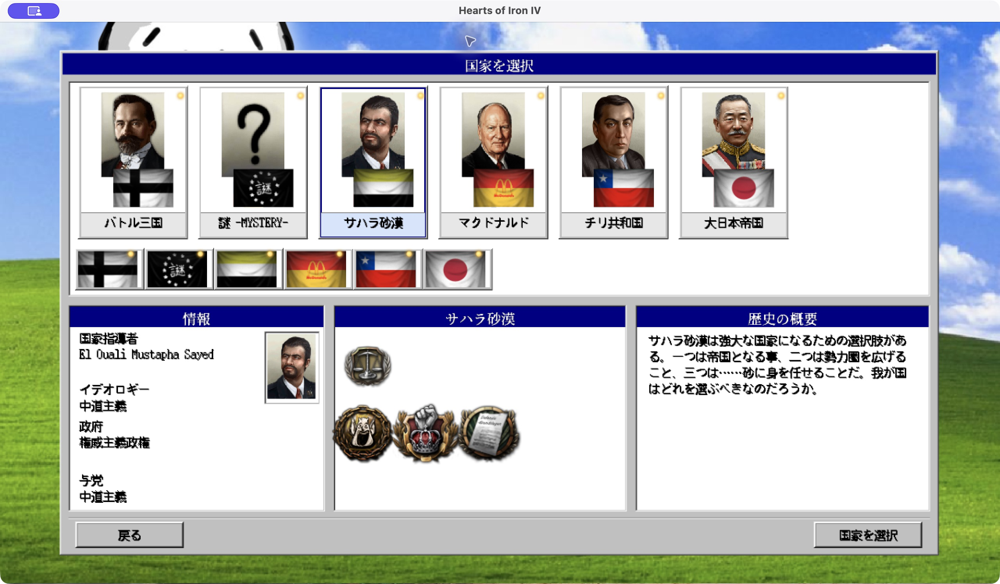

# ポートレート本番適用 / 2026-10-29

ユーザーの「本番適用」を受け、`r104x140_c256_fs`をリポジトリ内の通常肖像793枚へ適用した。`feature/_system_race_removal`上のローカル変更。commit・push・Workshop公開は行っていない。

## 対象と維持した契約

| 項目 | 結果 |
| --- | --- |
| 適用対象 | 156×210の通常肖像784枚＋実使用large参照を確認したCHIの156×212肖像9枚＝793枚 |
| 除外 | 小型・顧問・focus兼用22枚＋非標準寸法で現在の画像参照を確認できない3枚＝25枚 |
| 内部解像度 | 標準104×140。CHIの156×212は縦横比と元寸法を維持して104×141 |
| 色・ディザ | 人物ごとのRGB上限256色、Median Cut＋Floyd–Steinberg。実験と同じBOX縮小・最近傍拡大 |
| 本番の出力寸法 | 全793枚で原本と一致 |
| alpha | 全793枚で原本と全画素一致 |
| パス・参照・frame | 既存パス・ファイル名・1枚画像を維持。GUI/GFX・character定義は編集していない |
| 実形式 | PNG 142、DDS 469、TGA 182 |
| DDS | 色・alphaを損失なく保存するため無圧縮RGBA32。mipmap付き89枚は元の8段を維持して再生成 |
| 原本 | 793枚・80,273,932 bytesを丸ごとバックアップ。SHA-256と復元用modeを記録 |
| 出力合計 | 87,259,630 bytes。原本比約6.7 MiB増加 |

CHLの100×135の3枚はarmy.smallとfocus pictureの兼用素材なので除外した。65×67の18枚・49×67の1枚も小型素材として除外。JAP/JPNの`Portrait_Japan_Hisaichi_Terauchi_Cap.dds`2枚とMONの`Portrait_MON_Butochiyn_Tsog.dds`1枚は非標準寸法で現在の画像参照を確認できず、今回は保持した。対象・除外の全リストはmanifestにある。

既存の2つの`.dds`パスは原本の実体がPNGだったため、その実形式も維持した。無関係な形式修正や参照変更へは広げていない。元のDDSに多い無圧縮RGBA32と同じ形式を使い、圧縮による色数・alphaの変化を避けている。

色数上限と原本alphaの完全一致は最上位の本体画像に対する検証。下位mipmapは通常のBOX縮小で再生成しており、中間色や縮小されたalphaを含む。

## 検証

- **PASS**：793枚の本番ファイルを原本バックアップから再計算した結果と全画素照合。寸法、形式、RGB色数上限、alpha、frame数も確認。
- **PASS**：mipmap付きDDS89枚について、段数、各段の画素、フラグとpayload長を確認。
- **PASS**：選択に使った代表6枚が、保存済みの`r104x140_c256_fs`実験PNGと全画素一致。
- **PASS**：原本バックアップ793枚と除外25枚のSHA-256を確認。
- **PASS**：実験132条件・264枚の再計算と30枚の4倍画像検証も継続して通過。本番への承認済み差し替え793枚を別枠で認識し、原本スナップショットを保持する。
- **PASS**：使い捨てコピーで、適用、再適用の冪等性、原本復元、再復元、同時編集時の適用／復元拒否、部分失敗のrollback、rollback時の他者変更保護の8ケースを実行。

適用前に793枚全ての原本バックアップと検証済みの置換ファイルを用意した。適用はファイル単位のatomic置換で、各置換直前に元hashを再照合する。途中失敗時は今回の書き込みを戻し、外部変更を検出したファイルには上書きしない。

並行作業中の`tools/generate_win95_major_gui.py`に採取後の変更を観測した。今回の適用処理は同ファイルへ書き込んでおらず、差し戻していない。GUI/GFXにも今回の変更を加えていない。

## 実ゲーム確認

HOI4 **Operation Postern v1.19.4.0.48d6 (7155)**を、通常の設定・playset・saveと分離したtemp userdirで新規起動。1280×720・GUI 1.0でmain menuからシングルプレイ→国家選択へ遷移した。

- 国家カードと詳細欄の肖像が正常に表示されることを実画面で確認。
- サハラ砂漠（WES）へ実際に切り替え、`gfx/leaders/WES/Sands.dds`を使うEl Ouali Mustapha Sayedの肖像と詳細欄の更新を確認。
- `error.log`は1行。`gfx/leaders`／texture／DDS／PNG／TGA関連のエラーは0件。
- 通常ユーザーの設定・セーブ・playsetは使用していない。認証情報のコピーはしていない。起動状態やaccount/cache等はリポジトリへ保存していない。
- 自分で起動した隔離プロセスは確認後に終了した。

全793人の目視、キャンペーン開始後の全画面、save/load挙動は未検証。



## バックアップ・再検証・復元

全データは`documents/portrait_experiment/production/2026-10-29-r104x140_c256_fs/`にある。

- [manifest.json](production/2026-10-29-r104x140_c256_fs/manifest.json)：全793枚の前後hash・形式・寸法・mipmapと除外25枚。
- `backup/bakasekai/gfx/leaders/`：原本バイト列793枚。
- `staged/bakasekai/gfx/leaders/`：検証済みの本番置換ファイル793枚。
- [verification.json](production/2026-10-29-r104x140_c256_fs/verification.json)：本番画像の検証。
- [safety_verification.json](production/2026-10-29-r104x140_c256_fs/safety_verification.json)：8つの復元・保護ケース。
- [runtime_verification.json](production/2026-10-29-r104x140_c256_fs/runtime_verification.json)：隔離実起動と実画面確認。
- [国家選択の実画像](production/2026-10-29-r104x140_c256_fs/runtime_country_selection.png)。

再検証：

```sh
cd /Users/eightman/dev/hoi4/HOI4-Bakasekaitizu-MOD
PORTRAIT_PYTHON=/Users/eightman/.cache/codex-runtimes/codex-primary-runtime/dependencies/python/bin/python3
"$PORTRAIT_PYTHON" tools/portrait_experiment/apply_portraits.py check
"$PORTRAIT_PYTHON" tools/portrait_experiment/run_experiment.py check
```

原本へ戻す必要がある場合のコマンド（今回の作業では本番の復元は実行していない）：

```sh
"$PORTRAIT_PYTHON" tools/portrait_experiment/apply_portraits.py restore
```

`restore`は現在のファイルが原本hashまたは今回の出力hashと一致することを全対象で確認してから復元する。適用後の別の編集を見つけたら拒否し、その編集を上書きしない。`apply`の再実行は保存済みの置換ファイルを使うため、二重の縮小・減色を行わない。
