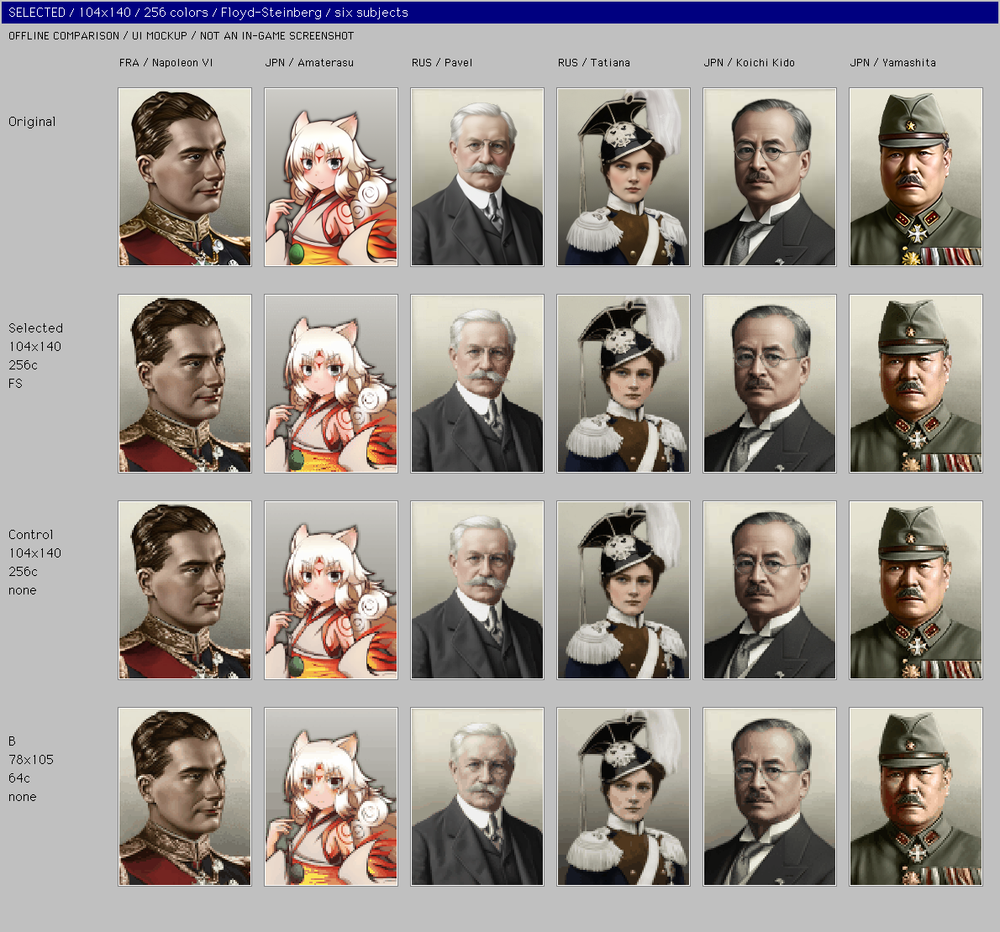

# ポートレート縮小・減色実験 / 2026-10-29

**本番適用済み：`r104x140_c256_fs`（104×140・人物ごとの256色・Floyd–Steinberg）。** 比較後のユーザーの「本番適用」を受け、通常肖像793枚へ適用した。原本は全てバックアップ済み。HOI4 1.19.4の国家選択画面でも表示を確認した。[本番適用の対象・検証・復元手順](PRODUCTION_APPLY_2026-10-29.md)。以下は比較実験の記録。

[操作できる比較ページ](index.html)で人物・解像度・色数・ディザ・表示倍率を切り替えられる。インターネット接続は不要。最初は1倍の画像で見分けやすさを確認し、4倍や顔の拡大で画素・階調の違いを見る。



## 選択候補と判断

選択候補は104×140・256色・FS。64色より肌・白髪・眼鏡まわりの階調を残せる。FSの粒を比較するため、同じ104×140・256色のディザなしを対照として保存した。さらに78×105・64色・なしを、より粗い画素表現の対照として並べた。[選択候補の6名比較](comparisons/preferred.png)、[アマテラスの顔3倍](comparisons/amaterasu_preferred_face_3x.png)で確認できる。

104×140→156×210は1.5倍なので、最近傍拡大のブロックが1pxと2pxで混在する。256色はRGB上限で、アマテラスのこの候補の実測は213色。人物ごとの見え方や階調の評価であり、利用者による識別テストは行っていない。

初期比較のA/B/Cも再現性のため保存している。[初期3候補の比較](comparisons/shortlist.png)。

| 候補 | 内部解像度 / 色数 / ディザ | 視覚上の特徴・用途 |
| --- | --- | --- |
| B：粗い画素の対照 | 78×105 / 64 / なし | 156×210への拡大が整数2倍。横顔・口髭・軍帽の特徴を保ちつつ粗さが見える。木戸の眼鏡とタチアナの小さい顔では原本より細部が減る。 |
| A：細部優先 | 104×140 / 64 / なし | 眼鏡・刺繍・小さい顔を比較的残す。156×210への1.5倍拡大は1pxと2pxのブロックが混在する。細かい画像向けの代案。 |
| C：ディザあり | 78×105 / 64 / Floyd–Steinberg | Bと同一パレットで誤差拡散。肌の段差を粒で補うが、顔・白髪・眼鏡・明るい背景にも粒が増える。粒状感を積極的に選ぶ場合の代案。 |

52×70は顔が小さいタチアナやアマテラスの目の形が潰れやすく、今回の本命から外した。32色では肌の面分割や暗い軍服の色の統合が強くなる。256色は色の変化を弱めたい対照として有用だが、64色より原本に近い。いずれも人物・倍率によって印象が変わる。

特定機種の固定パレットやハードウェアを再現する試みではない。各人物に最適化したRGBパレットによる見た目の実験で、PNGはalphaを保つためRGBA形式で保存している。64色は画像ごとのRGB色数の上限を表し、ファイル形式のビット深度やRGBA組合せ数を表さない。

## まず確認した寸法・alpha・実使用参照

`bakasekai/gfx/leaders/`の画像818枚を読み取り監査した。全てデコード可能だった。784枚が156×210、残りには65×67の小型肖像18枚、156×212の9枚、100×135の3枚などがある。alphaは689枚が全不透明、124枚が中間alphaあり、5枚が0/255の二値。[全寸法・alpha・SHA-256](audit/source_audit.json)に保存している。ここでの818枚はフォルダー内の画像数で、全ての起用を確認したという意味ではない。

比較対象の6枚は、実ファイル・有効なportrait定義・historyのrecruit_characterを確認したもの。GFX経由の2枚も解決している。全て156×210・1枚画像。原本は5枚が全不透明、山下のみalpha225〜255の中間値313画素を持つ。

| ID / 人物 | 原本形式 | 比較する細部 | 有効な参照経路（bakasekai/から） |
| --- | --- | --- | --- |
| napoleon / ナポレオン6世 | PNG RGBA | 横顔・暗い髪・金刺繍・赤い礼服 | `common/characters/FRA.txt:37` → `gfx/leaders/FRA/NAPOLEONVI.png`、`history/countries/FRA - France.txt:141`で起用 |
| amaterasu / アマテラス | PNG RGBA | 白い髪と耳・目・輪郭・鮮やかな衣服 | `common/characters/JPN.txt:59` → `gfx/leaders/JPN/JPN_Amatesrasu.png`、`history/countries/JPN - Japan.txt:134` |
| pavel / パーヴェル | PNG RGBA | 白髪・口髭・眼鏡・黒いスーツ | `common/characters/RUS.txt:407` → `interface/BSM_characters.gfx:5` → `gfx/leaders/RUS/RUS_Pavel_Nikolayevich.png`、`history/countries/RUS -Russia.txt:167` |
| tatiana / タチアナ | PNG RGBA | 小さい顔・帽子・羽根・白い飾緒 | `common/characters/RUS.txt:64,67` → `interface/BSM_ministers.gfx:20` → `gfx/leaders/RUS/tatiana.png`、`history/countries/RUS -Russia.txt:137` |
| kido / 木戸幸一 | PNG RGBA | 丸眼鏡・口髭・髪・暗い衣服 | `common/characters/JPN.txt:2402` → `gfx/leaders/JPN/JPN_kido.png`、`history/countries/JPN - Japan.txt:227` |
| yamashita / 山下奉文 | DDS RGBA | 軍帽・口髭・襟章・勲章・中間alpha | `common/characters/JPN.txt:384` → `gfx/leaders/JPN/Portrait_Japan_Tomoyuki_Yamashita.dds`、`history/countries/JPN - Japan.txt:140` |

正確な原文とハッシュは[source_selection.json](source_selection.json)。この表の行番号は採取時点のもの。コメントアウトされた`JPN/tenno.png`の参照などは、実使用の根拠として数えていない。

現在の国家選択GUIでは国家カードの肖像が`scale = 0.55`、少数国詳細が`0.42`。156×210をそれぞれ約86×116・66×88相当で見る比較も作った。少数国の新規フレーム画像は76×100。政治画面の`leader`にはscale指定がない。採取したGUI位置・ハッシュは監査JSONにある。

[UI倍率の近似比較](comparisons/ui_scales_approx.png)はBILINEARで縮小した模式図。実ゲームのテクスチャ補間、DPI、最終画面の倍率は未確認。ブラウザー側でも1倍・2倍・4倍・小数倍率、最近傍／標準補間を選べる。

## 処理と比較条件

1. 6枚の原本をバイト単位で`originals/`へ複写し、SHA-256とRGBAデコード結果を記録。
2. BOX縮小で104×140、78×105、52×70を作る。premultiplied alphaで色のにじみを避ける。平均はsRGB符号値上で計算。
3. 透明度0を除くRGBから、人物・解像度・色数ごとにMedian Cutパレットを作る。256／64／32色を比較。同じパレットでディザなし／Floyd–Steinbergを別々に実行する。
4. 低解像度PNGを`working/`に保存し、RGBを最近傍で156×210へ戻す。出力alphaは原本の156×210のalphaを全画素そのまま保持する。作業画像のalphaのみBOX縮小されたもの。
5. 原本・3候補の通常サイズ、顔の3倍、全身の4倍、全18条件、縮小だけ・減色だけの対照画像を出力。

顔・衣服・背景の描き替え、トリミングによる本体構図の変更、パレットの手修正、コントラスト・彩度・輪郭・シャープ化の補正は行っていない。顔のトリミングは比較シートだけに使用する。

6人 ×（3解像度 × 3色数 × 2ディザ + 縮小だけ3条件 + 原寸64色1条件）= **132候補**。低解像度作業画像も132枚。選択候補と2つの対照を`preferred.png`にまとめ、初期A/B/Cの比較も保存した。

## 保存物

- `index.html`：外部通信不要の操作できる比較ページ。データはHTML内に埋め込み済み。今回のアプリ内ブラウザーではlocalhost経由で確認した。
- `originals/`：6枚の原本そのもの、比較用RGBA PNG、原本の一覧。
- `variants/<人物ID>/`：156×210の候補PNG。例：`r78x105_c064_none.png`がB。
- `working/<人物ID>/`：縮小・減色後の内部解像度PNG。
- `enlarged/<人物ID>/`：原本・A/B/C・選択候補Pの624×840（4倍）PNG。
- `comparisons/preferred.png`：6名×原本・選択候補・同じ256色のディザなし・粗い画素の対照。
- `comparisons/preferred_pair.png`：6名×原本・選択候補だけの簡潔な比較。
- `comparisons/<人物ID>_preferred_face_3x.png`：選択候補と対照2種の顔3倍比較。
- `comparisons/shortlist.png`：6名×原本・A/B/C。
- `comparisons/<人物ID>_matrix.png`：全18条件。行＝解像度、列＝色数とディザ。
- `comparisons/<人物ID>_face_3x.png`：顔の3倍比較。各候補は同じcropで比較。
- `comparisons/controls.png`：縮小だけ3条件と、原寸64色の対照。
- `comparisons/ui_scales_approx.png`：現在のGUI倍率を近似した比較。
- `manifest.json` / `metrics.csv`：全設定・実測RGB色数・RGBA画素ハッシュ。
- `source_selection.json` / `audit/`：原本・参照・開始時status・読み取り監査。
- `verification.json`：画像・参照・原本保全の検証結果。
- `browser_verification.json`：比較ページの操作確認結果。

## 再現手順

作業場所：`/Users/eightman/dev/hoi4/HOI4-Bakasekaitizu-MOD`。実験コードは`tools/portrait_experiment/`内だけを使う。実行環境はPython 3.12.14 / Pillow 12.3.0。Pillow 12.3以降が必要。比較シートの文字にはローカルのGeneva、なければDejaVu Sansを使うため、別OSでのシートの文字の画素一致までは保証しない。

```sh
cd /Users/eightman/dev/hoi4/HOI4-Bakasekaitizu-MOD
PORTRAIT_PYTHON=/Users/eightman/.cache/codex-runtimes/codex-primary-runtime/dependencies/python/bin/python3
"$PORTRAIT_PYTHON" tools/portrait_experiment/run_experiment.py generate
"$PORTRAIT_PYTHON" tools/portrait_experiment/run_experiment.py check
```

`generate`は保存済み原本だけから再生成する。`check`は132条件のRGBA画素を再計算し、寸法・alpha・色数・拡大画像・HTML参照・起用参照・818枚の原本ハッシュを照合する。パラメーターと代表画像は`tools/portrait_experiment/experiment.json`、比較ページの原型は同じ場所の`gallery.html`。

今回のアプリ内ブラウザーは`file:`プロトコルを許可しないため、ファイルURLでの動作は未検証。操作確認には先に起動した127.0.0.1限定のローカルHTTPサーバーを使った。公開サーバーや外部サービスは使用していない。

比較画像の再生成は`generate`、検証は`check`を使う。本番適用後の`all`／`audit`は原本複写と本番画像の差を検出して拒否するため、原本複写を上書きしない。既存のGUI改装スクリプトは呼び出さない。実験出力先はコード内で`documents/portrait_experiment/`に固定し、そこからのパストラバーサルを拒否する。

## 検証と範囲

- **PASS**：818枚のデコードと寸法・alpha監査、6枚の有効なportrait／sprite／recruit参照。
- **PASS**：132条件、作業画像と156×210出力の264枚の再計算による画素照合、色数上限、原本alphaの完全一致。
- **PASS**：54組でディザあり／なしに画素差があること。30枚の4倍画像が最近傍の拡大と完全一致。
- **PASS**：実験時点で保存した原本と本番肖像818枚のSHA-256を照合。本番適用後は、承認済みの置換793枚・未変更25枚・保存原本を区別して検証する。
- 比較ページの操作確認は`browser_verification.json`、機械検証の詳細は`verification.json`に記録。
- 後続の本番適用では、国家選択とDDS肖像の切り替えを実ゲームで確認した。全員の目視・識別テスト・save互換性・性能は未検証。

現在の`feature/_system_race_removal`上に未コミットで保存。本番適用で変更した既存素材はmanifest記載の肖像793枚。GUI/GFX・既存生成スクリプトは今回編集していない。commit、push、外部公開、課金は行っていない。
